# Danh mục kho asset của cutout3d (chung)

File này do `python3 tools/kho.py muc-luc` viết ra từ `catalog.json` cùng thư mục; đừng sửa tay. Thêm món: thêm một mục vào `catalog.json` của danh mục (chung: `chung/assets/`, kênh: `kenh/<kênh>/kho/`), một ảnh xem trước vào file PREVIEWS của danh mục đó, rồi chạy `python3 tools/kho.py`.

Tìm nhanh: `python3 tools/kho.py tim <từ>` (ví dụ `tim den`, `tim san truong`). Tấm tổng hợp từng nhóm: `_tong-hop/` cùng thư mục.

Tổng cộng 397 mục.

## Bối cảnh dựng sẵn (49)

| Ảnh | Tên và id | Trông thế nào | Hợp với | Cách gọi | Code |
|---|---|---|---|---|---|
| 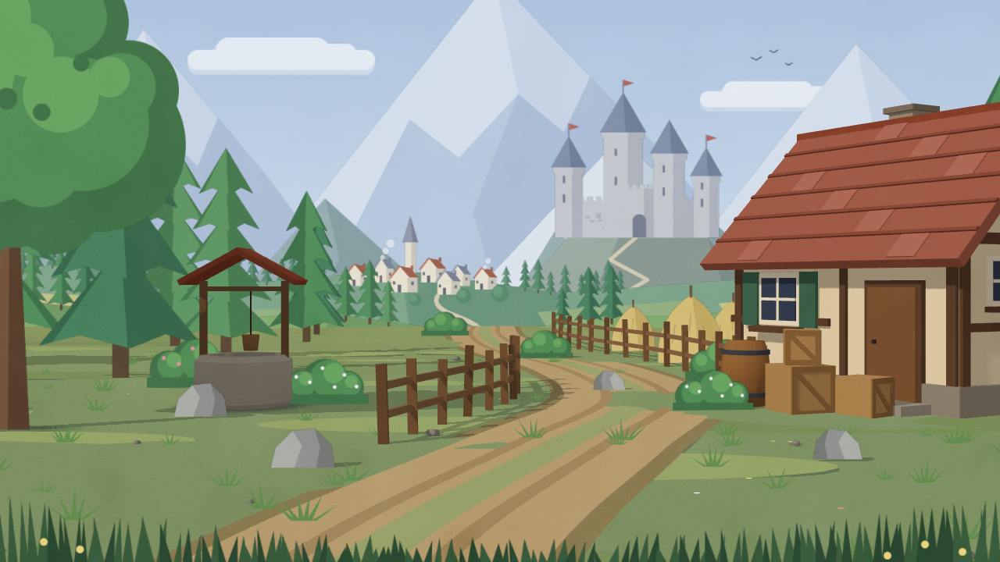 | **Thung lũng núi tuyết, lâu đài xa, đường đất** `thung-lung-nui-tuyet-lau-dai-duong-dat` | Ban ngày. Trời, núi tuyết rất xa, lâu đài, đồi, rặng thông, nhà nhỏ, giếng, đường đất dẫn vào sâu, hàng rào, cây và đá ở tiền cảnh. | mở truyện cổ tích, vương quốc, đường về làng | `<Valley>{nhân vật}</Valley>` ; comp `valley-still` | `src/demo/Valley.tsx` |
| 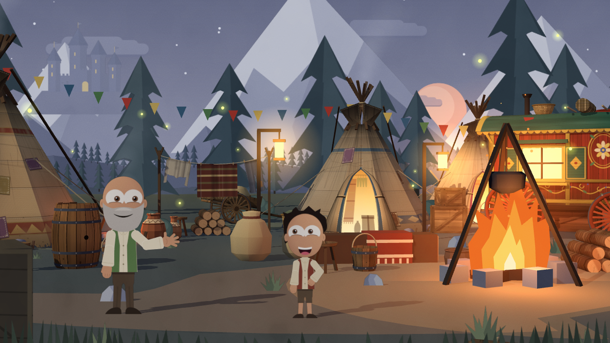 | **Trại lều vải lúc chạng vạng, có đống lửa** `trai-leu-vai-chang-vang-co-lua` | Chạng vạng. Rừng thông tối, năm lều vải du mục vá víu (ba lều sáng cửa, khói mỏng), lửa trại có kiềng nồi, xe thùng, đèn lồng, dây phơi, bếp đá, thùng, giỏ, gốm, củi, yên ngựa quanh từng lều, đom đóm. Nâng cấp 22/11/2026 bằng kitCamp. Ảnh: máy chuẩn có hai cha con. Ba trạng thái: state='dem' (mặc định), 'do-leu', 'sang'; torches cho đoàn đuốc. Thêm (d1c3, d1c4): ritual 'phep' | 'phep-chay' | 'mo' ở RITUAL_AT (-14, 0, -4.5), knock (kiềng đổ), donTruoc, leuAToi, walkers. Thêm (d1c3 lượt ba): state 'chang-vang' (chạng vạng còn sáng: trời cam tím, đèn và lửa vẫn cháy), lua (lửa trại cháy ở 'sang'), hillSoldiers (lính tí hon trên đường mòn ở 'sang'). Thêm (d1c4): ban ngày cửa lều không đèn thấy lòng lều; vatCuaA (chỉ buông vạt cửa lều A); soldierPath, SOLDIER_PATH_C11 (lính tí hon ở chỗ thấy được từ máy chương 4 cảnh 11). Không khí (23/11/2026): bụi, lá, đom đóm, tàn lửa bật sẵn ở mọi trạng thái (bui, buiK; tắt ở mộ có tuyết). | trại lính, đoàn lữ hành, đêm kể chuyện bên lửa | `<Camp f={khung}>{nhân vật}</Camp>` ; comp `camp-still` | `src/demo/Camp.tsx` |
| 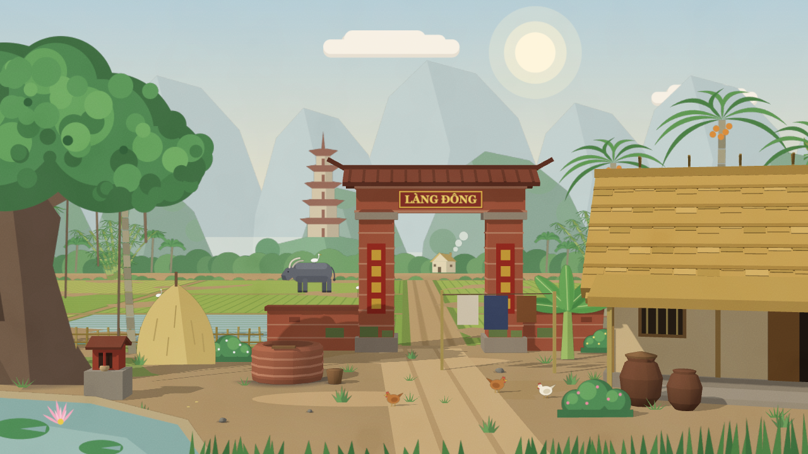 | **Làng quê Bắc Bộ: cổng làng, cây đa, nhà tranh** `lang-que-bac-bo-cong-lang-cay-da` | Ban ngày. Núi đá vôi xa, chùa tháp, ruộng có trâu và cò, luỹ tre, cổng làng, cây đa, nhà tranh, chum, gà. | truyện dân gian Việt, tuổi thơ ở quê | `<Village>{nhân vật}</Village>` ; comp `village-still` | `src/demo/Village.tsx` |
| 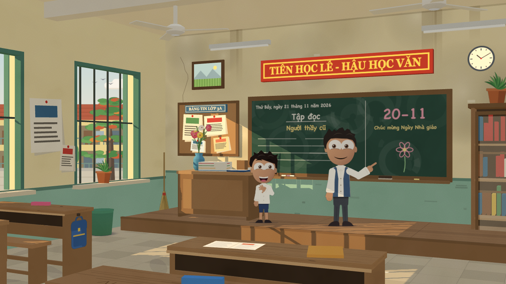 | **Lớp học Việt Nam buổi sáng, nắng xiên qua cửa sổ** `lop-hoc-viet-nam-sang-nang-xien-cua-so` | Trong nhà, sáng. Phòng nhìn chéo: tường cửa sổ song sắt bên trái, bảng đen và bục giảng, bàn giáo viên, các dãy bàn đôi, quạt trần, tủ; ngoài cửa sổ là sân trường và cây bàng. | chuyện học trò, thầy cô, kỉ niệm đi học | `<Classroom>{nhân vật trong toạ độ phòng}</Classroom>` ; comp `classroom-still` | `src/demo/Classroom.tsx` |
| 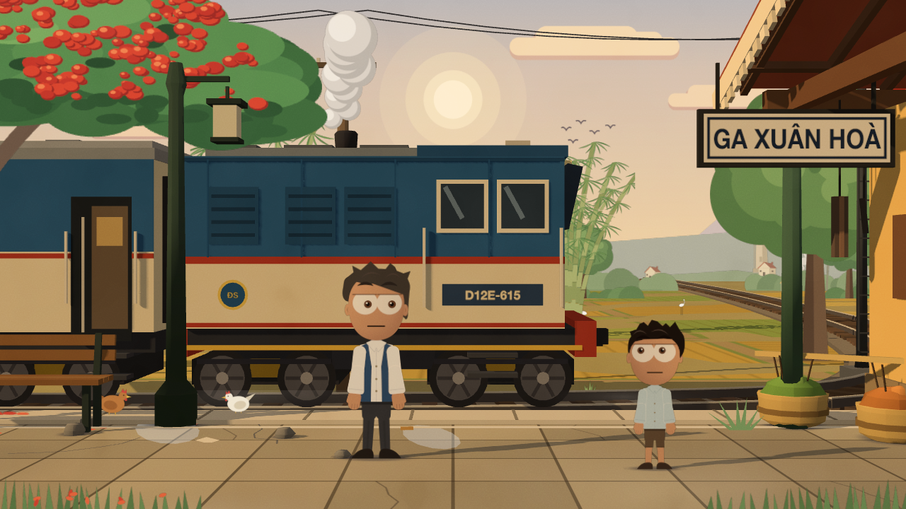 | **Ga xép chiều muộn, đoàn tàu sắp chạy** `ga-xep-chieu-muon-doan-tau-sap-chay` | Chiều muộn, nắng thấp bóng dài. Núi xa, ruộng, tháp nước, cột tín hiệu, hàng cột điện báo, đầu máy và toa khách, sân ga, nhà chờ mái tôn, ghế, đèn, quang gánh, cây phượng che phía trên. | chia tay, lên đường, đón người về | `<Station f={khung} moving?>{nhân vật}</Station>` ; comp `station-still` | `src/demo/Station.tsx` |
| 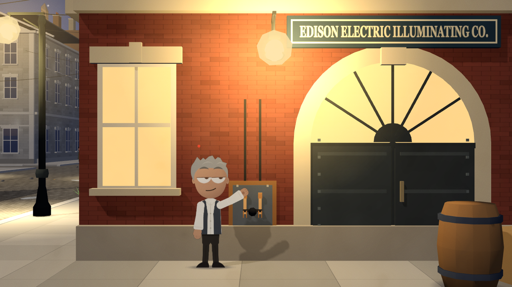 | **Phố New York 1880 đêm, trước cửa nhà máy điện** `pho-new-york-1880-dem-truoc-nha-may-dien` | Chạng vạng xanh chàm. Mặt tiền nhà máy điện gạch đỏ chiếm hai phần ba phải: cửa vòm sắt, biển EDISON ELECTRIC ILLUMINATING CO., cầu dao trên tường, đèn bóng tròn trên tay sắt; bên trái là phố Pearl đi vào sâu với cột đèn và dãy nhà. Edison đứng ở mốc trước cầu dao. Đèn nhà máy và đèn phố bật theo khung. | cảnh kéo cầu dao, đêm khai trương điện, nhân vật trước cửa xưởng | `<NyStreet time="dem" view="a" power={powerShot1(f)} pull={...}>{nhân vật}</NyStreet>` ; comp `ph-dem-a` | `src/demo/NyStreet.tsx` |
| 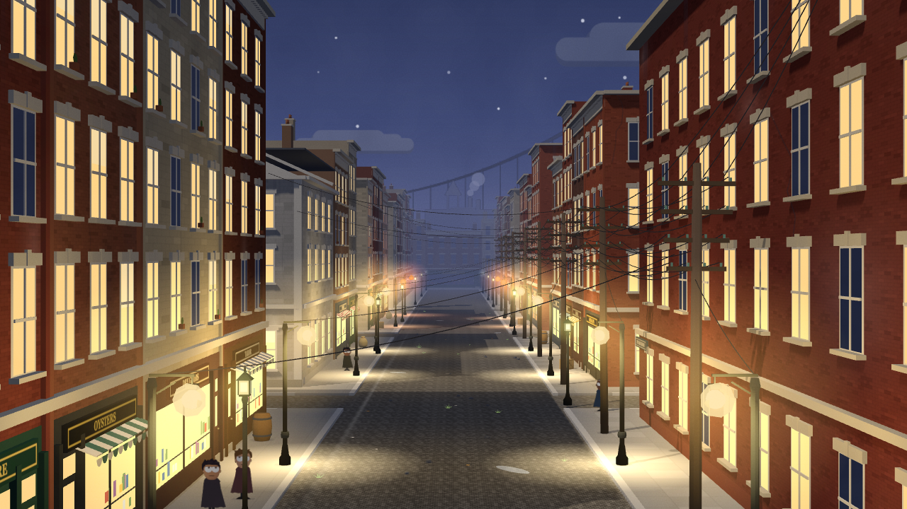 | **Phố New York 1880 đêm, toàn cảnh cao dọc phố có đèn điện** `pho-new-york-1880-dem-toan-canh-cao-den-dien` | Nhìn cao dọc phố Pearl: hai dãy nhà gạch bốn năm tầng hội tụ vào giữa, cột điện gỗ nhiều xà và dây chằng chịt bên phải, cột đèn điện hai bên, cửa sổ và tủ kính sáng; dãy 3 sáng yếu và cam, dãy 4 tối với đèn khí xanh vàng; tháp cầu treo mờ ở cuối phố; vài người qua đường ngước nhìn. Đèn bật lan theo chiều sâu theo khung. | phố cổ ban đêm, điện về, đèn bật lan, thành phố thế kỉ 19 | `<NyStreet time="dem" view="b" power={powerShot2(f)}>{nhân vật}</NyStreet>` ; comp `ph-dem-b` | `src/demo/NyStreet.tsx` |
| 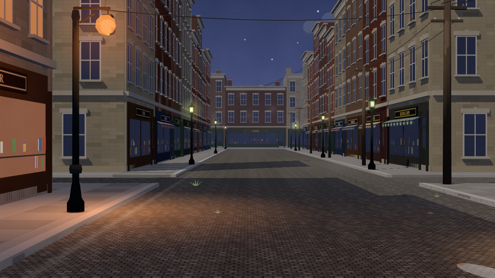 | **Phố New York 1880 đêm, cột đèn điện cuối cùng trước phố tối** `pho-new-york-1880-dem-cot-den-cuoi-pho-toi` | Ngang tầm mắt trong dãy phố 3: cột đèn điện cuối cùng bên trái tiền cảnh, quả cầu cam chập chờn, vũng sáng cam trên đá hộc; phía trước là dãy phố tối, cửa sổ đen, chỉ còn đèn khí xanh vàng nhỏ và dây điện báo mảnh. | giới hạn, nơi ánh sáng dừng lại, mất điện, phố vắng | `<NyStreet time="dem" view="c" power={powerShot3(f)}>{nhân vật}</NyStreet>` ; comp `ph-dem-c` | `src/demo/NyStreet.tsx` |
| 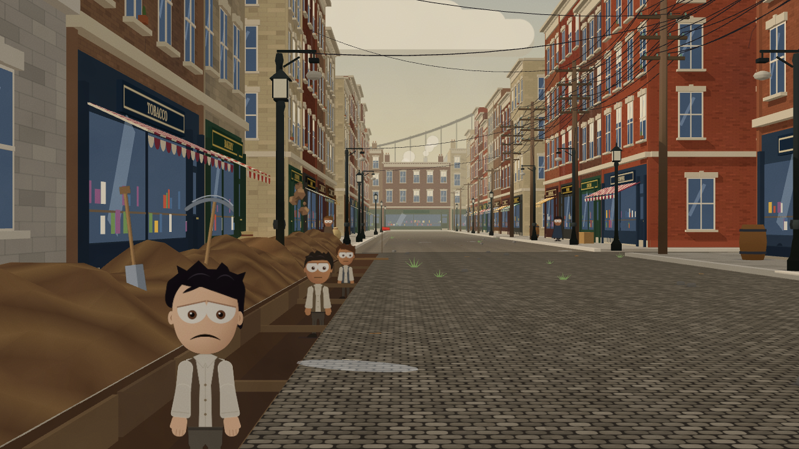 | **Phố New York 1880 ban ngày, mương đào dọc lề đường** `pho-new-york-1880-ngay-muong-dao` | Ban ngày trời xám vàng khói than. Máy thấp nhìn dọc con mương đào theo lề trái, đống đất nâu, xẻng cuốc cắm trên đống, hai thợ đào ở xa, đất văng; hai dãy nhà phố có tủ kính và mái hiên sọc, cột điện nhiều dây, tháp cầu mờ cuối phố. Tesla đứng dưới mương ở mốc. | lao động cực nhọc, sa cơ, công trường giữa phố | `<NyStreet time="ngay" view="d" f={khung}>{nhân vật}</NyStreet>` ; comp `ph-ngay-d` | `src/demo/NyStreet.tsx` |
| 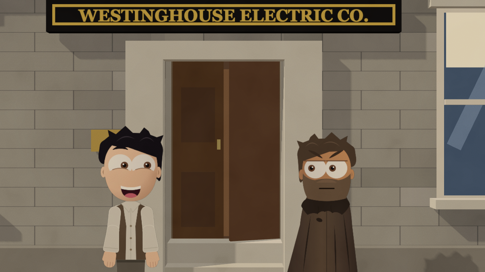 | **Phố New York 1880 ban ngày, trước cửa nhà đá xám có biển** `pho-new-york-1880-ngay-truoc-cua-nha-da-xam` | Ban ngày, mặt đầu hồi nhà đá xám lấp kín khung: biển WESTINGHOUSE ELECTRIC CO. chữ vàng nền đen ở trên, cửa gỗ hai cánh khép hờ trên hai bậc đá ở giữa, cửa sổ hai bên. Tesla và Westinghouse đứng ở hai bên cửa. | hai người gặp nhau trước cửa hãng, chào hàng, xin việc | `<NyStreet time="ngay" view="e">{nhân vật}</NyStreet>` ; comp `ph-ngay-e` | `src/demo/NyStreet.tsx` |
| 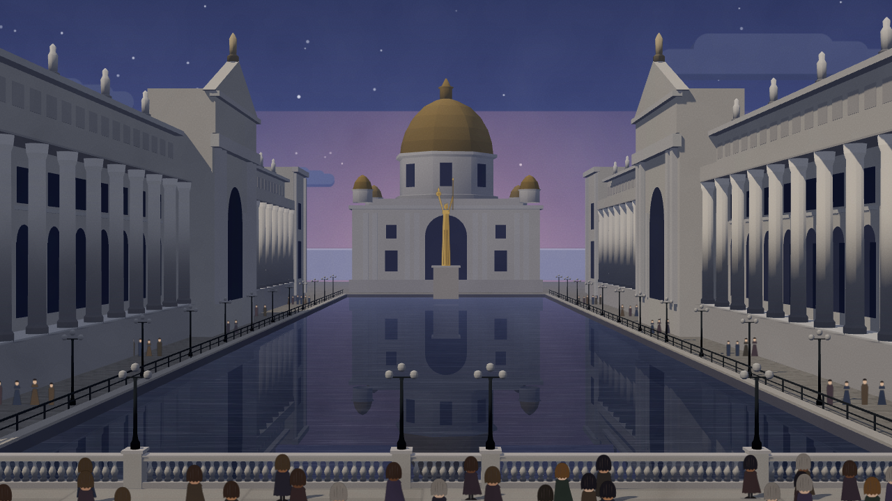 | **Hội chợ Chicago 1893 lúc chạng vạng, chưa bật đèn (toàn cảnh cao)** `hoi-cho-chicago-1893-dem-toi-ho-dai-vom-vang` | Máy cao 8 m ở đầu hồ: mặt hồ dài tối là đường dẫn mắt tới toà nhà mái vòm vàng ở giữa, hai lâu đài trắng hàng cột hai bên đóng khung, tượng vàng giữa hồ, trời chàm có dải hồng sau vòm và sao; lối đi hai bờ có cột đèn ba cầu và người đi dạo nhỏ; lan can con tiện và đầu vai đám đông quay lưng ở mép dưới. Trạng thái tối (FAIR_DARK); bóng phản chiếu toà nhà dưới mặt nước. Bối cảnh có 3 góc máy (FAIR_VIEWS a, b, c) và hàm bật đèn theo khung. | hội chợ, triển lãm, thành phố trắng, đêm khai mạc, chờ đợi trước khoảnh khắc lớn | `<ChicagoFair view="a" power={FAIR_DARK} f={f}>{nhân vật}</ChicagoFair>` ; comp `hc-toi-a` | `src/demo/ChicagoFair.tsx` |
|  | **Hội chợ Chicago 1893 đêm, mọi dải đèn đã sáng (toàn cảnh cao)** `hoi-cho-chicago-1893-dem-sang-den-toan-canh` | Cùng góc máy cao: mọi gờ mái, gờ hàng cột, cột, trán tường, sườn vòm viền bóng đèn vàng ấm, mặt hồ in các vệt phản chiếu đứt đoạn, hai chùm đèn pha chéo nhau trên trời, mặt đá trắng ngả vàng, cửa sổ sáng, trời tối hơn. | hội chợ, lễ hội ánh sáng, đêm khai mạc, thành công rực rỡ | `<ChicagoFair view="a" power={FAIR_LIT} f={f}>{nhân vật}</ChicagoFair>` ; comp `hc-sang-a` | `src/demo/ChicagoFair.tsx` |
| 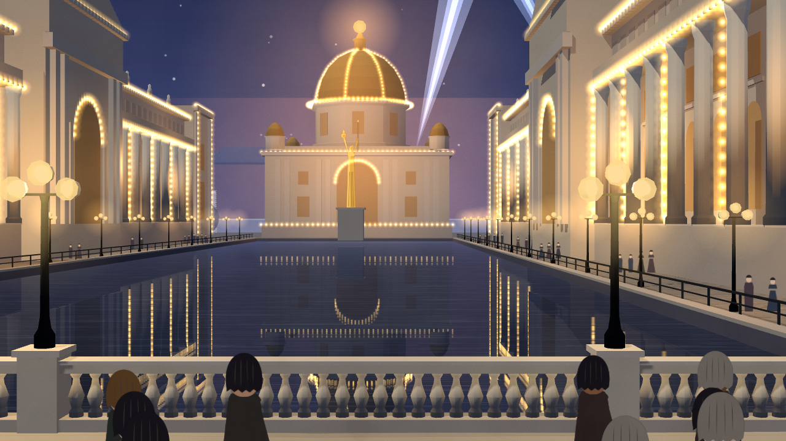 | **Hội chợ Chicago 1893 đêm sáng đèn, góc thấp sau lan can** `hoi-cho-chicago-1893-dem-sang-sau-lan-can` | Máy thấp (3,3 m) sau lan can đầu hồ, lệch phải trục: lan can con tiện và hai cột đèn ba cầu ở tiền cảnh, đầu vai sáu người quay lưng chồng lên lan can ở mép dưới, mặt hồ có vệt phản chiếu giữa khung, toà vòm vàng hơi trái giữa, hai lâu đài viền đèn hai bên, đèn pha trên trời. Comp hc-b chạy kế hoạch bật đèn của cảnh 12 (powerShot12). | cảnh phô diễn thắp sáng, đám đông reo hò, đêm hội | `<ChicagoFair view="b" power={powerShot12(f)} f={f}>{nhân vật}</ChicagoFair>` ; comp `hc-sang-b` | `src/demo/ChicagoFair.tsx` |
| 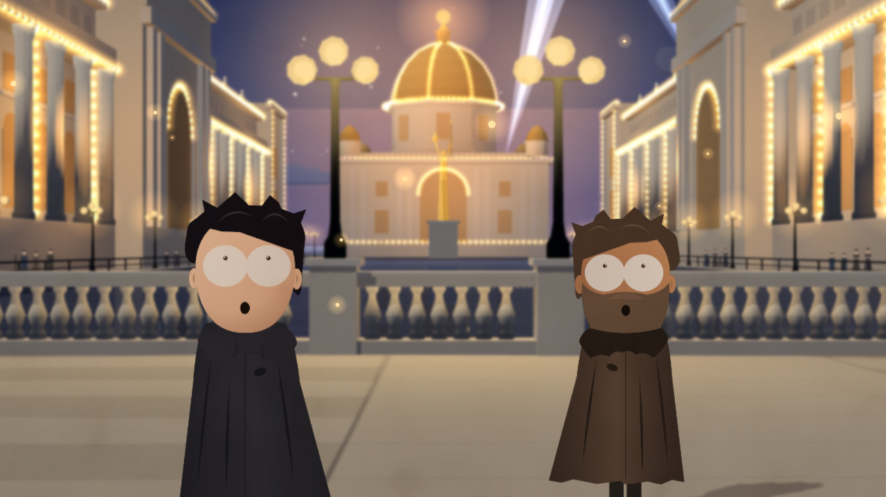 | **Hội chợ Chicago 1893, hai người trước lan can, nền mềm** `hoi-cho-chicago-1893-hai-nguoi-truoc-lan-can-nen-mem` | Trung cảnh hai người ngang tầm vai trên sân đầu hồ: Tesla áo choàng đen bên trái, Westinghouse râu quai nón áo nâu bên phải; sau lưng họ, mềm đi, là lan can, hai cột đèn ba cầu khung lấy toà vòm vàng ở giữa, hai lâu đài viền đèn, đèn pha; hạt sáng ấm lơ lửng; ánh vàng ấm hắt lên mặt từ phía máy. | hai người cùng ngắm thành quả, khoảnh khắc chiến thắng, đêm hội | `<Shot eye={FAIR_VIEWS.c.eye} soft={1.6} set={(i, cam) => <ChicagoFair view="c" power={powerShot13(f)} people={false}>{i}</ChicagoFair>} figures={...} />` ; comp `hc-sang-c` | `src/demo/ChicagoFair.tsx` |
| 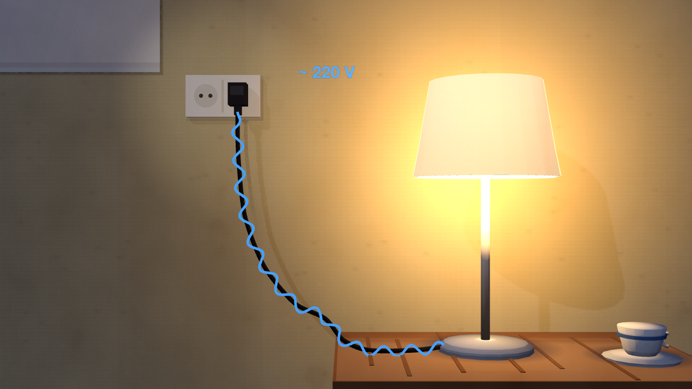 | **Góc tường trong nhà buổi tối: ổ cắm, dây, đèn bàn** `goc-tuong-nha-o-cam-day-den-ban-buoi-toi` | Cảnh chèn nhìn thẳng một mặt tường vàng kem rộng 1,4 m: mép dưới tờ lịch góc trên trái, ổ cắm đôi trắng có phích đen ở một phần ba trái, dây đen võng xuống rồi chạy lên bàn gỗ nhỏ tới đèn bàn chao trắng ở một phần ba phải, cốc trà. Phòng tối xanh xám, ổ cắm có đèn riêng; đèn bàn bật thì tường loang sáng ấm, sóng xanh lam (SineWave dùng chung của kit.tsx) chạy dọc dây, chữ "~ 220 V". Comp nha-a chạy kế hoạch của cảnh 14 (homeShot14). | điện trong nhà, đồ điện, bật đèn, cảnh chèn đời sống ngày nay | `<HomeCorner f={f} lamp={lampOn(f, 22)} wave={{from: 0, to: 1, phase: f * 0.45}} label={1} />` ; comp `nha-sang` | `src/demo/HomeCorner.tsx` |
| 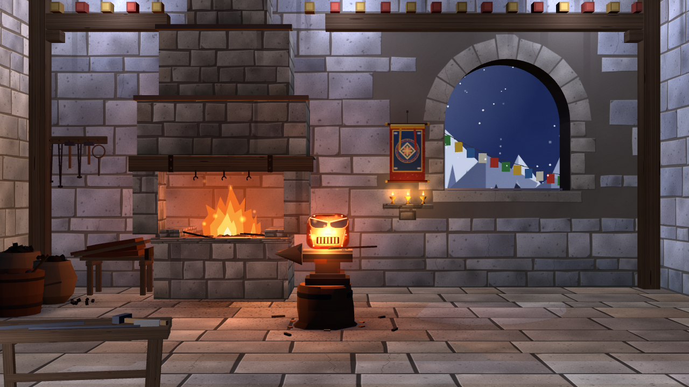 | **Lò rèn tu viện, mặt nạ còn nóng đỏ trên đe (chưa có người)** `lo-ren-tu-vien-mat-na-ruc-tren-de` | Cùng lò rèn, trạng thái 'ruc': chiếc mặt nạ đỏ rực ngả trên mặt đe, hắt cam lên đe, kìm nằm trên đe. | cảnh mở tập Doom, rèn vũ khí, vật vừa rèn xong | `<Forge state="ruc" heat={1} f={f}>{nhân vật}</Forge>` ; comp `forge-ruc` | `src/demo/Forge.tsx` |
|  | **Lò rèn: cận mặt nạ đỏ trên đe, nền mềm** `lo-ren-can-mat-na-do-tren-de-nen-mem` | Máy thấp ngang mặt đe, mặt nạ đỏ chiếm một phần ba bề ngang, đe và mặt nạ nét; sau lưng mờ là lửa lò bên trái, thangka và đèn bơ, mép cửa sổ đêm bên phải. Cảnh quay 1 của d1mo. | khung mở đầu, cận đồ vật nóng | `<Shot eye={FORGE_VIEWS.s1} soft={1.6} set={...<Forge state="ruc" anvil={false}>} figures={<Anvil/><LooseMask/>} />` ; comp `forge-s1` | `src/demo/Forge.tsx` |
| 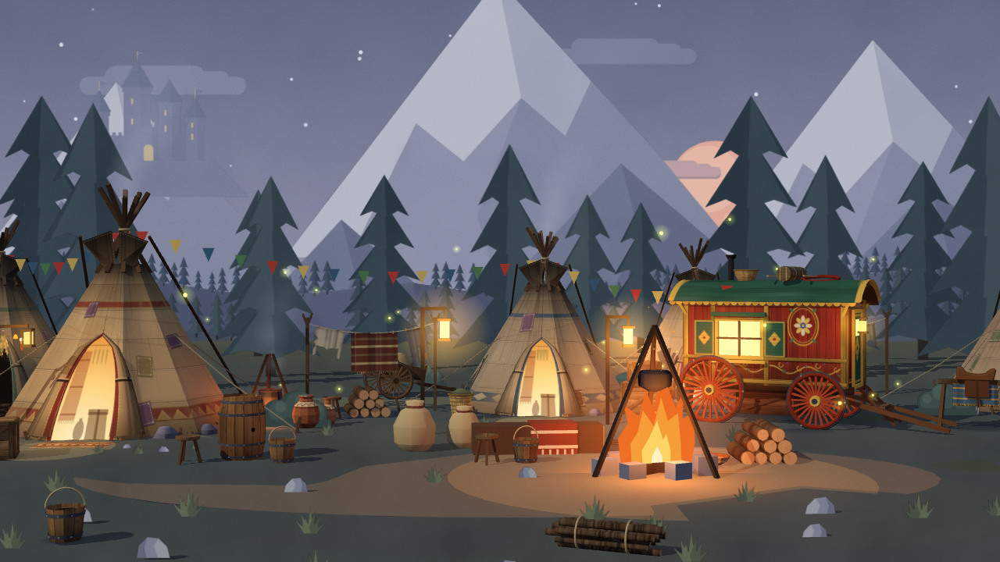 | **Trại du mục: toàn cảnh từ cao, lửa trại, xe thùng** `trai-du-muc-toan-canh-cao-lua-trai-xe-thung` | Toàn cảnh trại lúc chạng vạng từ máy lùi xa nâng cao [0.5, 2.8, 14]: năm lều vải vá víu (ba lều sáng cửa), lửa trại có kiềng nồi giữa phải, xe thùng đỏ, hai dây phơi, xe đẩy, yên ngựa, thùng, giỏ, gốm quanh từng lều; núi tuyết, lâu đài xa, rừng thông. Không người. | cảnh mở trại, trại nhìn từ xa, chuyển cảnh vào trại | `<Shot grade="nightExterior" eye={CAMP_WIDE} set={(inside, cam) => <Camp f={khung} dx={cam.dx} dz={cam.dz}>{inside}</Camp>} figures={...} />` ; comp `camp-toan-canh` | `src/demo/Camp.tsx` |
| 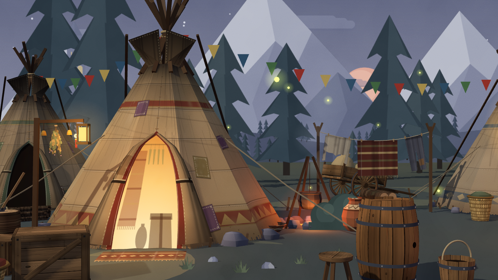 | **Trại du mục: lều A sáng đèn, cửa vén buộc dây** `trai-du-muc-leu-a-sang-den-cua-vat-buoc` | Góc máy [-5.2, 1.7, 3.0] (khung cuối cảnh 7 đoạn d1mo, khung đầu d1c2 cảnh 1): lều nhà Victor ở một phần ba trái, cửa sáng là điểm sáng nhất; cọc đèn treo thảo dược và chuông bên trái cửa, thảm trước cửa, hai thùng gỗ thấp góc dưới trái, bếp đá treo nồi và dây phơi bên phải, thùng rượu, xô, ghế đẩu thấp ở tiền cảnh phải. Không người. | mở đầu chuyện ở trại, cảnh trước cửa lều | `<Shot grade="nightExterior" eye={[-5.2, 1.7, 3.0]} set={(inside, cam) => <Camp f={khung} dx={cam.dx} dz={cam.dz}>{inside}</Camp>} figures={...} />` ; comp `camp-leu-a` | `src/demo/Camp.tsx` |
| 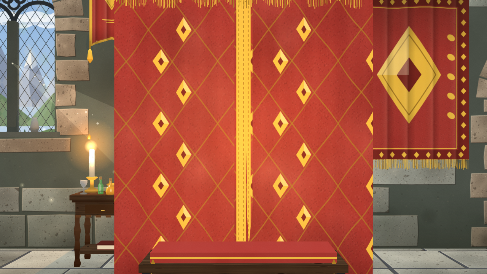 | **Phòng ngủ trong lâu đài: rèm giường kéo kín, sáng ấm từ trong** `phong-ngu-lau-dai-rem-giuong-keo-kin-sang-am` | Trạng thái kin-rem, máy PN_VIEWS.kin nhìn thẳng chân giường (d1c3 cảnh 18): tấm rèm nhung đỏ thêu thoi vàng kéo kín, sáng ấm xuyên vải (đèn đầu giường bên trong), một vệt sáng ở khe giữa hai tấm; hai cột giường hai bên; bên trái bàn đầu giường có nến, cửa sổ đêm; bên phải thảm treo đỏ. Không người; bóng người nằm trên rèm là việc của cảnh quay (mặt rèm: FOOT_CURTAIN). Từ 23/11/2026 có hai giờ: gio="ngay" (mặc định: nắng chiều qua cửa sổ, trời xanh núi tuyết ngoài kính, tường đá sáng, nến vẫn thắp, hành lang sáng nhờ một cửa sổ nhỏ) và gio="dem" (trăng, đuốc, đèn dầu). Ảnh kho là ánh ngày. | cảnh kín đáo, người ốm sau rèm, bóng in trên rèm | `<PhongNgu gio="ngay" eye={PN_VIEWS.kin} state="kin-rem" f={f}>…</PhongNgu>` ; comp `phong-ngu-kin-rem` | `src/demo/PhongNguNamTuoc.tsx` |
| 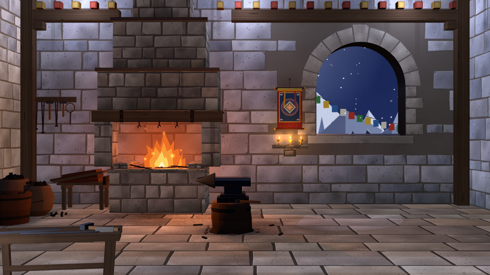 | **Lò rèn tu viện ban đêm, toàn cảnh không người** `lo-ren-tu-vien-dem-trong-khong-nguoi` | Lò rèn trên núi ban đêm, lò đang cháy, đe và búa trên đe, cửa sổ vòm nhìn ra núi tuyết; không có ai. | cảnh lò rèn, xưởng rèn, tu viện trên núi | `<Forge state="trong">{người}</Forge>` ; comp `forge-trong` | `src/demo/Forge.tsx` |
| 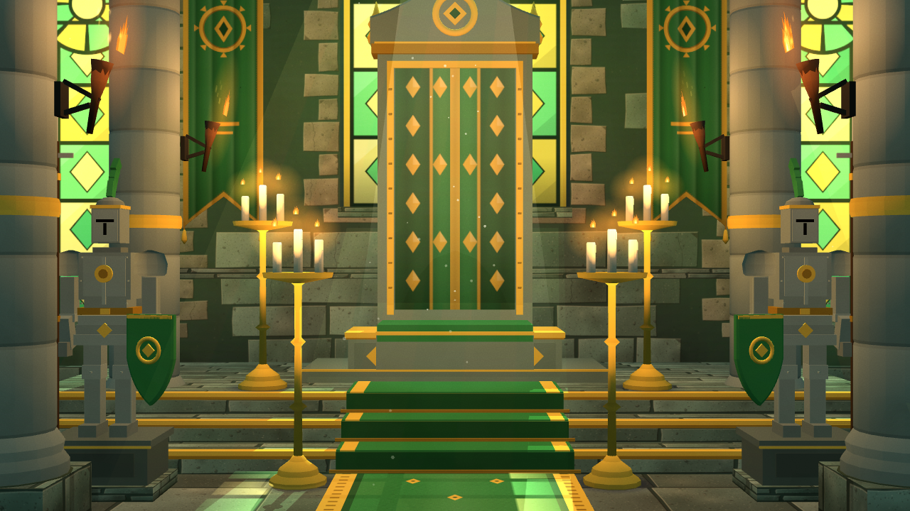 | **Sảnh ngai kính màu xanh vàng, toàn cảnh dọc lối thảm, không người** `sanh-ngai-kinh-mau-xanh-vang-toan-canh-khong-nguoi` | Sảnh ngai lâu đài ban đêm nhìn dọc lối thảm: ngai đá trên bệ, cửa kính màu xanh vàng, cờ, đuốc tường; không có ai. | cảnh triều đình, lâu đài, vua ngồi ngai | `<SanhNgai eye={HALL_VIEWS.c5}>{người}</SanhNgai>` ; comp `sanh-ngai-trong` | `src/demo/SanhNgai.tsx` |
| 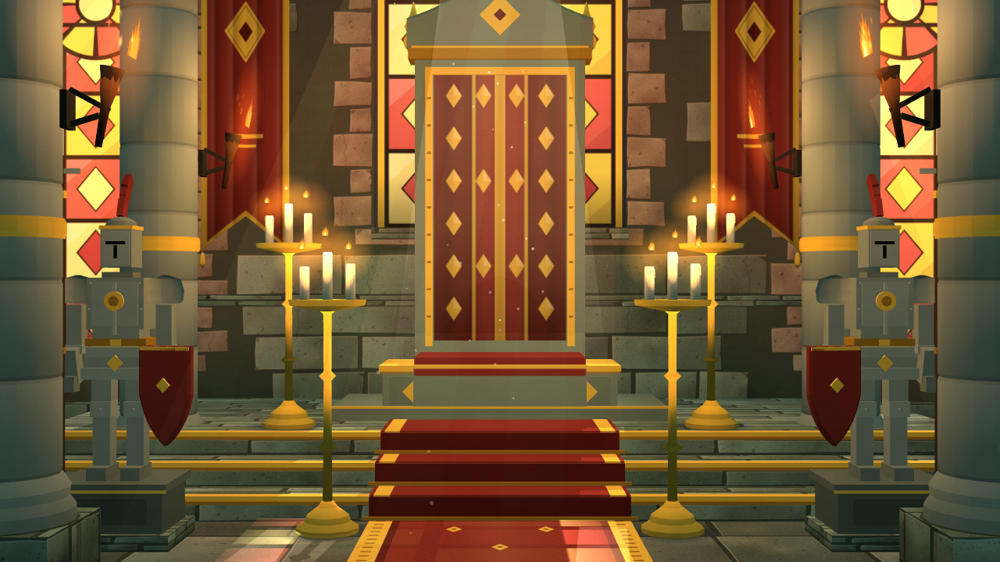 | **Sảnh ngai đỏ và vàng, toàn cảnh dọc lối thảm, không người** `sanh-ngai-do-vang-toan-canh-khong-nguoi` | Sảnh ngai lâu đài ở trạng thái đỏ và vàng (state "nam-tuoc"), nhìn dọc lối thảm; không có ai. | cảnh triều đình của một lãnh chúa khác, lâu đài | `<SanhNgai state="nam-tuoc" eye={HALL_VIEWS.c5}>{người}</SanhNgai>` ; comp `sanh-ngai-nam-tuoc-trong` | `src/demo/SanhNgai.tsx` |
| 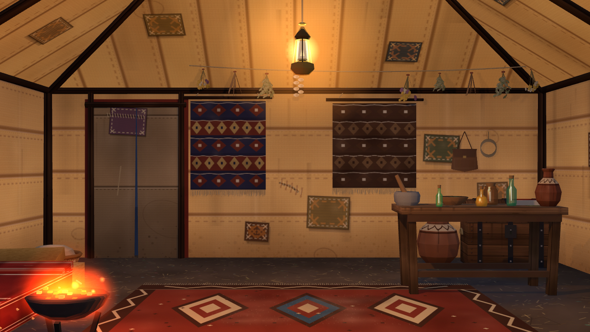 | **Trong lều thầy lang ban đêm, toàn cảnh không người** `leu-thay-lang-dem-den-dau-chau-than-khong-nguoi` | Trong căn lều vải ban đêm: đèn dầu treo, chậu than, bàn thuốc, đệm rơm, rương; không có ai. Vách vải dựng bằng TentInside, cửa lều TentDoor, số đo LEU, vải vẽ bằng paintTentCloth (lib3/kitLeuThayLang). | cảnh trong lều, nhà người du mục, đêm | `<LeuThayLang state="sinh">{người}</LeuThayLang>` ; comp `leu-sinh-trong` | `src/demo/LeuThayLang.tsx` |
| 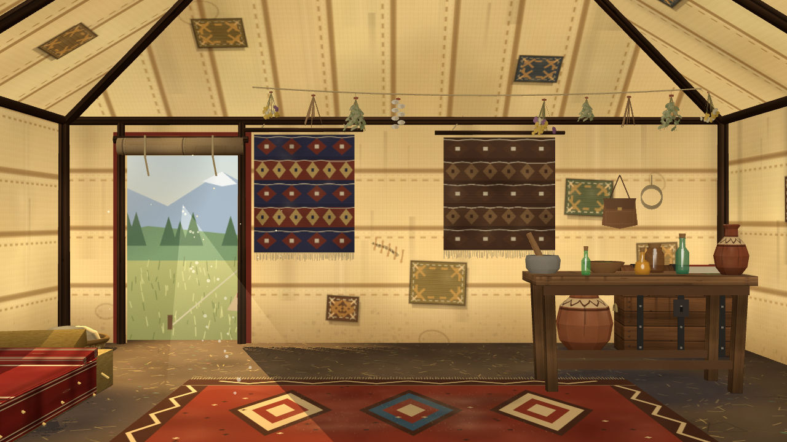 | **Trong lều thầy lang ban ngày, toàn cảnh không người** `leu-thay-lang-ngay-vai-sang-cua-ven-khong-nguoi` | Trong căn lều vải ban ngày, cửa lều vén, vải sáng; bàn thuốc và đồ chữa bệnh; không có ai. | cảnh chữa bệnh, trong lều ban ngày | `<LeuThayLang state="chua-benh">{người}</LeuThayLang>` ; comp `leu-chua-benh-trong` | `src/demo/LeuThayLang.tsx` |
| 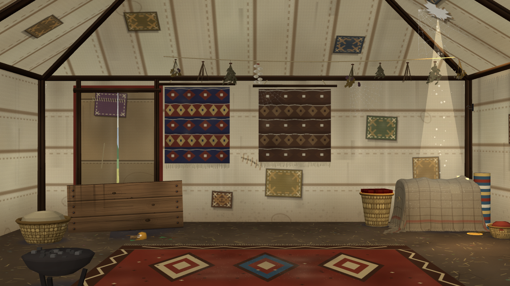 | **Lều bỏ hoang, luồng nắng qua mái rách, không người** `leu-bo-hoang-luong-nang-qua-mai-rach-khong-nguoi` | Căn lều bỏ hoang: mái vải rách để lọt nắng, đồ đổ, mạng nhện, rương đóng; không có ai. | cảnh nơi bỏ hoang, nhiều năm sau | `<LeuThayLang state="bo-hoang" chest={{cover: 0}}>{người}</LeuThayLang>` ; comp `leu-bo-hoang-trong` | `src/demo/LeuThayLang.tsx` |
| 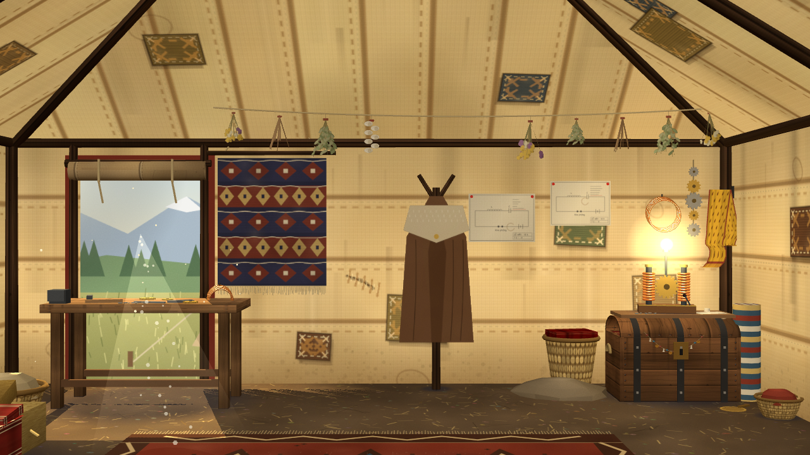 | **Xưởng trong lều: bàn thợ và máy cuộn đồng, không người** `leu-xuong-ban-tho-may-cuon-dong-khong-nguoi` | Căn lều thành xưởng: bàn thợ, bản vẽ, máy cuộn đồng đang chạy; không có ai. | cảnh xưởng chế tạo, nhà sáng chế trẻ | `<LeuThayLang state="xuong" machine={{kind: 'coil', on: 1}}>{người}</LeuThayLang>` ; comp `leu-xuong-trong` | `src/demo/LeuThayLang.tsx` |
| 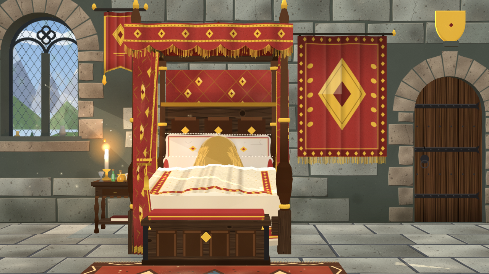 | **Phòng ngủ lâu đài, giường màn đỏ, ban ngày, không người** `phong-ngu-lau-dai-giuong-man-do-ngay-khong-nguoi` | Phòng ngủ lâu đài ban ngày: giường có màn đỏ, bàn đầu giường, cửa sổ chấn song, thảm treo tường; không có ai. | cảnh người ốm, phòng ngủ quý tộc | `<PhongNgu>{người}</PhongNgu>` ; comp `phong-ngu-trong` | `src/demo/PhongNguNamTuoc.tsx` |
| 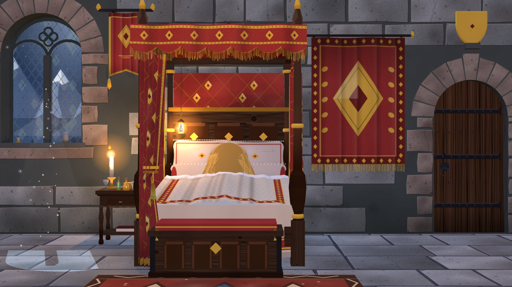 | **Phòng ngủ lâu đài, giường màn đỏ, ban đêm, không người** `phong-ngu-lau-dai-giuong-man-do-dem-khong-nguoi` | Phòng ngủ lâu đài ban đêm (gio="dem"): ánh trăng qua cửa sổ, nến; không có ai. | cảnh đêm trong lâu đài | `<PhongNgu gio="dem">{người}</PhongNgu>` ; comp `phong-ngu-dem-trong` | `src/demo/PhongNguNamTuoc.tsx` |
| 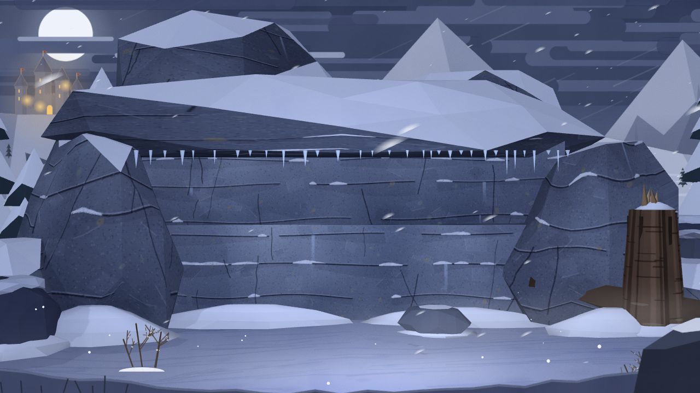 | **Sườn núi tuyết có hốc đá, đêm bão, không người** `suon-nui-tuyet-hoc-da-dem-bao-khong-nguoi` | Sườn núi tuyết đêm bão: hốc đá, tuyết thổi ngang, lâu đài xa sáng đèn; không có ai. | cảnh bão tuyết, trú bão | `<NuiTuyet state="dem-bao">{người}</NuiTuyet>` ; comp `nui-tuyet-dem-bao-trong` | `src/demo/NuiTuyet.tsx` |
| 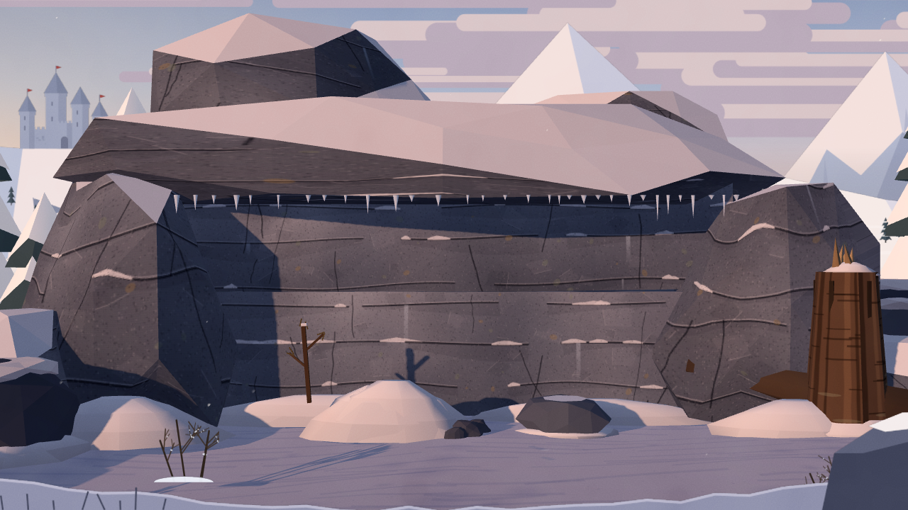 | **Sườn núi tuyết có hốc đá, bình minh, không người** `suon-nui-tuyet-hoc-da-binh-minh-khong-nguoi` | Sườn núi tuyết lúc bình minh sau bão, nắng thấp, tuyết lấp lánh, mộ tuyết; không có ai. | cảnh sau cơn bão, buổi sáng trên núi | `<NuiTuyet state="binh-minh">{người}</NuiTuyet>` ; comp `nui-tuyet-binh-minh-trong` | `src/demo/NuiTuyet.tsx` |
| 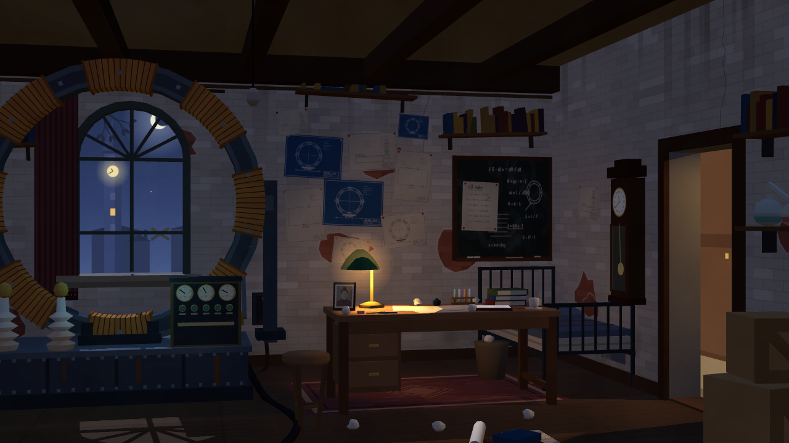 | **Phòng thí nghiệm ban đêm, toàn cảnh không người** `phong-thi-nghiem-dem-toan-canh-khong-nguoi` | Phòng thí nghiệm trong kí túc xá ban đêm: bàn, đèn bàn, cỗ máy năm đèn, bảng; không có ai. | cảnh nhà khoa học trẻ, phòng làm việc đêm | `<Lab view="wide">{người}</Lab>` ; comp `lab-trong` | `src/demo/Lab.tsx` |
| 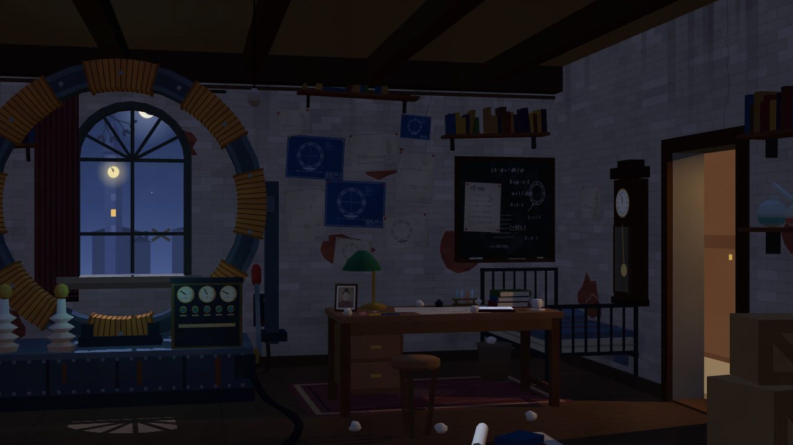 | **Phòng thí nghiệm tắt đèn, toàn cảnh không người** `phong-thi-nghiem-tat-den-khong-nguoi` | Phòng thí nghiệm tắt đèn trước khi bật máy (state "dark"); không có ai. | cảnh sắp thí nghiệm, căng thẳng | `<Lab view="wide" state="dark">{người}</Lab>` ; comp `lab-toi-trong` | `src/demo/Lab.tsx` |
| 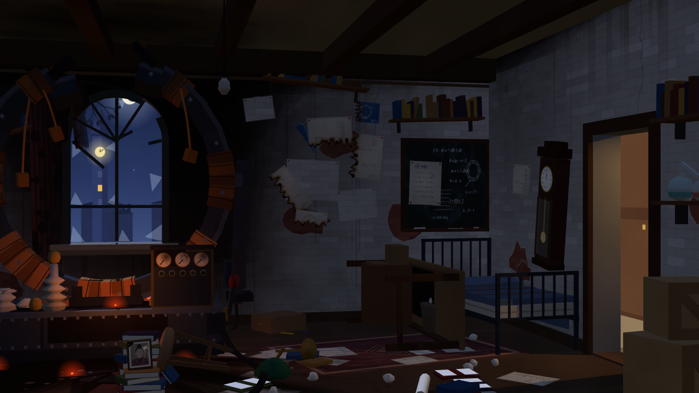 | **Phòng thí nghiệm đổ nát sau vụ nổ, không người** `phong-thi-nghiem-do-nat-khong-nguoi` | Phòng thí nghiệm sau vụ nổ (state "wrecked"): máy vỡ, bàn đổ, giấy cháy; không có ai. | cảnh sau tai nạn, vụ nổ | `<Lab view="wide" state="wrecked">{người}</Lab>` ; comp `lab-do-nat-trong` | `src/demo/Lab.tsx` |
| 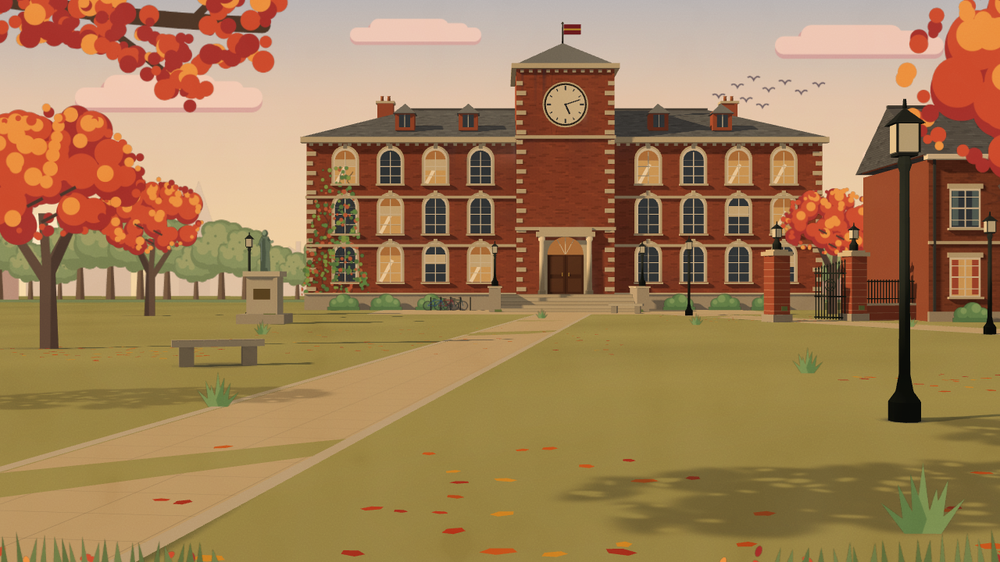 | **Sân trường đại học gạch đỏ, chiều, không người** `san-truong-dai-hoc-gach-do-chieu-khong-nguoi` | Sân trường đại học buổi chiều: giảng đường gạch đỏ, lá phong, lối lát đá; không có ai. | cảnh trường đại học, sinh viên | `<Campus time="chieu" view="a">{người}</Campus>` ; comp `campus-chieu-trong` | `src/demo/Campus.tsx` |
| 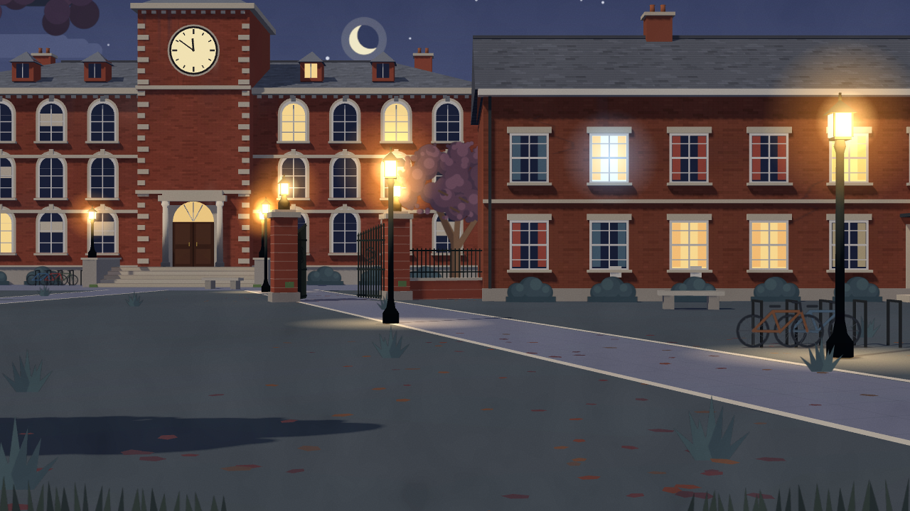 | **Sân trường đại học ban đêm trước kí túc xá, không người** `san-truong-dai-hoc-dem-ki-tuc-xa-khong-nguoi` | Sân trường đại học ban đêm nhìn về kí túc xá sáng đèn; không có ai. | cảnh đêm ở trường, kí túc xá | `<Campus time="dem" view="b">{người}</Campus>` ; comp `campus-dem-trong` | `src/demo/Campus.tsx` |
| 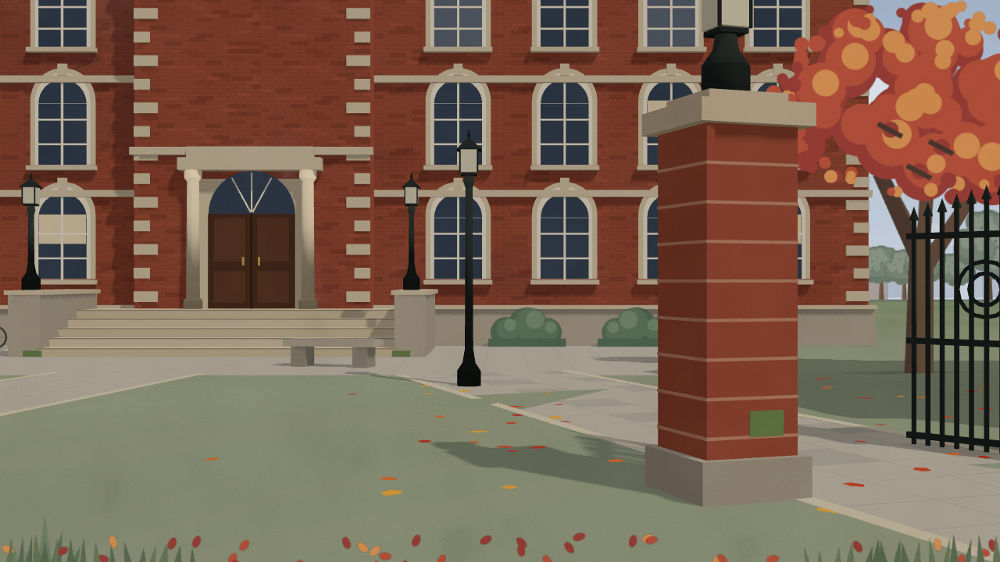 | **Sân trường đại học buổi sáng, chân bậc thềm, không người** `san-truong-dai-hoc-sang-bac-them-khong-nguoi` | Sân trường đại học buổi sáng nhìn lên bậc thềm giảng đường; không có ai. | cảnh buổi sáng ở trường, đuổi học, công bố | `<Campus time="sang" view="c">{người}</Campus>` ; comp `campus-sang-trong` | `src/demo/Campus.tsx` |
| 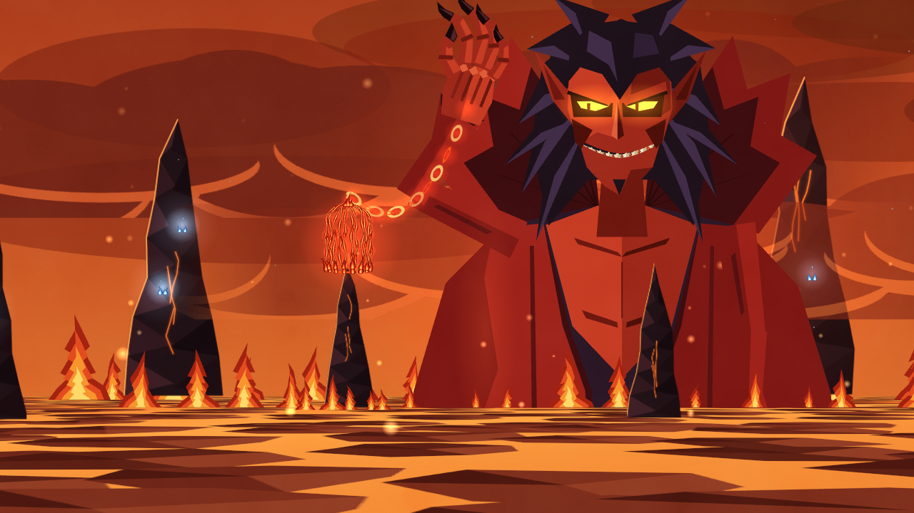 | **Cõi lửa: hồ dung nham, Mephisto giữ lồng bằng xích lửa (lồng trống)** `coi-lua-ho-dung-nham-mephisto-giu-long-xich-lua` | Máy sát mặt hồ dung nham nhìn lên (rise 0,25): trời khói đỏ thẫm sáng dần xuống chân trời cam, dãy núi vỏ chai đen viền sáng, dải khói cuộn trôi, tường lửa cắt giấy trên mặt hồ xa; Mephisto (quỷ đỏ truyện tranh, con rối có khớp) đứng ngập tới hông ở nửa phải, cao 16 m, cổ áo chạm mép trên; mỏm vỏ chai đen nhô giữa hồ ở nửa trái, trên đỉnh là lồng lửa (người trong lồng truyền qua prop `soul`); xích lửa nối lồng với bàn tay trái của nó; các mỏm nhỏ có đốm lửa linh hồn xanh nhạt; tàn lửa, tro. Tự chạy kế hoạch cảnh 13 (coiLuaShot13): cúi, nheo, cười; buông xích, chụp lồng, khép từng ngón, chớp đỏ; nhấc nắm tay lên cạnh mặt và cười. Ảnh ở khung 4. Không có đèn thật. | địa ngục, cõi quỷ, nơi giam linh hồn, giao kèo với quỷ; d1c3 cảnh 13, chương 16 | `<CoiLua f={f} plan={coiLuaShot13(f)} soul={spec người} soulHeight={cao} />  (máy COI_EYE, COI_RISE; mốc COI_MARKS; tay COI_ARMS)` ; comp `coi-lua-trong` | `src/demo/CoiLua.tsx` |
|  | **Cận mặt Mephisto ba phần tư, ánh lửa hắt từ dưới, bàn tay vuốt giơ lên** `mephisto-can-mat-ba-phan-tu-anh-lua-hat-len` | Mặt Mephisto quay ba phần tư sang trái, cúi như nhìn người ở ngoài khung, ánh lửa hắt từ dưới (cằm, gò má, môi sáng; hốc mắt tối), đầu chiếm khoảng 55 % chiều cao khung ở phần ba bên phải; nửa trái là khói đỏ, lửa cắt giấy, tàn lửa, và bàn tay vuốt của nó giơ lên với các ngón xoè. Sân khấu MephistoFaceStage nhận pose để diễn (comp thử chuyển động mephisto-thu-dong). | cận mặt quỷ ra giá, cười đắc thắng; d1c3 cảnh 8 hoặc chèn ở cảnh 9 | `<MephistoFaceStage f={f} pose={{...FACE_POSE, jaw: 0.5}} />  (máy FACE.eye, mốc FACE.mephisto, cao FACE.h)` ; comp `mephisto-can-mat` | `src/demo/CoiLua.tsx` |
| 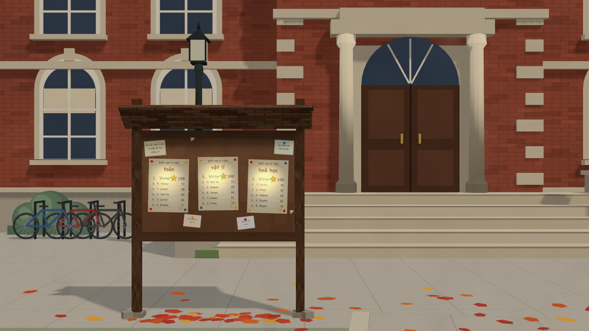 | **Sân trường đại học buổi sáng, bảng tin kết quả trước cửa giảng đường, không người** `san-truong-dai-hoc-sang-bang-tin-ket-qua-khong-nguoi` | Sân trước giảng đường buổi sáng: bảng tin gỗ có mái đứng trên sân lát đá (BOARD_POS), lá phong rụng trên mặt lát, sau lưng là cửa chính, bậc thềm, cửa sổ vòm và tường gạch đỏ; máy BOARD_EYE cách bảng 7 m. Không có ai; ba ngôi sao đã bật (khung 40). | công bố kết quả, gặp gỡ trước bảng tin, đời sinh viên buổi sáng | `<Campus time="sang" view="c" board={{stars: [4, 16, 28]}} f={f}>{người}</Campus> qua Shot với eye` ; comp `campus-sang-bang-tin` | `src/demo/Campus.tsx` |
| 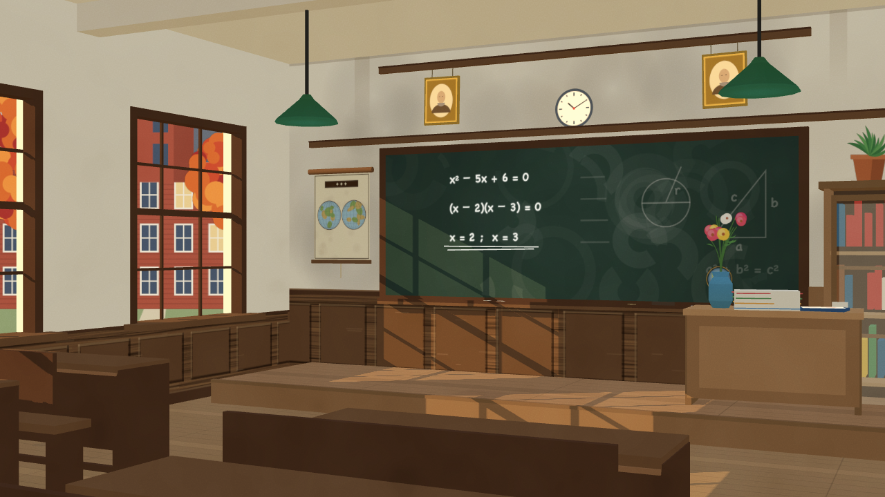 | **Giảng đường đại học Mỹ đầu thế kỉ 20, ốp gỗ, bảng đen phấn tự viết, ban ngày, không người** `giang-duong-dai-hoc-my-op-go-bang-den-phan-tu-viet-ngay` | Trạng thái `dai-hoc` của lớp học (cùng vỏ phòng, cùng cửa, cùng góc máy; lớp học Việt cũ giữ nguyên): tường vôi kem trên ốp gỗ sồi có pa-nô tới ngang hông, cửa sổ cao khung gỗ có song kính (không song sắt) nhìn ra toà gạch đỏ có tháp đồng hồ và cây phong đỏ, nắng xiên vào bục; bảng đá phiến lớn có bài cũ mờ bên phải và ba dòng phấn tự viết theo khung bên trái; hai thanh treo tranh với hai chân dung học giả khung vàng, đồng hồ; bản đồ cuộn treo tường, tủ sách, bàn giảng ở đầu phải bục có bình hoa, sách và quả địa cầu nhỏ; đèn treo chao men xanh (tắt); bàn dài gỗ sẫm có ghế băng; sàn ván. Ảnh: khung 47 (phấn đã viết xong). LOP cho yaw, toạ độ máy, LOP.eye(điểm phòng) đổi chỗ đứng trong phòng ra eye cho Shot; DH_BOARD là bảng. | giảng đường, lớp học đại học, trường học phương Tây cuối 19 đầu 20, giải bài trên bảng | `<Shot grade="brightInterior" eye={LOP.eye([x, cao, z])} set={(inside, cam) => <GiangDuong f={f} dx={cam.dx} dz={cam.dz}>{inside}</GiangDuong>} figures={người theo toạ độ phòng, rotY={-LOP.yaw}} />` ; comp `giang-duong-dai-hoc-trong` | `src/demo/Classroom.tsx` |
| 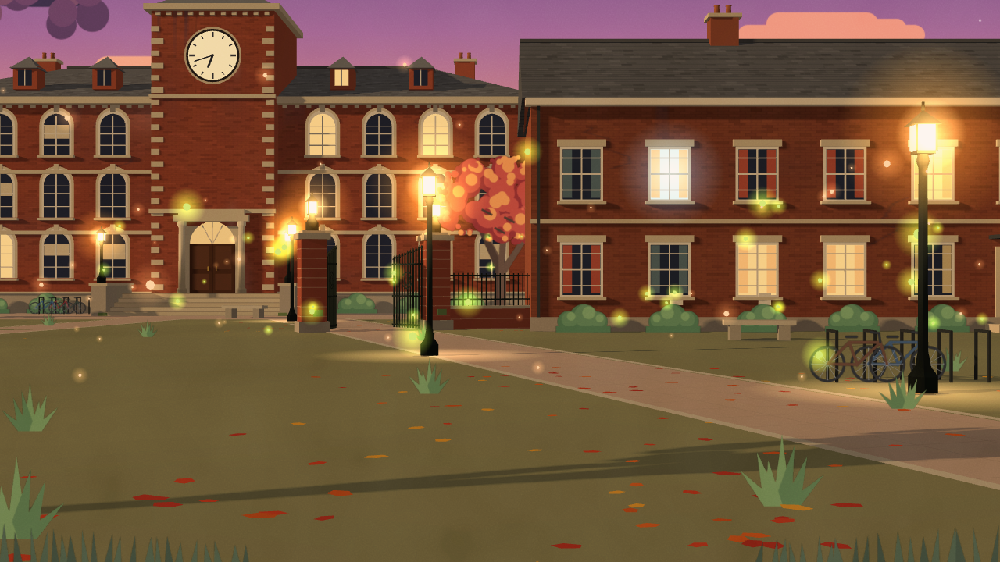 | **Sân trường đại học chạng vạng, đèn vừa bật, đom đóm, không người** `san-truong-dai-hoc-chang-vang-den-vua-bat-dom-dom-khong-nguoi` | Sân trường đại học lúc chạng vạng góc b: trời tím chuyển cam, kí túc xá và giảng đường tường hồng, lá phong đỏ sẫm, cột đèn vừa bật, bụi và đom đóm bay trên cỏ. Prop domDom 0..1 chỉnh độ lớn đom đóm: cho máy bay sát vào thì hạ dần về 0 để đom đóm tắt dần, không thành đốm to (mặc định 1). Prop gain nhân ánh sáng nếu cảnh đo tối. | chạng vạng ở trường, cảnh buồn êm, máy bay sát về phía toà nhà, kết một ngày | `<Campus time="chang-vang" view="b" domDom={1 - tiến độ}>{người}</Campus>` ; comp `campus-chang-vang-trong` | `src/demo/Campus.tsx` |
| 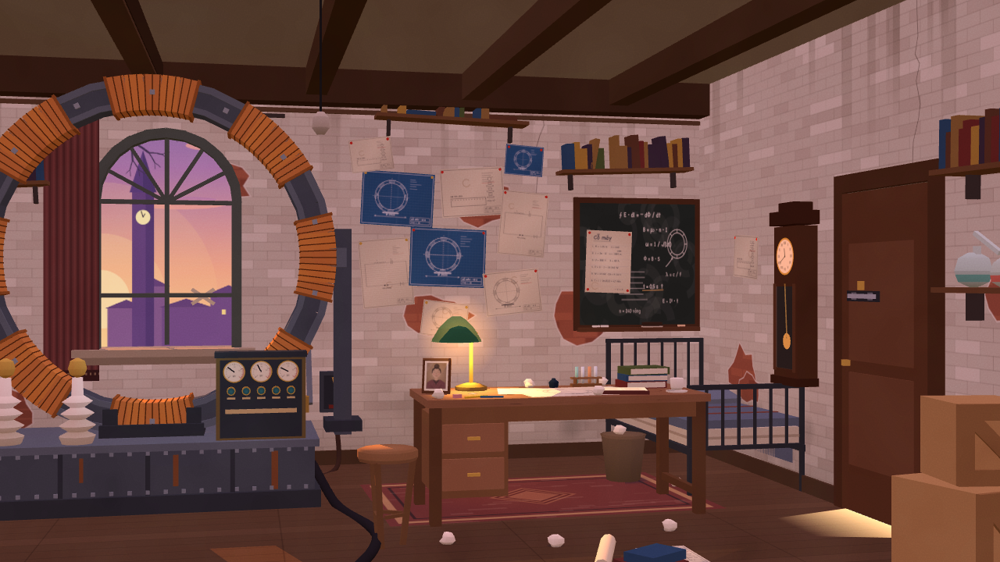 | **Phòng thí nghiệm chạng vạng, cửa đóng chốt cài, không người** `phong-thi-nghiem-chang-vang-cua-dong-chot-cai-khong-nguoi` | Phòng thí nghiệm góc rộng chéo vào góc phải sau lúc chạng vạng: nắng cam thấp qua cửa sổ, trời tím cam, đèn bàn bật, vòng máy lớn bên trái; cửa hành lang bên phải đóng kín, vạch sáng dưới cửa, chốt trượt cài chặt (door 1, bolt 1). Không phủ vải (không có cover). Không có ai. | bị nhốt, giấu việc, một mình làm máy lúc cuối ngày, cửa khoá từ bên trong | `<Lab view="wide" gio="chang-vang" door={1} bolt={1}>{người}</Lab>` ; comp `lab-chang-vang-cua-chot-trong` | `src/demo/Lab.tsx` |
| 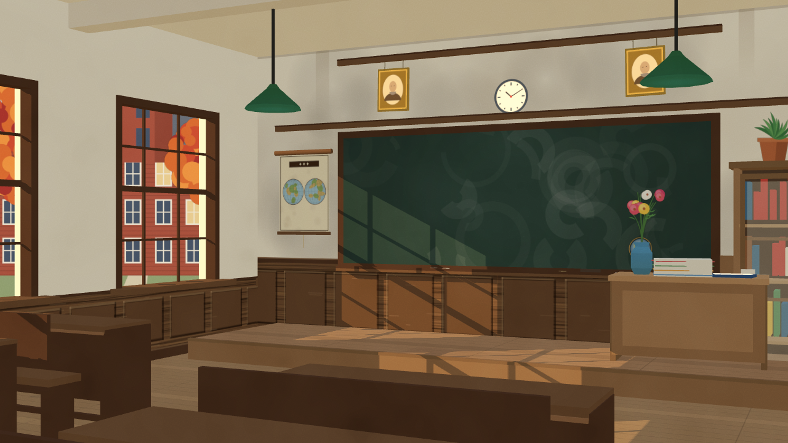 | **Giảng đường đại học, bảng đen đã lau sạch, không người** `giang-duong-dai-hoc-bang-den-da-lau-sach-khong-nguoi` | Giảng đường ban ngày sáng: bảng đá phiến khung sồi đã lau sạch, chỉ còn vệt lau mờ và máng phấn, không bài nào, không chữ phấn; bục giảng, đèn treo, bản đồ, cửa sổ nhìn ra toà nhà trường và cây phong. Gọi bangSach để bảng sạch; bỏ prop thì bảng còn bài cũ mờ. | sau giờ học, bảng bị xoá, bắt đầu bài mới, người giải bài trên bảng trống | `<GiangDuong f={khung} bangSach>{người theo toạ độ phòng}</GiangDuong>` ; comp `giang-duong-bang-sach-trong` | `src/demo/Classroom.tsx` |
| 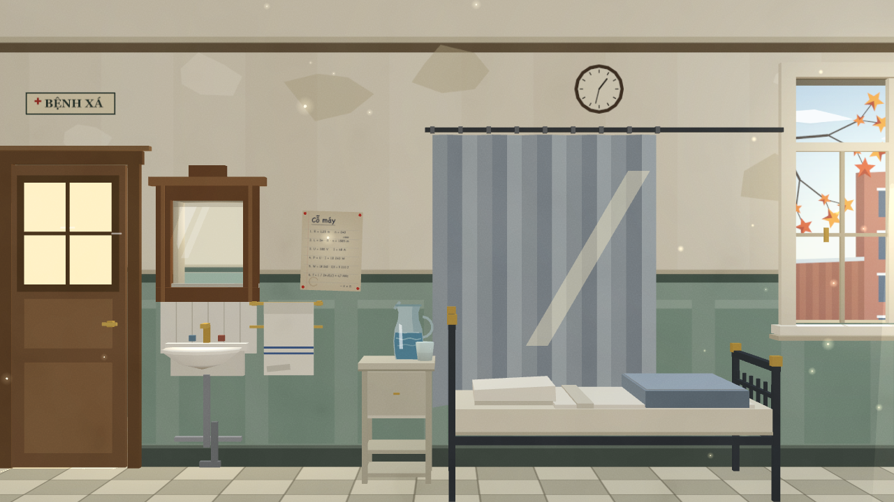 | **Bệnh xá buổi sáng, giường sắt, rèm xám, gương gỗ, không người** `benh-xa-sang-giuong-sat-rem-xam-guong-go-cua-so-phong-khong-nguoi` | Bệnh xá trường đại học buổi sáng, toàn cảnh một bức tường từ cửa tới cửa sổ: cửa gỗ ô kính sáng đèn bên trái, biển BỆNH XÁ, gương gỗ trên chậu rửa sứ có khăn treo, tờ tính toán ghim tường, bàn đầu giường có bình nước và cốc, giường sắt, rèm xám có vệt nắng, cửa sổ nhìn ra cây phong lá cam và toà nhà đỏ, bụi bay trong nắng. Prop: state 'sang' (mặc định) | 'chieu'; eye (góc máy, BX_VIEWS: giuong, can, ban, guong, toan, toanGan, to); cua 'dong'|'mo'|số góc; rem 0..1; khan, khanLay (khăn phủ gương); guong (hình trong gương, đặt bằng guongDiem); thu (lá thư trên bàn); toTinh, vong (vòng đỏ trên tờ tính); mốc người BX_MARKS (victorGiuong, victorGuong, victorTo, aCua). Món nhỏ dùng lại ở src/lib3/kitBenhXa.tsx: Guong (gương gỗ, khan/lay phủ khăn) <Guong khan={1} lay={1}/>; ChauRua (chậu rửa sứ) <ChauRua x={1.75}/>; GiaKhan <GiaKhan/>; BinhNuoc (bình nước có mực nước, rung được) <BinhNuoc level={0.62} rung={0}/>; Coc; GiuongBenh; DongHo; TuThuoc; LaThu (lá thư). | bệnh xá, phòng ốm, người ốm nằm hoặc ngồi mép giường, soi gương, nhận thư, buổi sáng yên | `<BenhXa state="sang" eye={BX_VIEWS.toan.eye} f={khung}>{người theo BX_MARKS}</BenhXa>  (cảnh không người: composition benh-xa-sang-toan)` ; comp `benh-xa-sang-toan` | `src/demo/BenhXa.tsx` |
| 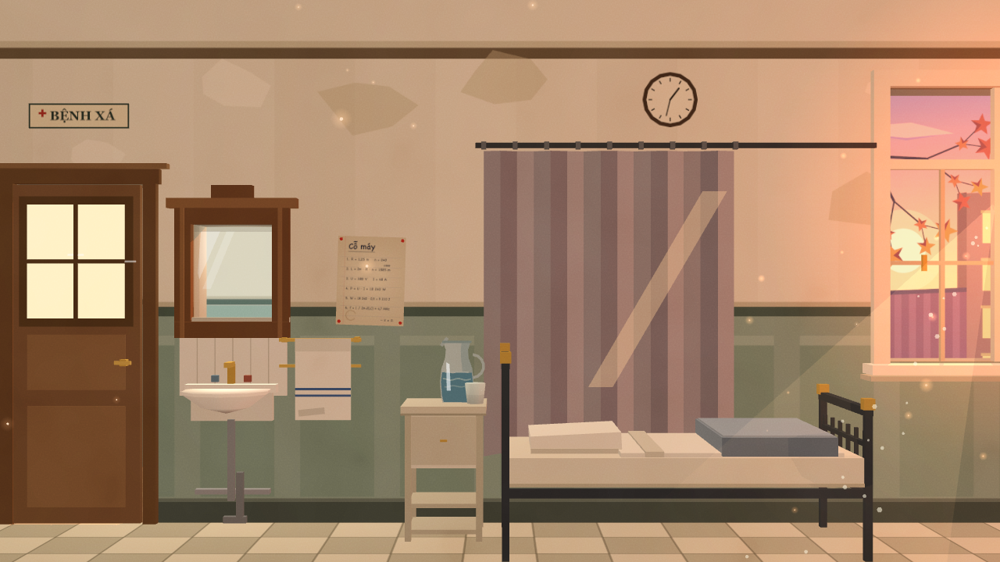 | **Bệnh xá buổi chiều, nắng cam, giường sắt, rèm tím, không người** `benh-xa-chieu-nang-cam-giuong-sat-rem-tim-guong-go-khong-nguoi` | Cùng bệnh xá giường sắt, gương gỗ, chậu rửa, bàn đầu giường, nhưng buổi chiều: nắng cam thấp tràn qua cửa sổ, trời hồng tím, rèm ngả tím, tường và sàn ấm, bụi vàng bay. Gọi bằng state="chieu"; mọi prop khác như bản sáng (eye, cua, rem, khan, khanLay, guong, thu, vong; mốc người BX_MARKS). Món nhỏ dùng lại ở src/lib3/kitBenhXa.tsx: Guong, ChauRua, BinhNuoc, Coc, GiaKhan, GiuongBenh, DongHo, LaThu, BuiNang (bụi trong nắng, state 'sang'|'chieu'). | bệnh xá lúc chiều tà, ốm kéo dài, chờ đợi, thư tới, nỗi buồn êm cuối ngày | `<BenhXa state="chieu" eye={BX_VIEWS.toan.eye} f={khung}>{người theo BX_MARKS}</BenhXa>  (cảnh không người: composition benh-xa-chieu-toan)` ; comp `benh-xa-chieu-toan` | `src/demo/BenhXa.tsx` |
| 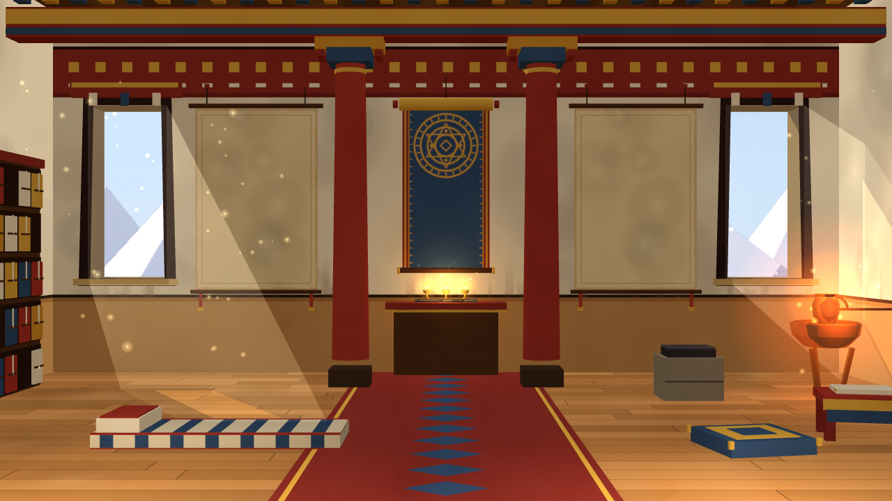 | **Điện học tu viện, cột đỏ, tranh cuộn, lò than, đệm, không người** `dien-hoc-tu-vien-cot-do-tranh-cuon-lo-than-toan-canh-khong-nguoi` | Điện học trong tu viện Tây Tạng ban ngày, toàn cảnh nhìn dọc điện: hai cột đỏ chân đen, thảm đỏ hoa văn thoi xanh dẫn tới bàn thờ có ba đèn bơ, tranh cuộn xanh có pháp trận vàng ở giữa, hai tấm giấy da lớn trên tường, cửa sổ cao nhìn ra núi tuyết với vệt nắng, giá kinh bên trái, lò than có bình nung và nồi đồng bên phải, đệm sọc xanh, bụi sáng trong nắng. Prop: eye (DH_VIEWS: toan, trung, thap, day, hai, gan, can, lo); cuon 0..1 (mở tranh cuộn), vong 0..1; giay1, giay2 {kind 'trang'|'vong'|'giap'|'matna', p, sang}; nung 0..1 (đổ sắt nung từ chén); lo; nem (đệm nằm), chan (chăn); den (đèn lồng); bui; mốc người DH_MARKS. Món nhỏ dùng lại ở src/lib3/kitDienHoc.tsx: GiayDa (giấy da vẽ dần, <GiayDa pos kind="vong" p={0.7}/>), CuonTranh, LoThan, ChenNung, Khuon, DongSat, GiaKinh, Dem, Nem; đèn lồng cầm tay DenLongCam (src/lib3/kitTayTang.tsx): <DenLongCam pos={[x,y,z]} f={khung} s={1}/>. | tu viện, nơi học phép, pháp trận, đúc, chép giấy da, người quỳ học trong điện, ánh nến và nắng | `<DienHoc eye={DH_VIEWS.toan} nem f={khung}>{người}</DienHoc>  (cảnh không người: composition dien-hoc-toan)` ; comp `dien-hoc-toan` | `src/demo/DienHoc.tsx` |
| 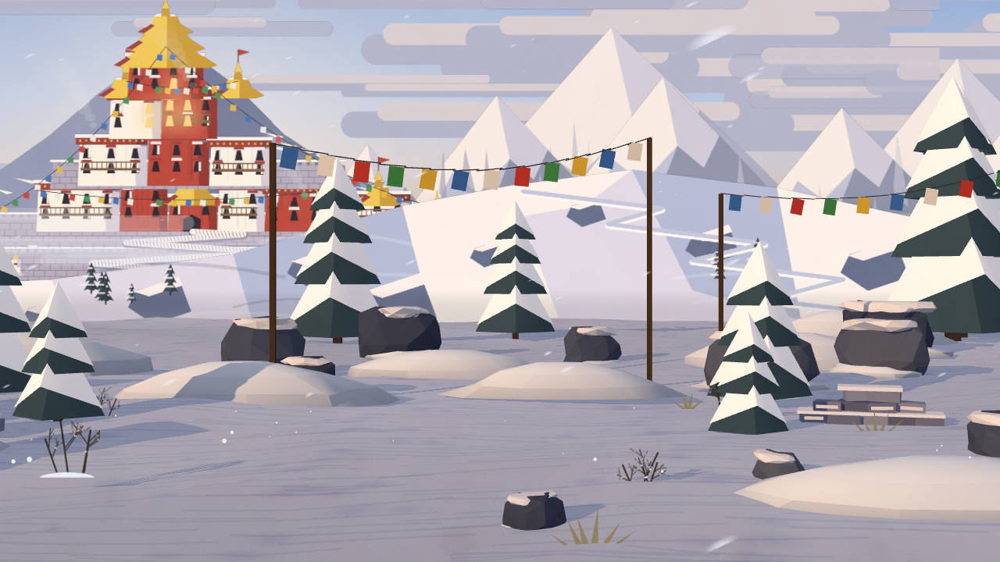 | **Núi tuyết Tây Tạng, tu viện đỏ vàng, cờ phướn, gió tuyết, không người** `nui-tuyet-tay-tang-tu-vien-do-vang-co-phuon-bao-gio-khong-nguoi` | Sườn núi tuyết kiểu Tây Tạng (state 'tay-tang'): tu viện đỏ trắng mái vàng nhiều tầng, ban công và cờ nhỏ ở trái trên triền núi, đường mòn ngoằn ngoèo, dải cờ phướn năm màu giăng giữa hai cột gỗ, thông phủ tuyết, đá tảng, đống đá khắc, tuyết bay nhẹ, mây dải. Prop: state="tay-tang"; eye (NUI_VIEWS: tt1 đi trong bão, tt2 gục, tt3 thấy tu viện, ttCua bay vào cửa sổ tu viện); gust gió (0.3 nhẹ .. 2 bão); tan 0..1 (bão tan dần: màu và ánh sáng chuyển sang vàng); cuaSo 0..7 (số cửa sổ tu viện sáng đèn); mốc người NUI_MARKS_TT. Món nhỏ dùng lại ở src/lib3/kitTayTang.tsx: CoPhuon (dây cờ phướn năm màu, <CoPhuon a={[x,y,z]} b={[x,y,z]} f={khung} wind={1} n={12}/>), DenLongCam (đèn lồng cầm tay), TamChan, DongDaKhac, TuVienPlate (tu viện vẽ trên tấm nền). | vùng núi cao, bão tuyết, tu viện, người lạc đường được cứu, hành hương, cờ phướn Tây Tạng | `<NuiTuyet state="tay-tang" eye={NUI_VIEWS.tt3} gust={0.3} tan={1} cuaSo={7} f={khung}>{người}</NuiTuyet>  (cảnh không người: composition nui-tay-tang-tu-vien)` ; comp `nui-tay-tang-tu-vien` | `src/demo/NuiTuyet.tsx` |
| 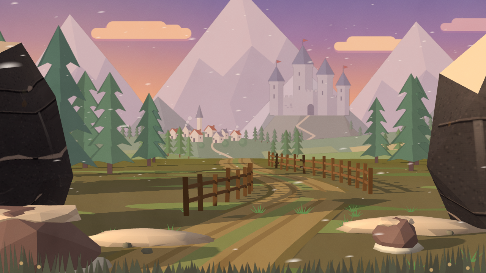 | **Thung lũng núi tuyết lâu đài lúc chiều tà, trời tím cam, tuyết bay** `thung-lung-nui-tuyet-lau-dai-chieu-ta-vang-tim-tuyet-bay` | Cùng thung lũng có lâu đài xám trên đồi, làng mái đỏ, hàng rào gỗ, đường đất, nhưng gio="chieu-ta": nắng vàng thấp, trời tím chuyển cam, mọi lớp ấm hoặc lạnh theo độ xa, đá chắn tuyết hai bên, tuyết bay ngang, cờ trên lâu đài. Prop: gio="chieu-ta" (bỏ prop thì là ban ngày như cũ); eye (VALLEY_VIEWS.vai: ngang vai, máy nhìn người từ sau); tuyet mật độ tuyết 0..1; f khung; mốc người VALLEY_MARKS.doomLung. | trở về nhà, đi qua đèo lúc hoàng hôn, kết cảnh, nhìn từ sau lưng người về phía lâu đài | `<Valley gio="chieu-ta" eye={VALLEY_VIEWS.vai} f={khung}>{người}</Valley>  (cảnh không người: composition valley-chieu-ta-toan)` ; comp `valley-chieu-ta-toan` | `src/demo/Valley.tsx` |

## Nhân vật, nét mặt, tư thế (22)

| Ảnh | Tên và id | Trông thế nào | Hợp với | Cách gọi | Code |
|---|---|---|---|---|---|
| 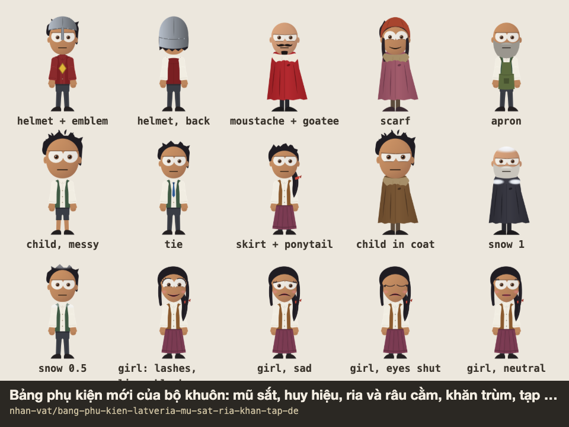 | **Bảng phụ kiện mới của bộ khuôn: mũ sắt, huy hiệu, ria và râu cằm, khăn trùm, tạp dề** `bang-phu-kien-latveria-mu-sat-ria-khan-tap-de` | Năm thứ thêm cho các chương Latveria: mũ sắt có che mũi (nhìn trước và nhìn sau) và huy hiệu hình thoi trên ngực cho lính; ria vểnh và râu cằm cho Nam tước; khăn trùm đầu có tóc dài hai bên cho người mẹ; tạp dề cho thầy lang. Thêm 23/11/2026: bốn hình con gái (mi, môi, má hồng, lọn tóc ôm mặt, cằm thon) ở các nét mặt cười, buồn, nhắm mắt, bình thường. | lính của Nam tước, Nam tước, Cynthia, cha của Victor | `helmet: '#8a9098', emblem: '#e0b63a', moustache: '#1c1614', goatee: '#1c1614', scarf: '#a8452e', apron: '#5c6b3e', lashes: true, lips: '#c2566a', blush: '#e58686', sideLocks: true, faceShape: 'oval'` | `src/mould/draw.ts` |
| 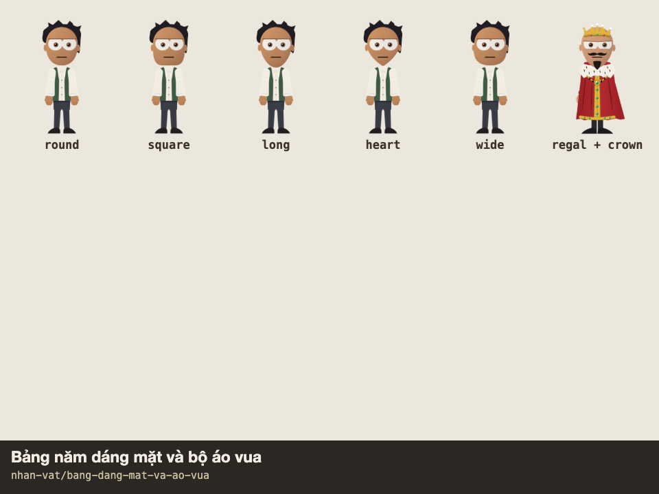 | **Bảng năm dáng mặt và bộ áo vua** `bang-dang-mat-va-ao-vua` | Năm dáng mặt của bộ khuôn (tròn, hàm vuông, mặt dài, cằm nhọn, má xệ) trên cùng một người, và bộ áo vua: cổ lông chồn trắng đốm đen, nẹp vàng nạm đá dọc thân và quanh gấu, dây chuyền có mặt đá, vương miện, các điểm lấp lánh. | mỗi nhân vật một dáng mặt; vua, nam tước, quý tộc | `faceShape: 'square' | 'long' | 'heart' | 'wide'; regal: {gold: '#e0b63a', gem: '#2a8a5a'}, crown: '#e0b63a'` | `src/mould/draw.ts` |
| 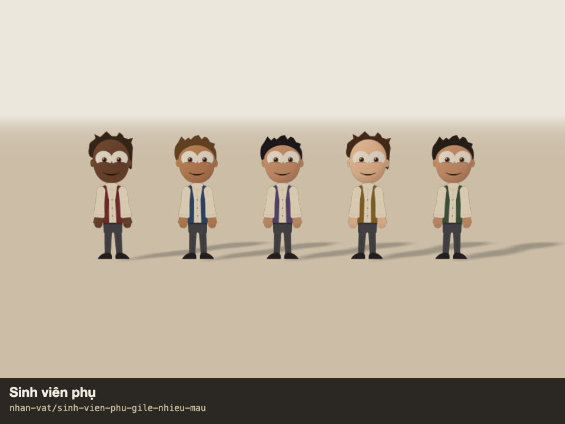 | **Sinh viên phụ** `sinh-vien-phu-gile-nhieu-mau` | Người phụ mặc gi-lê; chọn màu gi-lê, màu tóc, kiểu tóc; màu da tự chia theo người. | lấp sân trường, lớp học, đám đông nhỏ | `<Puppet3 height={CAO_MAU.sinhVien} pos={[x, 0, z]} spec={sinhVien("#7a2f2f", "#3a2a1e", "sweep")} />` | `src/mould/nguoi-mau.ts` |
| 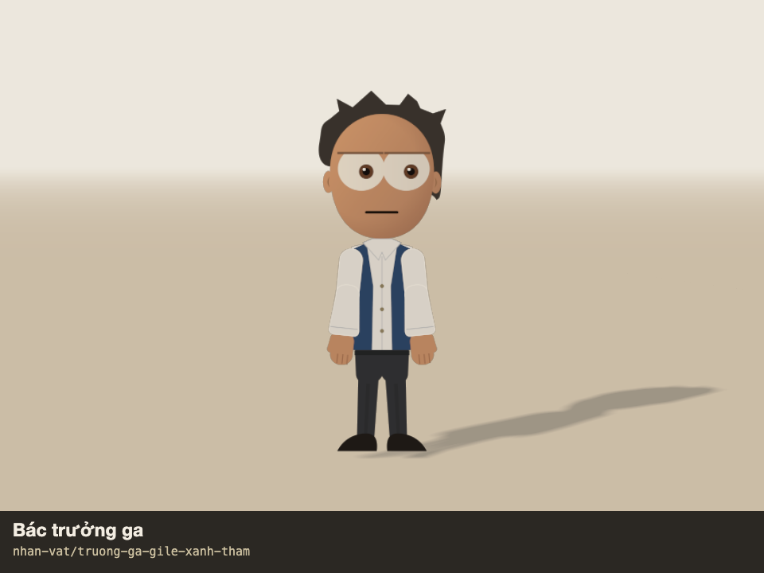 | **Bác trưởng ga** `truong-ga-gile-xanh-tham` | Người lớn tóc vuốt sẫm, áo trắng xám, gi-lê xanh thẫm. | cảnh ga xe lửa; người lớn đứng đón | `<Puppet3 height={1.7} pos={MASTER_MARK} spec={MASTER} />` | `src/demo/Station.tsx` |
|  | **Cậu bé** `cau-be-ao-xanh-nhat-quan-nau` | Trẻ con tóc đen ngang, áo xanh nhạt, quần nâu. | cảnh ga xe lửa; trẻ con đi một mình | `<Puppet3 height={1.15} pos={BOY_MARK} flip spec={BOY} />` | `src/demo/Station.tsx` |
|  | **Bảng bảy tông da đo từ video gốc (bộ SKINS)** `bang-nam-tong-da` | Năm tông da có sẵn: porcelain, fair, tan, brown, dark. Mỗi người một tông; một nhóm cùng một tông là lỗi. | mọi nhân vật | `palette: {...SKINS.tan, hair: ..., vest: ...} ; nhân vật phụ: skinFor(tên)` | `src/mould/palettes.ts` |
|  | **Bảng nét mặt** `bang-net-mat` | Mười một nét mặt có sẵn: neutral, sad, sadTalk, squint, angry, glare, happy, smile, shock, bored, smirk. | chọn mặt cho từng nhịp diễn | `expr: {...EXPR.smile, gaze: [x, y]} ; trong nhịp diễn: {f, face: "smile"}` | `src/mould/expr.ts` |
|  | **Mắt chuẩn theo video gốc (bảng nét mặt)** `mat-chuan-bang-net-mat` | Mắt của nhân vật theo số đo video gốc (Daniel duyệt 25/11/2026): mỗi mắt khoảng 0,40 bề ngang mặt, hai mắt chạm nhau ở giữa, mắt tròn; mặt bình thường mắt mở tròn, mí chỉ hạ khi giận, buồn, chán, nheo; lông mày tách khỏi mắt. matChuan(spec) tắt mắt của bộ khuôn (noEyes) và cắm lớp mat-chuan vẽ mắt cùng lông mày; đọc đủ gaze, lidL/lidR, closed, pupil, brow, browY, lashes của nét mặt. Nhân vật có lông mày riêng: opt {may: false} hoặc gọi veMat trong lớp head của mình. Không kênh nào tự vẽ lại mắt hay đổi cỡ, khoảng cách mắt (tools/kiem_mat.py báo LOI). Kênh lich-su đã dùng cho cả dàn. | mọi nhân vật mới; dàn nhân vật của một kênh mới | `import {matChuan} from 'chung/src/mould/matChuan'; const NV = matChuan({...spec})   // mày riêng: matChuan(spec, {may: false})` | `src/mould/matChuan.ts` |
|  | **Bảng tư thế tay** `bang-tu-the-tay` | Hai mươi mốt tư thế tay có sẵn: idle, greet, wave, present, offer, open, cheer, hips, akimbo, chest, think, cross, point, pointUp, scold, fist, fists, shrug, explain, hold, gasp. | chọn tư thế cho từng nhịp diễn | `withPose(spec, "point") ; trong nhịp diễn: {f, pose: "point", big: true}` | `src/mould/gestures.ts` |
|  | **Edison: tóc bạc sớm, sơ mi trắng, gi-lê xám than** `edison-toc-bac-gile-xam-than` | Thomas Edison khoảng 35-40 tuổi, cao 1.74, da fair, tóc xám nhạt kiểu level, mày xám sẫm, mặt nhẵn, sơ mi trắng, gi-lê xám than, quần nâu sẫm. Nét quen: smirk. | đoạn Tesla và Edison; nhà phát minh, ông chủ xưởng thế kỉ 19 | `<Puppet3 height={HEIGHT.edison} pos={[x, 0, z]} spec={EDISON} />` | `src/episodes/teslaCast.ts` |
|  | **Tesla: cao nhất, tóc đen chải ngược, ba bộ áo** `tesla-cao-toc-den-vuot-ba-bo-ao` | Nikola Tesla ngoài 20, cao 1.86, da porcelain, tóc đen sweep, mặt nhẵn (bộ khuôn chưa có ria). Ba bộ: TESLA_LAB sơ mi trắng gi-lê xanh than; TESLA_WORN sơ mi xám bạc màu gi-lê nâu sờn; TESLA_FAIR áo choàng dài đen ve sẫm. Ảnh: ba bộ cạnh nhau. | đoạn Tesla và Edison; kĩ sư trẻ, nhà phát minh nghèo | `<Puppet3 height={HEIGHT.tesla} pos={[x, 0, z]} spec={TESLA_LAB | TESLA_WORN | TESLA_FAIR} />` | `src/episodes/teslaCast.ts` |
|  | **Westinghouse: râu quai nón nâu, áo choàng nâu đen** `westinghouse-rau-quai-non-ao-choang-nau` | George Westinghouse ngoài 40, cao 1.80, da tan, tóc nâu sẫm sweep, râu kín cằm nâu điểm xám (thay ria hải mã), áo choàng dài nâu đen. Áo coat: truyền tay bằng coatArms(tên tư thế) để có show: true; tay buông thì nằm sau vạt áo. | đoạn Tesla và Edison; nhà tư bản, ông chủ hãng thế kỉ 19 | `<Puppet3 height={HEIGHT.westinghouse} pos={[x, 0, z]} flip spec={{...WESTINGHOUSE, ...coatArms("offer")}} />` | `src/episodes/teslaCast.ts` |
|  | **Người phụ thế kỉ 19: áo choàng dài, hoặc gi-lê cho thợ** `nguoi-phu-the-ki-19-ao-choang-hoac-gile` | extra(màu áo, màu tóc, kiểu tóc, thợ?): người lớn áo choàng dài một màu (hoặc gi-lê sơ mi cũ cho thợ đào), da chọn khác sắc với tóc, không mũ. Dùng cho người qua đường, thợ, đám đông. | người qua đường, đám đông, thợ thời 1880-1900 | `<Puppet3 height={HEIGHT.extra} pos={[x, 0, z]} spec={extra("#3a3238", "#2a2228", "level", false)} />` | `src/episodes/teslaCast.ts` |
|  | **Nhóm người đi dạo nhỏ ở xa (hình phẳng)** `nguoi-di-dao-nho-o-xa-ao-toi` | Một tấm hình phẳng bốn tới sáu người tí hon: áo choàng và váy dài màu sẫm, mặt sáng, tóc tối; mỗi seed một nhóm khác. Chỉ để lấp các lối đi ở xa (người cao vài chục điểm ảnh), không dùng ở gần. | lối đi xa, bờ hồ, quảng trường xa, phố xa thế kỉ 19 | `<Sprite name="walkers-1" art={paintWalkers(seed)} px={[360, 120]} w={4.4} pos={[x, 0, z]} />` | `src/lib3/kitChicagoFair.tsx` |
|  | **Thần dân áo choàng dài nhìn từ sau lưng** `than-dan-ao-choang-dai-nhin-tu-sau-lung` | Người của bộ khuôn nhìn từ sau lưng, mỗi người một kiểu: danThuong(màu áo, màu tóc, kiểu tóc, extra) trong src/mould/nguoi-mau.ts (sáu người dựng sẵn: THAN_DAN_MAU), extra nhận backHair ('hat', 'scarf', 'long', 'bob'), backCloth, shawl, lean, head, cả outfit/build cho trẻ con. Sáu người dựng sẵn: THAN_DAN_MAU trong src/mould/nguoi-mau.ts (đứa trẻ gi-lê nâu, bà khăn trùm vàng đất và khăn choàng, ông mũ phớt, bà búi tóc khăn choàng xanh, người cao tóc dài, ông già hói tóc bạc hơi còng). | đám đông trước ngai, dân chúng nghe tuyên bố, khán giả quay lưng | `danThuong('#5a3a40', '#4a3426', 'bun', {backHair: 'scarf', backCloth: '#a0803e', shawl: '#6e5a3e'})` | `src/mould/nguoi-mau.ts` |
|  | **Người nhỏ đi trên đường mòn đồi xa** `nguoi-nho-di-tren-duong-moi-doi-xa` | Các hình người nhỏ phẳng đầu to kiểu bộ khuôn, không mặt, áo khác màu, người chống gậy, người mang bọc; nhấp nhô khi đi, đi dần về cuối đường. Dùng onPlate(from, d, u, v) để đổi một điểm vẽ trên tấm nền thành điểm thật. kind='soldiers': lính Nam tước tí hon (mũ sắt, áo đỏ có chấm vàng, giáo trên vai), thay đoàn đuốc ban ngày. | người kéo tới từ xa, khách hành hương, dân đi chợ | `<HillWalkers f={khung} path={WALK_UV.map(([u, v]) => onPlate(EYE, 70, u, v, 1.0))} n={5} gap={2.4} />` | `src/lib3/kitCamp.tsx` |
|  | **Bọc tã em bé Victor (ba hình: nhắm mắt, mở mắt, thò tay)** `boc-ta-em-be-victor-chan-do-soc-kem-ba-hinh` | Hình phẳng: tã kem quấn ba nếp chéo trong chăn đỏ sẫm viền sọc kem, mũ tã ôm mặt; mặt tròn da tan, má hồng, túm tóc gần đen (#1f1c22 như Victor lớn); look = closed (mắt nhắm), open (mắt tròn đen có đốm sáng), hand (một bàn tay nhỏ thò ra dưới cằm). Bọc nằm nghiêng đầu lên phải. Đặt giữa hai tay người bế, trước người 0,16 m (swaddleAt trong src/demo/LeuThayLang.tsx); tư thế bế: hai tay đưa ra trước ngực (ví dụ ở kênh: dàn nhân vật của kênh, tư thế "hold"). | cảnh sinh nở, mẹ bế con, nhãn tên em bé | `<Swaddle pos={swaddleAt(spec, mốc, cao)} look="open" w={0.42} />  (paintSwaddle(look) là hình vẽ)` | `src/lib3/kitLeuThayLang.tsx` |
|  | **Linh hồn kiểu người bóng (viền sáng xanh nhạt)** `linh-hon-nguoi-bong-vien-sang-xanh-nhat` | Nhân vật của bộ khuôn (spec bất kì) tự sáng, nhuộm gần đen, hơi trong, không rõ mặt; quầng xanh nhạt vẽ SAU hình (một quầng thân, một quầng quanh đầu) nên viền bóng sáng lên. glow 0..1 làm ánh yếu đi (linh hồn bị giữ chặt). Ảnh: Cynthia. | linh hồn bị giam (d1c3 cảnh 13), hồn ma, người hiện ra trong cửa sáng, kí ức | `<SoulFigure spec={CYNTHIA} height={1.56} pos={[x, 0, z]} glow={1} />` | `src/lib3/kitCoiLua.tsx` |
|  | **Hai cha con tí hon dắt tay leo đường mòn xa** `hai-cha-con-ti-hon-leo-duong-mon-xa` | PathPair: một hình phẳng nhỏ: người cha áo choàng nâu đeo túi dắt tay cậu bé gi-lê đỏ tóc bù xù, không rõ mặt, đi theo một đường các điểm thật (onPlate), nhún theo bước, hai khung chân; tint làm tối về đêm. | người tí hon trên sườn núi xa, trốn chạy, lên đường | `<PathPair f={khung} path={đường} start={21} speed={0.03} h={1.7} tint="#b8c0dc" />` | `src/lib3/kitNuiTuyet.tsx` |
|  | **Lính tí hon áo đỏ mũ sắt vác giáo, đi hàng một trên đường mòn** `linh-ti-hon-ao-do-mu-sat-giao-di-hang-mot-duong-mon` | PathSoldiers: n hình phẳng nhỏ lính Nam tước (mũ sắt, áo đỏ sẫm có dấu thoi vàng, vác giáo), đi hàng một cách nhau gap mét theo một đường các điểm thật (onPlate), nhún theo bước, hai khung chân, quay theo hướng đường; tint làm tối lúc chạng vạng. Bản ban ngày của đoàn đuốc. | quân lính đuổi theo ở xa, đoàn người trên sườn núi ban ngày | `<PathSoldiers f={khung} path={đường} n={6} gap={1.3} speed={0.05} start={11} />` | `src/lib3/kitNuiTuyet.tsx` |
|  | **Mephisto (quỷ đỏ truyện tranh), con rối có khớp** `mephisto-quy-do-toc-chom-nhon-co-ao-dung-con-roi` | Theo tạo hình truyện tranh Marvel, vẽ kiểu cắt giấy: da đỏ ba sắc, mặt dài gầy má hóp cằm nhọn, gờ mày nặng, tai nhọn, tóc đen dài chải ngược xuống vai có chỏm nhọn sâu giữa trán, mắt vàng tự sáng có con ngươi, miệng cười rộng răng ngà nhọn từng chiếc (có viền tối để đọc được trong cảnh lửa), lòng miệng cam tự sáng, hàm dưới rời; áo choàng đỏ sẫm lót đen, cổ dựng cao xoè lởm chởm, tay áo loe; ngực da đỏ hình chữ V, đồ bó đen tím chỉ một dải nhỏ; bàn tay đỏ ngón dài ba đốt, móng đen cong. Không sừng. Mọi mảnh trên khớp riêng, nhận MephistoPose: armL, armR {sh, el, wrist, spread[5], curl[5]}, turn, nod, tilt, gaze, squint, brow, jaw, grin, flash, lean, breath, wind, fire, light (side | below). Thở, tóc, áo, ngón tự động theo khung. Tư thế tay sẵn MEPH_POSES (down, reach, raise, beckon, fist); vị trí bàn tay trong thế giới: mephistoHand. handOrders để bàn tay nắm quanh một vật. | Mephisto ở mọi cỡ (chỗ làm lễ, cõi lửa, cận mặt); quỷ dữ dạng người; d1c3 cảnh 7–9, 13; chương 16; phần 2 | `<Mephisto pos={[x, y hông, z]} f={f} h={cao từ hông tới đỉnh đầu} pose={{armL: MEPH_POSES.raise, jaw: 0.4, grin: 0.8, nod: 0.3}} handOrders={{L: [440, 640]}} />` | `src/lib3/kitCoiLua.tsx` |
|  | **Mephisto: bảng tư thế tay (buông, vươn, vẫy gọi, nắm)** `mephisto-ban-tay-bang-tu-the-xoe-khep` | Bốn tư thế tay sẵn của MEPH_POSES trên cùng một con rối: down (buông), reach (vươn ra, ngón xoè), beckon (cong ngón trỏ gọi), fist (nắm chặt). Từng ngón nhận spread (xoè) và curl (cong) riêng; ngón cái khép ngược về phía các ngón kia. | chọn tư thế tay cho Mephisto khi diễn | `pose={{armL: MEPH_POSES.beckon}}  (hoặc {sh, el, wrist, spread: [5 số], curl: [5 số]})` | `src/lib3/kitCoiLua.tsx` |

## Nhà cửa (17)

| Ảnh | Tên và id | Trông thế nào | Hợp với | Cách gọi | Code |
|---|---|---|---|---|---|
|  | **Nhà khung gỗ mái ngói đỏ** `nha-khung-go-mai-ngoi-do-co-ong-khoi` | Nhà nhỏ kiểu châu Âu: tường trát màu kem lộ khung gỗ nâu, mái ngói đỏ dốc, ống khói, cửa sổ có cánh chớp xanh, chân tường đá. | thung lũng, làng châu Âu, chuyện cổ tích | `<Cottage pos={[x, 0, z]} rotY={0.5} />` | `src/lib3/kit.tsx` |
|  | **Nhà tranh vách đất** `nha-tranh-vach-dat-mai-ra` | Vách đất trên chân đá, lộ khung tre; mái rạ dày lợp từng lớp, mép mái xơ, nóc buộc; hiên trên cột tre; đồ dùng trong nhà bày quanh. | làng quê Việt xưa, chuyện cổ tích Việt | `<ThatchHouse pos={[x, 0, z]} rotY={1.25} />` | `src/lib3/kit.tsx` |
|  | **Cổng làng** `cong-lang-gach-co-cau-doi` | Hai trụ gạch có bảng câu đối, xà ngang mang biển tên, mái ngói nhỏ, tường cánh hai bên. | lối vào làng quê Việt | `<Gate pos={[x, 0, z]} name="tên làng" />` | `src/lib3/kit.tsx` |
|  | **Lều vải chóp nhọn** `leu-vai-chop-nhon` | Lều bốn mặt vải bạt trên cọc bắt chéo, cửa tam giác (tối, hoặc sáng vàng khi có đèn bên trong), đường may, miếng vá, dây chằng xuống cọc. | trại lính, trại ngoài trời, đoàn lữ hành | `<Tent pos={[x, 0, z]} s={1.1} color="#b99a68" lit seed={1} />` | `src/lib3/kit.tsx` |
|  | **Giảng đường gạch đỏ có tháp đồng hồ** `giang-duong-gach-do-thap-dong-ho` | Ba tầng gạch đỏ trên chân đá, tháp đồng hồ ở giữa có cửa chính, bậc thềm đá rộng, mái đá xám có cửa mái và ống khói, cửa sổ vòm; có bản ban đêm và bản nắng chiều. | sân trường đại học phương Tây thế kỉ 19, toà thị chính | `<LectureHall pos={[0, 0, z]} night? sun? hour={17} ivy={[màu lá]} /> ; kích thước trong HALL` | `src/lib3/kitCampus.tsx` |
|  | **Kí túc xá gạch hai tầng** `ki-tuc-xa-gach-hai-tang` | Dãy nhà gạch thấp hai tầng, cửa sổ ô vuông có rèm và bồn hoa, mái đá xám có ống khói, cửa có hiên nhỏ và đèn; chọn được cửa sổ nào sáng đèn. | khu ở sinh viên, phố nhà gạch, cảnh đêm nhìn lên cửa sổ | `<Dormitory pos={[x, 0, z]} night? sun? lit={[số cửa sổ sáng]} machine={số cửa sổ có ánh máy} /> ; kích thước trong DORM` | `src/lib3/kitCampus.tsx` |
|  | **Cổng sắt giữa hai trụ gạch** `cong-sat-tru-gach-co-den` | Hai cánh cổng sắt mở vào trong, hai trụ gạch có đèn, tường thấp và hàng rào sắt hai bên. | lối vào trường, dinh thự, nghĩa trang | `<IronGate pos={[x, 0, z]} rotY={0} open={1} night? wings={[trái, phải]} />` | `src/lib3/kitCampus.tsx` |
|  | **Nhà phố gạch hoặc đá nhiều tầng, cửa hàng tầng trệt, mái hiên sọc** `nha-pho-gach-da-nhieu-tang-cua-hang-mai-hien-soc` | Nhà phố thế kỉ 19, bốn năm tầng, gạch đỏ, nâu hoặc đá kem: tầng trệt là cửa hàng (trụ gang, tủ kính bày hàng, cửa kính có ô sáng trên, biển chữ serif vàng trên nền sẫm, mái hiên vải sọc), các tầng trên cửa sổ dọc có lanh tô đá, bậu đá, vài cửa kéo rèm, vài chậu cây; gờ đá giữa tầng, gờ mái nhô có hàng răng; ống khói và có khi bồn nước gỗ trên mái. Ban đêm cửa sổ và tủ kính sáng theo mức lit, shop (0-1) và màu warm; tường đầu hồi (end) có cửa sổ cho góc phố ngang. | phố thành phố châu Âu, Mỹ thế kỉ 19 đầu 20, ngày hoặc đêm; xếp nhiều nhà liền nhau dọc một phố | `<Townhouse pos={[x, 0, z]} rotY={-Math.PI / 2} w={8} h={16} color="#8a4434" kind="brick" sign="HARDWARE" awning={["#b8463a", "#efe4cc"]} night lit={0.8} shop={1} warm="#ffd486" end={1} tank />` | `src/lib3/kitNyStreet.tsx` |
|  | **Nhà máy điện gạch đỏ thập niên 1880, cửa vòm sắt, hai ống khói, cầu dao trên tường** `nha-may-dien-gach-do-cua-vom-sat-ong-khoi` | Nhà gạch đỏ sẫm bốn tầng, đế đá, cửa vòm lớn hai cánh sắt có đinh tán và ô kính quạt sáng được, biển "EDISON ELECTRIC ILLUMINATING CO." chữ kem nền xanh sẫm trên cửa, cửa sổ đá viền, gờ mái răng cưa; cầu dao lớn bên trái cửa, đèn bóng tròn trên tay sắt trên cửa; hai ống khói tròn cao trên mái có khói bay; tường hông dọc phố có cửa sổ và biển "DYNAMO ROOM". Tham số: lit (cửa sổ), door (ô kính cửa), lamp (đèn), pull (cầu dao), f (khói). Số đo và vị trí cầu dao, đèn trong STATION. | nhà máy điện, xưởng, công trình công nghiệp thế kỉ 19; cảnh bật điện | `<PowerStation pos={[8, 0, 0]} night lit={1} door={1} lamp={1} pull={1} f={khung} /> ; STATION.switchAt, STATION.lamp` | `src/lib3/kitNyStreet.tsx` |
|  | **Nhà đá xám ba tầng đầu hồi ra phố, cửa gỗ hai cánh trên bậc đá** `nha-da-xam-dau-hoi-cua-go-hai-canh-bac-da` | Văn phòng đá xám nhạt ba tầng, đầu hồi có trán tường tam giác và cửa sổ tròn; cửa vào lõm sâu với hai bậc đá và cửa gỗ hai cánh (một cánh khép hờ, bên trong tối ấm), trụ đá nhạt hai bên cửa, biển chữ vàng trên nền đen trên cửa (sign, bỏ trống thì là băng đá trơn), hai cửa sổ tầng trệt, biển đồng cạnh cửa; tường hông có cửa sổ. Số đo trong OFFICE (cửa thấp, biển ở 2.9 m để lọt khung trung cảnh). | văn phòng hãng, ngân hàng, toà thị chính nhỏ thế kỉ 19; cảnh hai người gặp nhau trước cửa | `<StoneOffice pos={[x, 0, z]} doorX={3} sign="WESTINGHOUSE ELECTRIC CO." night? lit? /> ; OFFICE` | `src/lib3/kitNyStreet.tsx` |
|  | **Lâu đài triển lãm trắng, hàng cột hai tầng (thế kỉ 19)** `lau-dai-trang-hang-cot-hai-tang-den-vien` | Toà nhà trắng rất dài kiểu tân cổ điển: bệ đá, hàng cột tròn hai tầng trước bức tường cửa sổ vòm cao, gờ trên hàng cột, tầng áp mái có ô lõm, gờ mái và tượng nhỏ trên mép mái; giữa là khối cổng cao có cửa vòm lớn, cột ốp đôi và trán tường tam giác có tượng vàng nhỏ trên đỉnh; hai đầu là hai khối cao hơn. Tham số: L (chiều dài), glow (cửa sổ sáng ấm từ trong), warm (đá trắng ngả vàng dưới đèn). Các dải bóng đèn theo gờ mái, gờ hàng cột, cột (mỗi cột thứ hai) và trán tường lấy từ palaceBulbs(chỗ đặt, góc xoay, L) cho BulbField. Kích thước trong PALACE. | hội chợ, triển lãm, quảng trường, cung điện, toà thị chính, thành phố trắng về đêm hoặc ban ngày | `<Palace pos={[x, 0, z]} rotY={Math.PI / 2} L={130} warm={0..1} glow={0..1} /> ; bóng đèn: palaceBulbs([x, 0, z], rotY, L)` | `src/lib3/kitChicagoFair.tsx` |
|  | **Toà nhà mái vòm vàng tám sườn** `toa-nha-vom-vang-tam-suon-tren-tang-tron` | Khối chân vuông trắng có cửa vòm lớn ở giữa, cột ốp đôi, bốn vòm nhỏ mạ vàng ở bốn góc mái; trên đó là tầng trống tám cạnh có cửa sổ, mái vòm VÀNG tám sườn và lồng đèn nhỏ trên đỉnh (cao 43,6 m). Mặt trước ở z = 0, tâm vòm ở z −15. Tham số: gold (màu vòm), warm, glow. Bóng đèn đỉnh, vành chân vòm, vành tầng trống, tám sườn vòm, gờ mái và vòm cửa lấy từ domeBulbs(chỗ đặt); kích thước trong DOME. | hội chợ, toà thị chính, nhà thờ lớn, cung điện, mốc cảnh cuối một trục đường hay mặt hồ | `<DomeHall pos={[0, 0, z]} warm={0..1} glow={0..1} /> ; bóng đèn: domeBulbs([0, 0, z])` | `src/lib3/kitChicagoFair.tsx` |
|  | **Lều vải du mục nghèo, chùm cọc ló đỉnh, vải vá khâu viền** `leu-vai-du-muc-chum-coc-vai-va-khau-vien` | Lều kiểu tipi mười cọc nghiêng về một chỗ bắt chéo có dây buộc, đầu cọc ló khỏi lỗ thoát khói; vải may từ nhiều khổ có đường may và mũi chỉ, chùng giữa các cọc, chốt gỗ cài dọc trên cửa, hai tai khói có cọc riêng; viền hoa văn vẽ gần chân (tam giác, quả trám, răng cưa hoặc dải trơn), miếng vá khác màu vẽ thẳng vào mặt vải có mũi khâu quanh viền và mũi chéo ở góc; muội quanh lỗ khói, vệt mưa, bụi bùn ở chân, mép vải sờn có sợi chỉ thòng; cửa viền vải màu, hai vạt vén sang hai bên buộc dây; dây chằng ra cọc, cọc quanh chân, đá chặn chân. Đổi được: cloth, trim, age, pattern 0-3, patches, lit (cửa sáng có đồ đạc in bóng bên trong), poles, smoke + f; down 0-1 = đang hạ / đã hạ (xem leu-vai-du-muc-dang-ha-va-da-ha-dong-coc); closed = hai vạt cửa buông kín (lều bỏ không); inside 'day' = cửa không sáng đèn thấy lòng lều nâu ấm lờ mờ (thảm treo, rương, nồi, thảo dược) thay cho lỗ đen. | trại du mục, dân nghèo vùng núi, trại lính cổ, đêm hoặc ngày | `<NomadTent pos={[x, 0, z]} s={1.15} lit seed={1} cloth="#c2a271" trim={['#8c3b2c', '#d8b468']} age={0.8} pattern={0} patches={5} res={4096} smoke f={khung} />` | `src/lib3/kitCamp.tsx` |
|  | **Lều vải du mục đang hạ, đã hạ thành đống vải và cọc** `leu-vai-du-muc-dang-ha-va-da-ha-dong-coc` | Cùng lều NomadTent với tham số down: 0 đứng; 0-1 đang dỡ (chỗ bắt chéo tụt xuống, vải xoè ở chân và nhàu thành nếp, tai khói và dây chằng gỡ trước, cửa tắt sáng); 1 = đống vải thấp nhàu nát, các cọc nằm cạnh nhau trên đất. Chạy theo khung bằng cách truyền down từ 0 tới 1. | trại dời đi trong đêm, trại bị đuổi, sáng hôm sau cảnh tan hoang | `<NomadTent pos={[x, 0, z]} seed={2} down={clamp(f / 30)} />` | `src/lib3/kitCamp.tsx` |
|  | **Cửa sổ vòm hai ô, kính chì ô thoi, nhìn ra đêm trăng núi tuyết** `cua-so-vom-hai-o-kinh-chi-thoi-nhin-ra-dem-trang` | MullionWindow: kính chì ô thoi trong vắt hơi ngả xanh (vài ô xanh lục, vài ô ấm), hoa đá đầu vòm hai vòm nhỏ và hình bốn cánh tối trên nền trời (paintLeadedGlass), song đá giữa, bậu đá sâu có mẩu nến và bình thiếc. Đặt vào lỗ vòm của HoledWall. Cảnh ngoài: paintNightView (trời xanh thẫm, sao, trăng lớn có quầng, dãy núi tuyết sáng sườn trái, sườn rừng thông tối, lửa trại cam dưới thung, sợi khói). Cảnh ban ngày: paintDayView (trời xanh mây trắng, núi tuyết nắng chiều, sườn xanh có thông, lều trại dưới thung). | lâu đài, nhà thờ, phòng đá ban đêm | `<group position={[x, bậu, tường]}><MullionWindow w={1.2} h={2.0} /></group> ; cảnh ngoài tex(..., paintNightView(9, 6)) trên một tấm sau tường` | `src/lib3/kitPhongNgu.tsx` |
|  | **Cửa gỗ sồi vòm tròn, ba đai sắt, hàng đinh tán, vòng kéo** `cua-go-soi-vom-tron-dai-sat-dinh-tan` | ArchDoor: tấm cửa cắt theo vòm, sáu tấm ván sồi có vân, ba bản lề sắt đuôi chẻ, hàng đinh tán, vòng kéo trên đế tròn, lỗ khoá, chân cửa tối (paintOakDoor). open = góc cánh xoay vào trong phòng quanh bản lề phải (1.75 = mở hẳn). | lâu đài, hầm, tu viện, nhà đá cổ | `<group position={[giữa cửa, 0, tường]}><ArchDoor w={1.1} h={2.3} open={0} /></group>` | `src/lib3/kitPhongNgu.tsx` |
|  | **Tường cửa sổ cao khung gỗ, ốp gỗ sồi ngang hông** `tuong-cua-so-cao-khung-go-op-go-soi-ngang-hong` | LectureWindowWall: tường bên của phòng (toạ độ phòng, x = 0): ốp gỗ sồi có pa-nô nổi tới bậu cửa (ảnh wainscotPaint), trụ tường vôi kem, cửa sổ cao khung sồi sẫm có thanh giữa hai cánh kéo và song kính ba ô ngang hai ô dọc, bậu gỗ rộng; không có song sắt. wainscotPaint vẽ tường vôi trên ốp gỗ cho mọi bức tường; màu OAK, OAK_DARK, PLASTER. | phòng học, giảng đường, thư viện, nhà cũ phương Tây | `<LectureWindowWall length height sill head windows={[[z0, z1]]} /> ; canvasTex(W, H, wainscotPaint(W, H, ppm, 1.0))` | `src/lib3/kitGiangDuong.tsx` |

## Đồ ngoài trời (55)

| Ảnh | Tên và id | Trông thế nào | Hợp với | Cách gọi | Code |
|---|---|---|---|---|---|
|  | **Giếng đá tròn có mái** `gieng-da-tron-mai-do-co-xo` | Thành giếng đá tròn nhiều mặt, mái ngói đỏ hai dốc trên hai cột gỗ, xô gỗ treo dây. | sân làng, sân lâu đài, thung lũng | `<Well pos={[x, 0, z]} />` | `src/lib3/kit.tsx` |
|  | **Thùng gỗ vuông nẹp chéo** `thung-go-vuong-nep-cheo` | Thùng gỗ vuông có khung và một nẹp chéo ở mỗi mặt, hai sắc gỗ; có tham số cỡ. | chợ, bến, trại, kho; chồng hai ba cái cỡ khác nhau | `<Crate pos={[x, 0, z]} s={0.9} rotY={0.25} />` | `src/lib3/kit.tsx` |
|  | **Thùng rượu gỗ** `thung-ruou-go-dai-sat` | Thùng gỗ bụng phình nhiều mặt, hai đai sắt sẫm. | quán rượu, chợ, trại, bến cảng | `<Barrel pos={[x, 0, z]} />` | `src/lib3/kit.tsx` |
|  | **Bao tải buộc miệng** `bao-tai-buoc-mieng` | Bao vải màu nâu nhạt nhiều mặt phẳng, miệng buộc túm. | trại, chợ, kho lương | `<Sack pos={[x, 0, z]} s={1} />` | `src/lib3/kit.tsx` |
|  | **Chum sành** `chum-sanh-dat-nung` | Chum đất nung nhiều mặt phẳng, có thể có nắp. | sân nhà làng quê, hiên bếp | `<Jar pos={[x, 0, z]} s={1} lid />` | `src/lib3/kit.tsx` |
|  | **Xe thùng lữ hành** `xe-thung-lu-hanh-do-mai-xanh-cua-so-sang` | Thùng xe gỗ đỏ viền vàng, mái xanh, cửa sổ sáng đèn vàng, cửa hông, bánh nan hoa gỗ. | trại, chợ phiên, đoàn lữ hành | `<Wagon pos={[x, 0, z]} rotY={-0.28} />` | `src/lib3/kit.tsx` |
|  | **Đèn lồng treo cọc** `den-long-treo-coc-go` | Cọc gỗ mảnh có tay ngang, treo một đèn lồng sáng cam có quầng. | trại ban đêm, sân nhà, lối đi | `<Lantern pos={[x, 0, z]} h={1.8} />` | `src/lib3/kit.tsx` |
|  | **Khúc gỗ để ngồi, vắt chăn đỏ** `khuc-go-ngoi-vat-chan-do` | Khúc gỗ dài nằm ngang để ngồi, có vắt một tấm chăn đỏ sọc kem tua rua. | quanh đống lửa trại | `<LogSeat pos={[x, 0, z]} rotY={0.1} />` | `src/lib3/kit.tsx` |
|  | **Đống củi** `dong-cui-tron-xep-thap` | Củi tròn xếp chồng hình tháp, nhìn từ đầu khúc thấy vòng gỗ (hình phẳng). | cạnh lửa trại, sau nhà | `<Sprite name="wood" art={paintWood} px={[420, 260]} w={1.3} pos={[x, 0, z]} shade={0.3} />` | `src/lib3/kit.tsx` |
|  | **Hàng rào tre thấp** `hang-rao-tre-thap-nan-thua` | Hàng rào nan tre thấp, nan đứng thưa và hai thanh ngang, cọc không đều. | quanh nhà và vườn làng quê Việt | `<BambooFence from={x đầu} to={x cuối} z={z} seed={1} />` | `src/lib3/kit.tsx` |
|  | **Hàng rào gỗ dọc đường** `hang-rao-go-coc-va-thanh-ngang` | Cọc cao thấp không đều, hơi nghiêng, hai thanh ngang; chạy theo một đường cong. | ven đường đất, đồng cỏ, trang trại | `<Fence curve={đường cong} off={-1.95} from={0.4} to={0.8} seed={1} />` | `src/lib3/kit.tsx` |
|  | **Đường đất có vệt bánh xe** `duong-dat-co-vet-banh-xe` | Dải đường theo một đường cong: lề sẫm, mặt đường, hai vệt bánh, dải cỏ ở giữa. | đường vào làng, thung lũng; dẫn mắt từ gần ra xa | `<Road curve={new THREE.CatmullRomCurve3([...])} />` | `src/lib3/kit.tsx` |
|  | **Ghế đá** `ghe-da-san-truong` | Phiến đá trên hai khối, mép trên sẫm vì phong hoá, một hai chiếc lá rơi trên mặt ghế. | sân trường, công viên, nghĩa trang | `<StoneBench pos={[x, 0, z]} rotY={0.3} L={1.8} />` | `src/lib3/kitCampus.tsx` |
|  | **Cột đèn gang** `cot-den-gang-long-den-bon-mat` | Cột gang có rãnh (hoặc gắn tường), lồng đèn bốn mặt có mái nhỏ; bật lit thì kính sáng và có quầng. | sân trường, phố cổ châu Âu, công viên ban đêm | `<CampusLamp pos={[x, 0, z]} h={3.2} lit bracket? />` | `src/lib3/kitCampus.tsx` |
|  | **Tượng đồng trên bệ đá** `tuong-dong-nguoi-sang-lap-tren-be-da` | Bệ đá nhiều bậc có biển đồng; tượng người mặc áo dài tay cầm sách (hình phẳng), ba sắc đồng. | sân trường, quảng trường | `<FounderStatue pos={[x, 0, z]} name="tên riêng cho ảnh" tone={[ba màu]} /> ; hình người vẽ bằng paintFounder` | `src/lib3/kitCampus.tsx` |
|  | **Giá xe đạp có xe dựng** `gia-xe-dap-co-xe-dung` | Các vòng sắt, vài chiếc xe đạp dựng nghiêng (xe là hình phẳng nhìn ngang); chọn màu từng xe. | sân trường, trước nhà ga, phố | `<BikeRack pos={[x, 0, z]} bikes={[màu, ...]} night? /> ; từng chiếc xe vẽ bằng paintBicycle(c, W, H, màu, night?)` | `src/lib3/kitCampus.tsx` |
|  | **Lối lát đá có vỉa** `loi-lat-da-co-via` | Lối đi lát phiến đá từ điểm a tới điểm b, hai bên có vỉa đá nhạt. | sân trường, quảng trường, lối vào nhà lớn | `<PavedPath a={[x, z]} b={[x, z]} w={3} color="#c9b999" kerb? seed={2} />` | `src/lib3/kitCampus.tsx` |
|  | **Lá rụng trên đất** `la-rung-rai-tren-dat` | Các mảnh lá năm cạnh đỏ, cam, vài lá vàng, dày ở giữa và thưa ra ngoài. | dưới gốc cây mùa thu, sân trường, lối đi | `<FallenLeaves pos={[x, 0, z]} area={[9, 6]} n={60} seed={1} night? keep? />` | `src/lib3/kitCampus.tsx` |
|  | **Quang gánh** `quang-ganh-hai-thung` | Đòn gánh đặt nằm trên hai thúng đan tròn có đai sẫm, trong thúng là rau và khoai. | sân ga quê, chợ, ven đường làng | `<CarryBaskets pos={[x, 0, z]} rotY={-0.9} />` | `src/lib3/kit.tsx` |
|  | **Biển chữ** `bien-chu-phang-tren-mat-tuong` | Chữ đậm viết phẳng sát một mặt tường hoặc mặt hộp; chọn màu chữ, có thể thêm nền và khung. | biển tên ga, biển hiệu, khẩu hiệu trên tường | `<Label text="GA XÉP" p={[x, y, z]} w={1.6} h={0.5} ink? bg? frame? rotY? />` | `src/lib3/kit.tsx` |
|  | **Cầu dao lớn bảng gỗ, hai lưỡi dao đồng, tay nắm sứ đen** `cau-dao-lon-bang-go-luoi-dong-tay-gat` | Cầu dao kiểu thế kỉ 19 gắn tường: bảng gỗ vàng nâu, tấm đá xám, hai lưỡi dao đồng nối bằng thanh ngang có tay nắm sứ đen, bản lề ở trên, ngàm đồng ở dưới, dây cáp chạy lên tường, biển men nhỏ. pull = 0: lưỡi dao vểnh lên và chìa ra (mở, tay nắm cao); pull = 1: kéo xuống cắm vào ngàm (đóng, tay nắm thấp). switchHandle(pull) cho vị trí tay nắm để đặt bàn tay. Cỡ trong SWITCH. | cảnh kéo cầu dao, bật điện, phòng máy cũ | `<KnifeSwitch pos={[x, y, z]} pull={0..1} rotY? /> ; switchHandle(pull) ; SWITCH` | `src/lib3/kitNyStreet.tsx` |
|  | **Cột đèn điện gang bóng tròn, bật tắt theo khung, có vũng sáng dưới chân** `cot-den-dien-gang-bong-tron-vung-sang` | Cột gang có khía, đế tròn, cần cong vươn ra lòng đường, quả cầu kính nhiều mặt treo dưới cần. level 0: kính đục xám; level 1: kính sáng, quầng nhiều cạnh (BulbHalo) cộng quầng mềm, một vũng sáng mềm trên mặt đất và một đèn thật chiếu tường và người gần; level trên 1 làm quầng phồng lên lúc vừa bật. tone đổi màu (cam cho điện yếu). | phố đêm cuối thế kỉ 19, cảnh đèn bật lần lượt, đèn chập chờn | `<ElectricLamp pos={[x, 0, z]} arm={1} level={0..1.4} tone="#ffe4a4" f={khung} light? pool={4} />` | `src/lib3/kitNyStreet.tsx` |
|  | **Đèn khí gang, lửa vàng xanh nhỏ và yếu** `den-khi-gang-lua-vang-xanh-yeu` | Cột đèn gang của sân trường (CampusLamp, không bật) cộng GasGlow: một ngọn lửa nhỏ vàng xanh trong lồng đèn và quầng mờ, không có đèn thật. Dùng để phân biệt đèn khí cũ với đèn điện. | phố thế kỉ 19 ban đêm trước khi có điện, vùng phố chưa có điện | `<CampusLamp pos={[x, 0, z]} h={3.4} /><GasGlow pos={[x, 0, z]} h={3.4} on={0.8} />` | `src/lib3/kitNyStreet.tsx` |
|  | **Cột điện gỗ cao nhiều xà, dây chằng chịt võng qua phố** `cot-dien-go-nhieu-xa-day-chang-chit` | Cột gỗ cao khoảng 9 m, hơi nghiêng, bốn xà ngang đầy sứ cách điện xanh, các dây đen võng từ cột này sang cột kia; extra thêm dây bất kì [từ, tới, độ võng] (từ mái nhà xuống cột, vắt ngang phố sang nhà bên kia, xuống đèn). | phố New York thập niên 1880, đường dây điện hoặc điện báo thời đầu | `<WirePoles feet={[[x, 0, z], ...]} h={9} arms={4} per={4} extra={[[a, b, võng]]} />` | `src/lib3/kitNyStreet.tsx` |
|  | **Mặt đường đá hộc xám** `mat-duong-da-hoc-xam` | Mặt đường lát đá hộc bo tròn xếp hàng so le, bốn sắc xám, mạch tối, vệt mòn và chỗ ướt loang trên cả mặt. Một tấm phẳng w x d đặt ở cao độ lòng đường. | phố cổ châu Âu, Mỹ, sân nhà máy, bến cảng | `<CobbleRoad pos={[x, -0.12, z]} size={[rộng, sâu]} color? seed? />` | `src/lib3/kitNyStreet.tsx` |
|  | **Vỉa hè lát đá phiến có bó vỉa** `via-he-lat-da-phien-bo-via` | Vỉa hè đá phiến vuông xám be, mặt trên ở cao độ 0 (người đứng ở 0), cao hơn lòng đường một bó vỉa; kerb chọn cạnh nào có viên bó vỉa sáng. | phố có lòng đường thấp hơn vỉa hè | `<Sidewalk x={[5, 8]} z={[2.5, -32.5]} kerb={["x0"]} />` | `src/lib3/kitNyStreet.tsx` |
|  | **Mương đào giữa phố, đống đất, ván, xẻng cuốc, cờ đỏ** `muong-dao-giua-pho-dong-dat-van-xeng-cuoc-co-do` | Mương thẳng đào trong lòng đường: thành đất nâu có ván chống ở nửa trên, đáy đất ướt, thanh chống ngang (chừa chỗ ở keep), một đống đất dài ba sắc nâu ở một bên, ván bắc qua, xẻng và cuốc cắm vào đống đất (hình phẳng), cờ đỏ trên cọc. Số đo mặc định trong DITCH (rộng 1.2, đáy ở -0.95). | công trường giữa phố, đào đặt cáp, đặt ống, lao động chân tay | `<Trench x={-4.4} z={[-42, -75]} floor={-0.95} road={-0.12} heap={-1} keep={[-47]} planks={[...]} tools={[...]} />` | `src/lib3/kitNyStreet.tsx` |
|  | **Mặt hồ tối phản chiếu, gợn lăn tăn, bờ đá** `mat-ho-toi-phan-chieu-lan-tan-bo-da` | Một lòng hồ dài: nước xanh đen hơi trong, sẫm ở gần và nhạt dần ra xa theo màu trời, các vệt gợn sáng mảnh trôi mỗi khung, gờ đá viền quanh. Dùng với Mirror: thứ gì đặt trong Mirror (nhà, vòm, tượng) hiện lộn ngược dưới mặt nước thành bóng phản chiếu thật, chỉ thấy qua mặt nước (đất xung quanh che phần còn lại). Đất quanh hồ phải chừa đúng lòng hồ. | hồ, kênh, ao trước công trình, bến nước về đêm hay chạng vạng | `<Lake x={[-18, 18]} z={[-16.6, -165]} level={-0.55} f={f} /><Mirror level={-0.55}>{nhà cửa}</Mirror>` | `src/lib3/kitChicagoFair.tsx` |
|  | **Lan can đá con tiện có bệ vuông** `lan-can-da-con-tien-be-vuong` | Lan can đá màu kem: gờ chân, hàng con tiện hình bình cách nhau 0,3 m (mỗi con lệch tông một chút), tay vịn trên cao 1,05 m, bệ vuông có nắp ở các chỗ posts để đặt cột đèn. | bến nước, quảng trường, sân thượng, cầu, ban công cung điện, công viên cổ điển | `<Balustrade x={[-18.6, 18.6]} z={-16} posts={[-10.5, -1.5, 1.5, 10.5]} />` | `src/lib3/kitChicagoFair.tsx` |
|  | **Cột đèn gang ba quả cầu** `cot-den-gang-ba-qua-cau-hoi-cho` | Cột gang sẫm có rãnh, đế loe, thanh ngang trên đỉnh mang ba quả cầu đèn tròn (một ở giữa cao hơn); level 0 là tắt (cầu trắng xám), 1 là sáng (cầu trắng ấm, quầng nhiều cạnh, quầng mềm), trên 1 là nhịp phồng khi vừa bật; light = có đèn thật chiếu lên người đứng gần. Đặt trên bệ lan can (h 2.4) hoặc trên đất (h 3.4). | hội chợ, quảng trường, bến nước, công viên thế kỉ 19 tới đầu thế kỉ 20 | `<FairLamp pos={[x, 0, z]} h={3.4} level={0..1.6} f={f} light />` | `src/lib3/kitChicagoFair.tsx` |
|  | **Tượng vàng nữ thần áo dài giơ hai tay** `tuong-vang-nu-than-gio-tay-cam-qua-cau` | Hình phẳng: tượng mạ vàng một người phụ nữ áo dài chấm chân, vương miện lá, hai tay giơ cao, tay phải cầm quả cầu có con đại bàng, tay trái cầm gậy; ba sắc vàng; lit = vàng sáng hơn khi đèn đã bật. Đặt trên một bệ đá vuông. | hội chợ, quảng trường, giữa hồ, trước toà nhà công | `<Sprite name="..." art={paintGoldStatue(lit)} px={[300, 920]} w={5} pos={[x, caoBệ, z]} />` | `src/lib3/kitChicagoFair.tsx` |
|  | **Thùng gỗ ván có vân, nẹp viền, nẹp chéo, đinh** `thung-go-van-co-van-nep-cheo-dinh` | Thùng gỗ ván ngang: mỗi tấm một sắc, có vân gỗ, mắt gỗ có vòng, vết nứt, khe tối giữa các ván, mép trên mòn sáng, mép sứt; nẹp sẫm hơn ở mọi cạnh của từng mặt, nẹp chéo ở mặt trước và một mặt bên, đầu đinh ở chỗ nẹp gặp nhau; bẩn dần xuống chân, vết ố, vệt nước. Đổi được: size [rộng, cao, sâu], base (màu gỗ), seed, age. | trại, kho, bến cảng, xe hàng, xưởng; xếp chồng được | `<PlankCrate pos={[x, 0, z]} size={[0.8, 0.66, 0.66]} rotY={0.3} seed={3} base="#94704a" />` | `src/lib3/kitCamp.tsx` |
|  | **Thùng rượu nan cong, đai sắt đinh tán** `thung-ruou-nan-cong-dai-sat-dinh-tan` | Thùng phình bụng ghép mười sáu nan, mỗi nan một mặt phẳng riêng sắc riêng có vân gỗ, khe mảnh giữa các nan lộ lòng tối; bốn đai sắt có đinh tán, gỉ chảy xuống dưới mỗi đai; mặt thùng ghép ván thụt trong vành, lỗ nút ở hông. Đổi được: s, base, seed. | trại, quán rượu, hầm, bến tàu, xe hàng | `<Cask pos={[x, 0, z]} seed={3} rotY={0.3} />` | `src/lib3/kitCamp.tsx` |
|  | **Xô gỗ nan, đai sắt, quai thừng** `xo-go-nan-dai-sat-quai-thung` | Xô nhỏ ghép mười một nan loe miệng, hai đai sắt có đinh tán và gỉ chảy, nước tối trong lòng, quai bằng thừng. Đổi được: s, base, seed. | trại, giếng, chuồng ngựa, bếp ngoài trời | `<Bucket pos={[x, 0, z]} seed={4} />` | `src/lib3/kitCamp.tsx` |
|  | **Bình gốm nâu có dải kẻ răng cưa, nồi gang** `binh-gom-nau-vien-ke-rang-cua` | Đồ gốm tiện nhiều mặt: chum, bình cổ hẹp, bát, nồi; một dải men sáng có nét răng cưa, mẻ ở miệng, ám bẩn ở đáy, vệt chảy. iron = nồi gang đen ám khói. Đổi được: kind jar | jug | bowl | pot, color, band, s, seed. | bếp ngoài trời, trại, nhà nghèo, chợ quê | `<ClayPot pos={[x, 0, z]} kind="jar" seed={3} />  (nồi gang: kind="pot" iron)` | `src/lib3/kitCamp.tsx` |
|  | **Giỏ mây đan, vành xoắn** `gio-may-dan-vanh-xoan` | Giỏ đan mây: hàng nan đan so le hai sắc trên các nan dọc, vành tròn dày, tối dần xuống đáy; thấp loe miệng hoặc cao (tall); fill = một túm vải gấp trong lòng giỏ. | trại, chợ, bếp, nhà quê | `<Basket pos={[x, 0, z]} fill="#8a4a3a" seed={2} />  hoặc  <Basket pos={...} tall />` | `src/lib3/kitCamp.tsx` |
|  | **Ghế đẩu ba chân mặt tròn** `ghe-dau-ba-chan-mat-tron` | Ghế vắt sữa: mặt tròn hai tấm ván có vân, ba chân doãng. Gọi từ kitCamp (khác Stool của kitLab). | trại, chuồng, bếp, xưởng | `import {Stool} from '../lib3/kitCamp';  <Stool pos={[x, 0, z]} rotY={0.3} />` | `src/lib3/kitCamp.tsx` |
|  | **Đống củi chẻ tròn ba tầng** `dong-cui-cha-tron-ba-tang` | Khúc củi tròn xếp ba tầng hình tháp, đầu khúc hướng ra trước có vòng gỗ, vết nứt và viền vỏ, thân vỏ sẫm có rêu. Đổi được: rows, seed, rotY. | trại, sân nhà quê, cạnh bếp | `<LogPile pos={[x, 0, z]} rotY={0.25} seed={3} />` | `src/lib3/kitCamp.tsx` |
|  | **Bó củi que buộc dây** `bo-cui-que-buoc-day` | Một bó mười ba que củi dài ngắn khác nhau, buộc hai vòng thừng, nằm trên đất. | trại, đường núi, người kiếm củi | `<StickBundle pos={[x, 0, z]} rotY={0.5} seed={2} />` | `src/lib3/kitCamp.tsx` |
|  | **Gốc chặt củi, rìu cắm trên mặt** `goc-chat-cui-riu-cam-tren-mat` | Gốc cây có vỏ và mặt vòng gỗ, cái rìu cán gỗ lưỡi sắt cắm nghiêng trên mặt, vỏ bào rơi quanh chân. | trại, sân nhà quê, xưởng mộc | `<ChopBlock pos={[x, 0, z]} rotY={0.4} />` | `src/lib3/kitCamp.tsx` |
|  | **Dây phơi quần áo, chăn sọc** `day-phoi-quan-ao-chan-soc` | Dây thừng võng giữa hai cọc chạc, đồ phơi kẹp bằng kẹp gỗ: áo, quần (có miếng vá), khăn viền chỉ, chăn sọc có tua, thảm hoa văn; vải có nếp sẫm dọc và vết bẩn. items = [{k: 'shirt' | 'pants' | 'cloth' | 'blanket' | 'rug', c, c2}]. | trại, sân nhà quê, xóm nghèo | `<ClothesLine a={[x1, 0, z1]} b={[x2, 0, z2]} items={[{k: 'shirt', c: '#c9c0a4'}, {k: 'blanket', c: '#6e3a2e', c2: '#d6b878'}]} />` | `src/lib3/kitCamp.tsx` |
|  | **Thảm trải đất hoa văn quả trám, có tua** `tham-trai-dat-hoa-van-thoi-tua` | Tấm thảm dệt nằm trên đất: các dải màu, hàng quả trám, tua hai đầu, nếp và vết bẩn. Đổi được: w, d, c, c2, rotY. | trước cửa lều, chỗ ngồi bên lửa, sàn lều | `<GroundRug pos={[x, 0, z]} w={1.25} d={0.7} c="#7a3428" c2="#d6b47a" />` | `src/lib3/kitCamp.tsx` |
|  | **Yên ngựa trên giá gỗ, dây cương treo** `yen-ngua-tren-gia-go-day-cuong` | Giá gỗ chân choãi, chăn lót yên sọc xanh vàng phủ hai bên, yên da có đầu yên và lưng yên, hai bàn đạp sắt treo dây, bộ dây cương và hàm thiếc treo ở đầu giá. | trại, chuồng ngựa, quán trọ, đoàn lữ hành | `<SaddleRack pos={[x, 0, z]} rotY={-0.35} />` | `src/lib3/kitCamp.tsx` |
|  | **Xe đẩy hai bánh chở bao tải** `xe-day-hai-banh-cho-bao-tai` | Xe thùng hai bánh chúi mũi xuống càng: sàn ván, thành ván có đinh, cọc góc, bánh nan gỗ vành sắt, chở hai bao tải và cuộn chăn sọc (load=false để trống). | trại, chợ quê, đoàn dời trại | `<HandCart pos={[x, 0, z]} rotY={0.4} seed={5} />` | `src/lib3/kitCamp.tsx` |
|  | **Cọc đèn lồng treo bùa, chuông, bó thảo dược** `coc-den-long-treo-bua-chuong-thao-duoc` | Cọc gỗ cong cắm đất có cần ngang: đèn lồng nhỏ treo đầu cần (sáng dịu, glow 0 = tắt), bó thảo dược treo ngược, hai quả chuông đồng, một lá bùa mắt xanh tua đỏ. Đặt bên cửa lều dry = bó thảo dược khô đen. | cửa lều du mục, lều thầy lang, quán ven đường | `<DoorPole pos={[x, 0, z]} arm={0.78} glow={0.8} />  (arm âm = cần chĩa sang trái)` | `src/lib3/kitCamp.tsx` |
|  | **Bếp đá than hồng, kiềng ba cọc treo nồi gang** `bep-da-than-hong-kieng-noi-gang` | Vòng đá quanh tro, than hồng lập loè có quầng và đèn ấm yếu (glow 0 = bếp nguội), ba cọc buộc chụm đỉnh treo nồi gang, khói mỏng. Dịu hơn cửa lều sáng. | trại, bếp ngoài trời, lều thầy lang | `<CookHearth pos={[x, 0, z]} f={khung} />` | `src/lib3/kitCamp.tsx` |
|  | **Xe thùng đỏ chở đồ trên nóc, bánh lăn theo quãng** `xe-thung-do-cho-do-tren-noc-banh-lan` | Xe nhà du mục (NomadWagon) chất đồ cho đường xa: hai thùng gỗ, bao tải, rương khoá đồng, hai cuộn chăn sọc buộc dây trên mái; cửa sổ và đèn tắt. roll = số mét đã lăn về phía -x của xe; bánh quay đúng theo quãng. | dời trại, đoàn lữ hành lên đường | `<LoadedWagon pos={[6, 0, -8.6]} rotY={-0.28} roll={0.8 * clamp((f - 36) / 30)} />` | `src/lib3/kitCamp.tsx` |
|  | **Cột đèn lồng gỗ tắt hoặc sáng** `cot-den-long-tat-ban-ngay` | Cột gỗ có tay ngang treo đèn lồng như Lantern của kit, nhưng tắt được: lit=false là kính xám đục, không quầng, không đèn (cảnh ngày). | trại, đường làng, ban ngày hoặc đèn đã tắt | `<PostLantern pos={[x, 0, z]} h={2.1} lit={false} />` | `src/lib3/kitCamp.tsx` |
|  | **Xe nhà du mục đỏ, mái cong có diềm, bánh nan hoa** `xe-nha-du-muc-do-mai-cong-diem-banh-nan` | Xe nhà (vardo) cùng cỡ xe thùng cũ: thân ván dựng sơn đỏ có vân, cột và nẹp vàng, dây hoa lá sơn dọc chân vách, ô hoa tròn tám cánh, hàng răng cưa dưới mái; mái vòm xanh có lớp vải phủ, mái đua hai đầu, đầu hồi vàng có thanh toả, diềm răng cưa vàng, chống mái; cửa sổ có khung, song chữ thập, bệ, mái che và hai cánh chớp xanh mở áp tường; cửa ra vào ở đầu xe có ô kính, hình thoi sơn, tay nắm, bậc lên xuống ba bậc; cửa sổ nhỏ đầu sau; ống khói lò; càng xe chạm đất, trục sắt, hòm dưới gầm, bánh nan hoa đỏ vành sắt (sau to trước nhỏ), xô treo; đèn treo ở góc trước. lit = cửa sổ và đèn sáng; load 'light' (tấm bạt cuộn, giỏ, bánh dự phòng) hoặc 'full'; roll = mét đã lăn, bánh quay theo. | trại du mục, đoàn lữ hành, chợ phiên, gánh xiếc rong | `<NomadWagon pos={[6, 0, -8.6]} rotY={-0.5} lit roll={0} load="light" />` | `src/lib3/kitCamp.tsx` |
|  | **Gậy chống cành cong, núm trên** `gay-chong-canh-cong-nam-tren` | Hình phẳng: cành cây cong làm gậy, núm tròn trên đầu, mắt gỗ; chân ở cạnh dưới. paintCane. Món cầm tay đặt cạnh bàn tay người già từng khung. | bà cụ, ông già, người đi núi | `<Sprite name="cane" art={paintCane} px={[80, 600]} w={0.12} pos={[x, 0, z]} />` | `src/lib3/kitLeuThayLang.tsx` |
|  | **Băng treo tay vải lanh tam giác** `bang-treo-tay-vai-lanh-tam-giac` | Hình phẳng: tấm vải lanh kem gấp tam giác thắt nút trên, một nếp ngang chỗ cẳng tay nằm, một vết máu khô nhạt; đặt trước ngực người bị thương (gần hơn thân 0,15 m). paintSling. | người bị thương, cảnh chữa bệnh, chiến tranh | `<Sprite name="sling" art={paintSling} px={[300, 300]} w={0.36} pos={[x, y, z]} />` | `src/lib3/kitLeuThayLang.tsx` |
|  | **Vòng đá làm lễ: bảy đá dựng vạch than, nến, đất nứt sáng** `vong-da-lam-le-nen-vach-than-dat-nut-sang` | Bảy hòn đá dựng sáu mặt cao 0,4–0,7 m trên vòng bán kính 1,2 m, mặt hướng máy vẽ ký hiệu bằng than; ba hòn có nến; giữa là đất đen. state 'phep': nến cháy (boost = bùng cao, ngả vào tâm), các vết nứt trên đất và ký hiệu trên đá sáng đỏ theo glow 0–1, có quầng và đèn đỏ; 'phep-chay': đá cháy xém một mặt, nến chảy cụt, mảng tro than nguội bốc khói mảnh, vòng cỏ cháy, khăn vàng mắc trên hòn cao nhất; 'mo': xem mo-da-chat-coc-go-khan-vang-buoc-dau. | chỗ làm phép, gọi quỷ, nghi lễ trong rừng | `<RitualSite pos={RITUAL_AT} state="phep" f={khung} glow={0.7} boost={1.4} />` | `src/lib3/kitCamp.tsx` |
|  | **Mộ đá chất có cọc gỗ, khăn vàng buộc đầu cọc** `mo-da-chat-coc-go-khan-vang-buoc-dau` | Trạng thái 'mo' của RitualSite: gò đất thấp chất đá, cọc gỗ 1,0 m có vân, khăn vàng của Cynthia thắt nút ở đầu cọc hai đuôi bay; bảy đá cũ quanh mộ đã sạch vết cháy, rêu bò chân. faded 0–1: khăn bạc, sờn, rách góc, cỏ dại, bụi gai, dây leo quấn cọc; snow 0–1: tuyết đọng đầu cọc, gò và đầu đá; postDx dời cọc. | mộ người thân ở rìa trại, mộ trong rừng, nhiều năm sau | `<RitualSite pos={RITUAL_AT} state="mo" f={khung} faded={0.15} />  (cảnh 17: faded={1} snow={1})` | `src/lib3/kitCamp.tsx` |
|  | **Khăn vàng của Cynthia: mắc trên đá, buộc đầu cọc, treo móc** `khan-vang-cynthia-mac-da-buoc-coc-treo-moc` | Khăn vàng viền đỏ gỉ, chấm giọt nâu, tua ở đầu; dải vải có đuôi bay theo khung. on 'post' (vòng quanh đầu cọc, nút, hai đuôi), 'stone' (vắt qua đỉnh đá, buông xuống mặt trước, đuôi bay), 'hook' (treo móc, hai đầu buông). faded 0–1 làm bạc màu, sờn mép, rách một góc; wind = hướng bay. | vật kỷ niệm người mẹ, cảnh chèn đồ vật | `<CynthiaScarf pos={[x, y, z]} on="post" | "stone" | "hook" faded={0} f={khung} />` | `src/lib3/kitCamp.tsx` |
|  | **Bảng tin gỗ có mái, ba tờ kết quả thi, sao vàng bật** `bang-tin-go-mai-ngoi-ba-to-ket-qua-sao-vang` | NoticeBoard: bảng tin đứng của trường: hai cột gỗ sồi vuông cắm đất (đá kê, bóng tiếp đất), khung gỗ sẫm, mặt dạ nâu (sợi dạ, lỗ ghim, vệt bạc màu chỗ giấy cũ, mẩu giấy rách còn ghim), mái nhỏ hai mái lợp ván có rêu đổ bóng xuống mặt bảng. Ba tờ kết quả 0,42 x 0,56 m ghim bốn góc (ghim đỏ, vàng, xanh), in "KẾT QUẢ THI", tên môn viết tay ("toán", "vật lí", "hoá học"), sáu dòng tên và điểm, dòng đầu cả ba tờ là "Victor 100". Bốn mẩu thông báo nhỏ ghim lệch ở mép ("mất một chiếc ô đen...", "học nhóm toán tối thứ năm", "bán sách cũ giá rẻ", "câu lạc bộ cờ vua"). stars = khung bật sao vàng ở dòng Victor của từng tờ (nảy, dòng ấy sáng lên). BOARD cho số đo, boardStar(i) chỗ ngôi sao. | sân trường, trước giảng đường, công bố kết quả, thông báo; thế kỉ 19 - 20 | `<NoticeBoard pos={[x, 0, z]} f={f} stars={[4, 16, 28]} /> (trong Campus: prop board)` | `src/lib3/kitCampus.tsx` |

## Nhà ga, xe lửa (9)

| Ảnh | Tên và id | Trông thế nào | Hợp với | Cách gọi | Code |
|---|---|---|---|---|---|
|  | **Đường ray** `duong-ray-ta-vet-go-nen-da` | Nền đá ba-lát, tà vẹt gỗ ba sắc nâu đặt hơi lệch, hai thanh ray có mặt trên sáng bóng; chạy theo một đường cong. | nhà ga, đường tàu qua đồng | `<Track curve={new THREE.LineCurve3(a, b)} y={0} seed={5} />` | `src/lib3/kit.tsx` |
|  | **Đầu máy xe lửa xanh và kem** `dau-may-diesel-xanh-kem-soc-do` | Đầu máy nhìn ngang: thân trên xanh, dải dưới màu kem, sọc đỏ, buồng lái hai cửa sổ, nắp máy có lưới, số hiệu. | nhà ga Việt Nam, đoàn tàu sắp chạy | `<Locomotive pos={[x, mặt ray, z]} L={5.6} num="D12" smoke? />` | `src/lib3/kit.tsx` |
|  | **Toa khách** `toa-khach-kem-xanh-duong-sat-viet-nam` | Toa nhìn ngang: thân dưới màu kem có chữ ĐƯỜNG SẮT VIỆT NAM, dải cửa sổ xanh có rèm, cửa lên xuống mở được. | nhà ga Việt Nam, nối sau đầu máy | `<Carriage pos={[x, mặt ray, z]} num="3" open={1} seed={4} />` | `src/lib3/kit.tsx` |
|  | **Sân ga thấp** `san-ga-be-tong-mep-da` | Mặt bê tông cũ lát tấm, hàng đá mép nhạt có mạch, vạch trắng phai, mặt gạch đổ xuống nền ray. | nhà ga; chỗ nhân vật đứng chờ tàu | `<Platform x0={-40} x1={40} edge={-2.2} back={12} h={0.9} />` | `src/lib3/kit.tsx` |
|  | **Nhà chờ sân ga** `nha-cho-san-ga-mai-ton-cot-gang` | Mái tôn đỏ gỉ hai dốc trên cột gang xanh, xà gỗ có tay đỡ cong, diềm mái răng cưa; phòng vé tường vàng; biển tên ga ở đầu hồi; có đồng hồ, bảng giờ tàu, chuông. | ga xép Việt Nam thời xưa | `<StationShelter pos={[x trái, 0, z]} w={9} d={4.6} h={3} name="GA ..." office={0.95} hour={5} />` | `src/lib3/kit.tsx` |
|  | **Ghế gỗ dài** `ghe-go-san-ga` | Ba nan gỗ và thanh tựa trên hai chân sắt. | sân ga, công viên, hành lang | `<Bench pos={[x, 0, z]} rotY={0} L={1.8} />` | `src/lib3/kit.tsx` |
|  | **Đèn sân ga** `den-san-ga-cot-gang-tay-cong` | Cột gang có rãnh trên đế, tay đèn uốn cong, đèn vuông có mái nhỏ; ban ngày tắt. | sân ga, phố cũ | `<StationLamp pos={[x, 0, z]} h={3.4} lit? />` | `src/lib3/kit.tsx` |
|  | **Cột tín hiệu cánh đỏ** `cot-tin-hieu-canh-do` | Cột sắt cao có thang, cánh đỏ vạch trắng (giơ lên là đường thông), hộp đèn kính màu. | đầu ga, dọc đường tàu | `<Semaphore pos={[x, 0, z]} h={6} clear? />` | `src/lib3/kit.tsx` |
|  | **Hàng cột điện báo** `hang-cot-dien-bao-day-vong` | Cột gỗ có xà ngang, sứ trắng, hai dây võng nối các cột. | dọc đường tàu, đường quê; tạo chiều sâu | `<PoleLine feet={[[x, y, z], ...]} h={6} />` | `src/lib3/kit.tsx` |

## Đồ trong nhà (103)

| Ảnh | Tên và id | Trông thế nào | Hợp với | Cách gọi | Code |
|---|---|---|---|---|---|
|  | **Tường có cửa sổ song sắt, cánh chớp** `tuong-cua-so-song-sat-canh-chop` | Bức tường bên trái phòng: các trụ giữa ô cửa, bậu và khung, song sắt mảnh, cánh chớp gập ra ngoài; tường trên và chân tường hai màu. | lớp học, phòng làm việc kiểu Việt Nam cũ; cho nắng xiên vào | `<WindowWall length={9} height={3.6} sill={1} head={2.7} windows={[[z đầu, z cuối], ...]} wall="#e9dfc4" dado="#8fb0a0" />` | `src/lib3/room.tsx` |
|  | **Tủ sách gỗ cánh kính** `tu-sach-go-canh-kinh` | Tủ gỗ nâu hai cánh kính, bốn ngăn đầy sách nhiều màu; trên nóc có chậu cây nhỏ và hộp giấy. | góc lớp học, văn phòng | `<Cabinet pos={[x, 0, z]} />` | `src/lib3/room.tsx` |
|  | **Bàn giáo viên** `ban-giao-vien-co-lo-hoa-chong-vo` | Bàn gỗ có tấm chắn trước; trên bàn có lọ hoa xanh, chồng vở, hộp phấn. | bục giảng lớp học | `<TeacherDesk pos={[x, y bục, z]} />` | `src/lib3/room.tsx` |
|  | **Bàn học sinh đôi liền ghế** `ban-hoc-sinh-doi-co-ghe-bang` | Bàn đôi nhìn từ phía sau: mặt bàn, ngăn có khe tối, tấm chắn trước, chân, ghế băng; có đồ trên và dưới bàn (đổi seed). | lớp học Việt Nam | `<Desk pos={[x, 0, z]} seed={3} wood="#b0865a" />` | `src/lib3/room.tsx` |
|  | **Quạt trần ba cánh** `quat-tran-ba-canh-mau-kem` | Quạt trần ba cánh màu kem trên ty treo; tham số turn để đặt góc cánh. | trần lớp học, văn phòng, nhà ga | `<CeilingFan pos={[x, cao trần, z]} turn={0.3} />` | `src/lib3/room.tsx` |
|  | **Cặp sách đeo lưng** `cap-sach-deo-lung` | Cặp nhìn từ mặt trước: thân, nắp, túi trước có mép sáng, hai quai bên, khoá. Treo bên hông bàn thì xoay rotY theo mặt bàn. | lớp học, cạnh bàn học | `<Sprite name="..." art={(c, W, H) => paintSchoolbag(c, W, H, màu, màu tối, viền)} px={[200, 240]} w={0.34} pos={[x, 0, z]} />` | `src/lib3/depth.tsx` |
|  | **Lọ hoa** `lo-hoa-nhieu-mau` | Bó hoa trong lọ: cuống, lá, bông tròn hai ba màu. | bàn giáo viên, bàn phòng khách | `<Sprite name="..." art={(c, W, H) => paintBouquet(c, W, H, [màu hoa])} px={[260, 300]} w={0.4} pos={[x, 0, z]} />` | `src/lib3/depth.tsx` |
|  | **Chổi rơm** `choi-rom-dung` | Chổi cỏ khô dựng đứng: cán thẳng, đầu chổi xoè có buộc. | góc lớp, hiên nhà | `<Sprite name="..." art={(c, W, H) => paintBroom(c, W, H)} px={[120, 520]} w={0.3} pos={[x, 0, z]} />` | `src/lib3/depth.tsx` |
|  | **Cỗ máy vòng sắt quấn dây đồng** `co-may-vong-sat-quan-day-dong` | Bệ sắt tán đinh; vòng sắt đứng cao hơn người quấn tám cuộn dây đồng; hai sứ cách điện có cầu đồng (khe phóng điện) bên trái; bàn điều khiển có đồng hồ kim, hàng đèn báo, cần gạt. Đèn, cuộn dây, kim, cần gạt đều điều khiển được. | phòng thí nghiệm của nhà phát minh, xưởng máy thế kỉ 19 | `<Machine pos={[x, 0, z]} rotY={0} lamps={3} coils={0.5} needles={[a, b, c]} lever={0} /> ; kích thước trong MACHINE ; leverAt={MACHINE.leverSide} đặt cần gạt bên bàn điều khiển (thấy được từ phía trước)` | `src/lib3/kitLab.tsx` |
|  | **Bàn làm việc có đèn chụp xanh** `ban-lam-viec-den-chup-xanh` | Bàn gỗ có ngăn kéo; trên bàn: đèn chụp xanh, bản vẽ trải, khung ảnh, sách, lọ mực, hoa ép. Vị trí từng thứ trong DESK. | phòng thí nghiệm, phòng học đêm, thư phòng | `<LabDesk pos={[x, 0, z]} rotY={0} lampOn />` | `src/lib3/kitLab.tsx` |
|  | **Ghế đẩu ba chân** `ghe-dau-ba-chan` | Ghế đẩu gỗ ba chân, mặt tròn mòn. | xưởng, phòng thí nghiệm, bếp | `<Stool pos={[x, 0, z]} />` | `src/lib3/kitLab.tsx` |
|  | **Giường sắt đơn** `giuong-sat-don-chan-xam` | Khung ống sắt có song đứng ở đầu và cuối, đệm mỏng, chăn xám hất lại, gối. | phòng trọ sinh viên, kí túc xá, bệnh xá | `<IronBed pos={[x, 0, z]} rotY={0} L={1.9} W={0.85} />` | `src/lib3/kitLab.tsx` |
|  | **Đồng hồ quả lắc** `dong-ho-qua-lac-treo-tuong` | Vỏ gỗ sẫm cao, mặt kem (kim chỉ mười hai giờ kém hai mươi), cửa kính thấy quả lắc đồng; lắc được. | phòng cũ, thư phòng, hành lang | `<PendulumClock pos={[x, cao chân, z tường]} rotY={0} swing={0.2} time={[giờ, phút]} />` | `src/lib3/kitLab.tsx` |
|  | **Kệ sách treo tường hơi lệch** `ke-sach-treo-tuong-lech` | Kệ trên hai giá đỡ, đặt hơi nghiêng, sách đứng nghiêng và nằm chồng. | phòng trọ, phòng thí nghiệm, thư phòng | `<CrookedShelf pos={[x, y, 0]} w={1.2} tilt={0.04} seed={3} />` | `src/lib3/kitLab.tsx` |
|  | **Kệ đồ thuỷ tinh thí nghiệm** `ke-do-thuy-tinh-thi-nghiem` | Bình cổ cong, bình cầu có nước màu, giá ống nghiệm, lọ. | phòng thí nghiệm, hiệu thuốc | `<GlassShelf pos={[x, y, 0]} w={1} />` | `src/lib3/kitLab.tsx` |
|  | **Cửa gỗ mở ra hành lang** `cua-go-mo-ra-hanh-lang` | Khung cửa, cánh cửa đang mở (chọn bản lề trái hay phải), thấy hành lang phía sau. | lối vào phòng; cho nhân vật đứng ở ngưỡng cửa | `<LabDoor w={1} h={2.15} open={-1.2} hinge="right" corridor={1.7} />` | `src/lib3/kitLab.tsx` |
|  | **Thảm cũ sờn** `tham-cu-son` | Tấm thảm sờn trải trên sàn. | giữa phòng, dưới bàn | `<Rug pos={[x, 0, z]} w={2.3} d={1.5} rotY={0.03} />` | `src/lib3/kitLab.tsx` |
|  | **Dây cáp trên sàn** `day-cap-cao-su-tren-san` | Ống cao su nặng chạy theo các điểm, có gờ sáng. | nối máy với nguồn; dẫn mắt trên sàn | `<Cable pts={[[x, y, z], ...]} r={0.03} />` | `src/lib3/kitLab.tsx` |
|  | **Bản vẽ máy nền xanh** `ban-ve-may-nen-xanh` | Bản thiết kế cỗ máy: nét trắng trên nền xanh, ghim trên tường. | tường phòng thí nghiệm, xưởng | `<Sheet map={tex(tên, 640, 460, paintPlan("blue", seed))} x={x} y={y} w={0.9} h={0.65} rot={-2} />` | `src/lib3/kitLab.tsx` |
|  | **Bản vẽ máy bút chì trên giấy kem** `ban-ve-may-but-chi-giay-kem` | Bản vẽ cỗ máy bằng bút chì trên giấy kem, ghim trên tường. | tường phòng thí nghiệm, bàn làm việc | `<Sheet map={tex(tên, 600, 430, paintPlan("cream", seed))} x={x} y={y} w={0.9} h={0.65} />` | `src/lib3/kitLab.tsx` |
|  | **Tờ tính toán có một dòng sai** `to-tinh-toan-co-mot-dong-sai` | Giấy kem kẻ dòng, lề đỏ, tiêu đề "Cỗ máy", sáu dòng tính; dòng thứ năm sai (18 240 x 0,5 ghi thành 9 210). Toạ độ các dòng trong CALC_LINES. | cảnh soát phép tính, bảng đen, tường | `<Sheet map={calcSheetTex()} x={x} y={y} w={0.62} h={0.8} pins={4} />` | `src/lib3/kitLab.tsx` |
|  | **Bảng đen đầy phấn** `bang-den-day-phan` | Bảng đá kín chữ phấn, lau dở một nửa. | phòng thí nghiệm, lớp học, phòng nghiên cứu | `<mesh><planeGeometry args={[1.08, 1.08]} /><meshLambertMaterial map={boardTex()} /></mesh>` | `src/lib3/kitLab.tsx` |
|  | **Ảnh chân dung người mẹ** `anh-chan-dung-nguoi-me-mau-nau` | Người phụ nữ tóc búi, khăn choàng vai, cười hiền; ảnh màu nâu đỏ trên nền kem. | khung ảnh trên bàn, cảnh chèn đồ vật về lí do của nhân vật | `map={portraitTex()} trên một mặt phẳng; có sẵn trong LabDesk` | `src/lib3/kitLab.tsx` |
|  | **Bản vẽ trải trên mặt bàn** `ban-ve-trai-tren-mat-ban` | Các bản vẽ trải phẳng trên bàn. | mặt bàn làm việc | `map={deskPlanTex()} trên mặt phẳng nằm ngang; có sẵn trong LabDesk` | `src/lib3/kitLab.tsx` |
|  | **Cỗ máy vỡ sau vụ nổ** `co-may-vong-sat-rach-dinh-cuon-dong-dut` | Cỗ máy vòng sắt bị xé toạc ở đỉnh, hai đầu vòng bẻ về phía trước, cuộn dây đồng đứt treo lủng lẳng, các cuộn cháy đen, bàn điều khiển tắt ngấm có một đồng hồ nứt kính, cần gạt đã kéo xuống, một chóp sứ gãy. | phòng thí nghiệm sau tai nạn; máy móc bị phá huỷ | `<WreckedMachine pos={[x, 0, z]} rotY={0} />` | `src/lib3/kitLab.tsx` |
|  | **Bàn gỗ dài lật nghiêng** `ban-go-dai-lat-nghieng-ngan-keo-roi` | Chiếc bàn làm việc dài nằm nghiêng trên cạnh, chân chĩa ngang, một ngăn kéo rơi ra sàn. | phòng bị xáo trộn, sau vụ nổ, sau trận ẩu đả | `<DeskOverturned pos={[x, 0, z]} rotY={0} />` | `src/lib3/kitLab.tsx` |
|  | **Đèn bàn chụp xanh đổ trên sàn** `den-ban-chup-xanh-do-nam-san` | Đèn bàn bằng đồng nằm nghiêng, chụp xanh văng ra cách một quãng, mảnh bóng đèn vỡ. | phòng đổ nát, bàn bị lật | `<FallenLamp pos={[x, 0, z]} rotY={0} />` | `src/lib3/kitLab.tsx` |
|  | **Giấy và sách vương vãi trên sàn** `giay-va-sach-vuong-vai-tren-san` | Giấy rời và bản vẽ nằm đủ hướng, sách mở và gấp, giấy vò; chừa được các khoảng tròn trống cho chỗ đặt chân (keep). | sàn phòng sau vụ nổ, phòng bị lục soát, phòng bừa bộn | `<SpiltPapers pos={[x, 0, z]} area={[2.6, 1.9]} n={18} books={5} seed={4} keep={[[x, z, bán kính]]} />` | `src/lib3/kitLab.tsx` |
|  | **Đống sách đổ hai bậc** `dong-sach-do-hai-bac` | Một đống sách đổ: bậc trước thấp, đống sau cao hơn, một cuốn úp mặt; bậc trước để dựng một vật lên (độ cao trong BOOKPILE). | tiền cảnh phòng đổ nát; chỗ tựa cho khung ảnh | `<BookPile pos={[x, 0, z]} rotY={0.1} />` | `src/lib3/kitLab.tsx` |
|  | **Khung ảnh người mẹ kính nứt** `khung-anh-me-kinh-nut-dung-nghieng` | Khung ảnh gỗ nhỏ có ảnh người mẹ, kính nứt hình sao từ một góc, dựng ngả ra sau và quay mặt về ống kính. | tiền cảnh sau vụ nổ; vật mang lí do của nhân vật | `<PhotoCracked pos={[x, BOOKPILE.step, z]} rotY={0} lean={0.28} />` | `src/lib3/kitLab.tsx` |
|  | **Cửa sổ vòm vỡ kính, rèm rách** `cua-so-vom-vo-kinh-rem-rach` | Cửa sổ vòm mất gần hết kính, mảnh kính còn dính ở góc, hai song gãy, vòm vỡ ở góc trên phải, thanh rèm lệch, rèm rách còn một dải. | phòng sau vụ nổ, nhà hoang | `<BrokenArchWindow x0={1.35} x1={2.55} sill={1.0} spring={2.2} /> đặt vào lỗ của HoledWall` | `src/lib3/kitLab.tsx` |
|  | **Bản vẽ cháy treo một ghim** `ban-ve-chay-treo-mot-ghim` | Tờ bản vẽ cháy xém treo lệch bằng một ghim, đầu tự do cong khỏi tường. | tường sau vụ nổ, sau đám cháy | `<HangingSheet map={tex(tên, 600, 430, paintBurnt(paintPlan("cream", 5), 3, "bottom", 0.4))} pin={[x, y]} w={0.6} h={0.45} hang={-30} />` | `src/lib3/kitLab.tsx` |
|  | **Bản vẽ cháy xém còn ghim phẳng** `ban-ve-chay-xem-con-ghim-phang` | Tờ bản vẽ cháy một bên: nâu sém rồi mép đen nham nhở; vẫn ghim phẳng, có thể mất một ghim. | tường sau vụ nổ, sau đám cháy | `<BurntSheet map={tex(tên, 600, 430, paintBurnt(paintPlan("blue", 5), 3, "left", 0.35))} x={x} y={y} w={0.9} h={0.65} pins={[true, false]} />` | `src/lib3/kitLab.tsx` |
|  | **Vết cháy toả hình quạt trên sàn** `vet-chay-xem-toa-hinh-quat-tren-san` | Lõi đen và các vệt cháy toả ra nửa vòng tròn, lấm tấm tro, trải trên sàn. | chân một cỗ máy vừa nổ, chỗ đống lửa cũ | `<FloorDecal pos={[x, 0, z]} size={[5, 4.5]} map={scorchTex()} rotY={0} />` | `src/lib3/kitLab.tsx` |
|  | **Than hồng âm ỉ trên sàn** `than-hong-am-i-tren-san` | Các mẩu than cam đỏ nhỏ nằm trên sàn, có quầng mềm; heat từ 0 tới 1. | sau vụ nổ, bếp tàn, tro còn nóng | `<EmberBed pts={[[x, y, z], ...]} heat={1} size={0.018} />` | `src/lib3/kitLab.tsx` |
|  | **Bản đồ cũ đông bắc nước Mỹ, giấy kem, chấm New York (paintMapNE, mapNETex, MAP_NE)** `ban-do-dong-bac-my-giay-kem-cham-new-york` | Tấm bản đồ kiểu thế kỉ 19 trên giấy kem có vết ố và nếp gấp: bờ biển từ New Jersey vòng qua đảo Long Island tới mũi Cape Cod nét nâu, biển tô xám xanh có nét gạch dọc bờ, hai hồ lớn và một hồ dài hẹp ở trên trái, sông Hudson chạy lên phía bắc, đồi gạch nét nhỏ, lưới kinh vĩ mờ, la bàn nhỏ, viền đôi. Chấm đậm có chữ NEW YORK ở một phần ba trái, nửa dưới; sáu vòng thị trấn nhỏ KHÔNG ghi tên; thước tỉ lệ "100 km" góc dưới phải, dài bằng một phần sáu lộ trình qua các thị trấn. MAP_NE cho toạ độ (phần của tấm giấy) của New York, sáu thị trấn theo thứ tự lộ trình và chỗ đặt chữ thứ hai. | cảnh chèn đồ hoạ về khoảng cách, đường dây điện, hành trình ở Mỹ cuối thế kỉ 19; ghim lên bảng đen hay tường | `<Sheet map={mapNETex()} .../> hoặc dùng cả cụm MapInsert; MAP_NE.ny, MAP_NE.towns` | `src/lib3/kit.tsx` |
|  | **Tường sơn vàng kem có vân loang nhẹ** `tuong-son-vang-kem-loang-nhe-len-chan-tuong` | Mặt tường phẳng đứng ở z = 0 quay về máy: sơn vàng kem (color đổi được), vân con lăn và vết ẩm loang rất nhẹ, vài vệt dọc, lấm tấm, một vết nứt chân chim thấp bên trái, một lỗ đinh với vết khung tranh cũ; len chân tường gỗ sẫm. | cảnh chèn trong nhà ngày nay, góc phòng, nhà Việt Nam | `<PaintedWall w={6} h={3} color="#ead9a6" />` | `src/lib3/kitHomeCorner.tsx` |
|  | **Lịch treo tường đầu đỏ** `lich-treo-tuong-dau-do-thang-11` | Tờ lịch giấy kem treo phẳng trên tường: dải đầu đỏ chữ "THÁNG 11", hàng thứ T2..CN, các ngày (chủ nhật đỏ, một ngày khoanh đỏ), bóng mờ sau tờ giấy. pos là mép dưới. | góc tường trong nhà ngày nay, văn phòng, lớp học | `<WallCalendar pos={[x, yMépDưới, 0]} w={0.36} />` | `src/lib3/kitHomeCorner.tsx` |
|  | **Ổ cắm đôi trắng hai lỗ tròn, phích đen và dây** `o-cam-doi-trang-hai-lo-tron-phich-den-day` | Ổ cắm đôi kiểu Việt Nam: tấm nhựa trắng, hai ổ tròn cạnh nhau, mỗi ổ hai lỗ tròn; phích cắm đen cắm vào một ổ (plug -1, 1 hoặc 0); kích thước trong SOCKET. Cable vẽ dây điện đen tròn theo một đường cong qua các điểm (pathCurve), ví dụ võng từ phích xuống rồi chạy trên mặt bàn. | cảnh chèn điện trong nhà, sạc điện, đồ điện gia dụng | `<WallSocket pos={[x, 1.2, 0]} plug={1} /><Cable pts={[[x, y, z], ...]} />` | `src/lib3/kitHomeCorner.tsx` |
|  | **Bàn gỗ nhỏ chân vuông** `ban-go-nho-chan-vuong-van-go` | Bàn phụ gỗ nâu ấm kê sát tường: mặt bàn có vân gỗ mảnh và một vệt tròn nhạt của cốc nước, diềm bàn sẫm hơn, bốn chân vuông. pos là giữa mép sau trên sàn; w, d, h đổi được. | góc phòng, đầu giường, cảnh chèn trong nhà | `<SideTable pos={[x, 0, 0.012]} w={0.62} d={0.42} />` | `src/lib3/kitHomeCorner.tsx` |
|  | **Đèn bàn chao trắng bật tắt được** `den-ban-chao-trang-than-manh-bat-tat` | Đèn bàn kiểu bây giờ: đế tròn trắng, thân mảnh, chao trống trắng loe ở dưới. on 0 là tắt (chao xám xanh trong phòng tối); 1 là sáng: chao sáng từ trong, đáy chao trắng, quầng ấm, đèn thật hắt một vùng sáng ấm lên tường và mặt bàn; trên 1 là nhịp phồng lúc vừa bật. Kích thước trong LAMP. | phòng ngủ, bàn học, phòng khách buổi tối, cảnh chèn bật đèn | `<DeskLamp pos={[x, caoMặtBàn, z]} on={0..1.15} f={f} />` | `src/lib3/kitHomeCorner.tsx` |
|  | **Cốc trà sứ trắng viền xanh, đĩa lót** `coc-tra-su-trang-vien-xanh-dia-lot` | Cốc sứ trắng có viền xanh lam mảnh, quai nhỏ, nước trà nâu bên trong, đặt trên đĩa lót trắng. | bàn trong nhà, quán nước, cảnh chèn đời thường | `<TeaCup pos={[x, caoMặtBàn, z]} />` | `src/lib3/kitHomeCorner.tsx` |
|  | **Lò rèn đá có chụp khói bậc, than hồng và lửa** `lo-ren-da-chup-khoi-bac-than-hong-lua` | Bệ lò xây đá hộc (mỗi mặt một tấm đá riêng), vành gạch chịu lửa, lòng than đen có viên than hồng phát sáng, hai lưỡi lửa nghiêng chậm theo f, tàn lửa bay lên; xà gỗ đai sắt trên hai đá đỡ, móc treo; chụp khói ba bậc đá thu nhỏ dần thành ống khói, có muội. Tự mang đèn: điểm ấm trong lò, đèn chiếu đổ bóng hắt vào phòng (aim), đèn hắt nhẹ ra trước để mặt nhân vật ăn ấm. Cỡ trong FORGE (rộng 1,9, sâu 1,4, cao bệ 0,8, xà 1,82). | lò rèn, xưởng thợ rèn, bếp lò lớn trong nhà đá, đêm | `<ForgeHearth pos={[x, 0, 0]} f={f} fire={1} ceiling={4.8} aim={[2.3, -1, 3.4]} />  (FORGE: số đo)` | `src/lib3/kitForge.tsx` |
|  | **Ống bễ da trên giá gỗ** `ong-be-da-tren-gia-go` | Ống bễ thợ rèn: hai ván gỗ hình nêm, ba nếp da nâu ở giữa, vòi sắt chĩa +x vào hông lò, tay cầm phía sau, đặt trên giá gỗ bốn chân; open đổi độ mở. | lò rèn, xưởng thủ công cổ | `<Bellows pos={[x, 0, z]} open={0.6} />` | `src/lib3/kitForge.tsx` |
|  | **Giá gỗ treo kìm, búa trên tường** `gia-go-treo-kim-bua-tren-tuong` | Thanh gỗ có chốt treo ba cái kìm dài, hai búa, một vòng dây thép và cái giũa; nằm trên mặt tường, đổ bóng lên tường. | lò rèn, xưởng mộc, nhà kho dụng cụ | `<ToolRack pos={[x, 2.35, 0]} w={1.0} />` | `src/lib3/kitForge.tsx` |
|  | **Tranh vải thangka mandala nền xanh viền đỏ** `tranh-vai-thangka-mandala-xanh-vien-do` | Cuộn tranh vải treo dọc: viền gấm đỏ chấm vàng, nền xanh thẫm với mandala sen nhiều vòng, hai trục gỗ đầu đồng, tấm che lụa vàng cuộn ở trên, hai dải ruy băng, dây treo. | tu viện Tây Tạng, chùa núi, điện thờ | `<Thangka pos={[x, 2.15, 0]} w={0.56} h={0.87} />` | `src/lib3/kitForge.tsx` |
|  | **Kệ đá với ba đèn bơ bằng đồng** `ke-da-ba-den-bo-dong` | Kệ đá nhỏ có đá đỡ bên dưới, ba chén đèn bơ bằng đồng chân cao, ngọn lửa nhỏ lay theo f, quầng ấm và một đèn ấm yếu riêng. | tu viện, điện thờ, góc thờ trong nhà đá ban đêm | `<ButterLamps pos={[x, 1.3, 0]} f={f} lit />` | `src/lib3/kitForge.tsx` |
|  | **Thùng gỗ đựng nước tôi sắt** `thung-go-nuoc-toi-sat-dai-sat` | Thùng gỗ ván ghép hai đai sắt, mặt nước tối có vệt ánh lửa (glow), một cái gáo treo trên miệng. | lò rèn, sân sau, nhà kho | `<QuenchTub pos={[x, 0, z]} glow={1} />` | `src/lib3/kitForge.tsx` |
|  | **Bao than củi miệng mở** `bao-than-cui-mieng-mo` | Bao tải gai sẫm căng tròn, miệng mở có than đen chất lên, vài cục than rơi bên cạnh, vết vá. | lò rèn, bếp, kho chất đốt | `<CoalSack pos={[x, 0, z]} s={1} seed={1} />` | `src/lib3/kitForge.tsx` |
|  | **Đe sắt trên gốc cây** `de-sat-tren-goc-cay` | Đe sắt có sừng nhọn quay về -x, mặt đe mài sáng, lỗ vuông ở gót, vết gỉ hai bên; đặt trên gốc cây có vỏ, đai sắt, mặt cắt vân vòng, mạt gỗ quanh chân. Tuỳ chọn: kìm nằm trên đe, búa trên gốc, ánh hắt glow từ vật nóng. Số đo ở ANVIL (mặt đe cao 0,86). | lò rèn, xưởng thợ rèn mọi thời | `<Anvil pos={[x, 0, z]} tongs hammer={false} glow={0} />  (ANVIL: số đo)` | `src/lib3/kitForge.tsx` |
|  | **Mặt nạ sắt của Doom để rời, nung đỏ rồi nguội dần** `mat-na-doom-roi-nung-do-nguoi-dan` | Đúng tấm mặt nạ trên mặt Doom (vẽ bằng paintMask của bộ khuôn, cùng cỡ: maskSize(1.96) rộng khoảng 0,51 m), là tấm phẳng hai mặt, hai khe mắt rỗng. heat 1 đỏ rực tự phát sáng, hắt cam lên vật gần (đèn đặt sau tấm), toé tàn lửa; heat 0 là sắt xám ăn sáng của cảnh. pos là giữa mép dưới; lean là độ ngả ra sau. | cảnh rèn mặt nạ Doom, chương 1 và 9 | `<LooseMask pos={[x, ANVIL.top, z]} heat={1} lean={0.6} f={f} />` | `src/lib3/kitForge.tsx` |
|  | **Bàn gỗ thấp của thợ rèn có kìm, búa** `ban-thap-tho-ren-co-kim-bua` | Bàn hai tấm ván dày trên bốn chân choãi, thanh giằng; trên bàn có kìm, búa, ba thanh sắt, hòn đá mài. Dùng làm tiền cảnh. | lò rèn, xưởng thủ công | `<LowBench pos={[x, 0, z]} rotY={0.15} />` | `src/lib3/kitForge.tsx` |
|  | **Cửa sổ vòm kính màu ô thoi xanh vàng** `cua-so-vom-kinh-mau-o-thoi-xanh-vang-hoa-hong` | Cửa sổ vòm bán nguyệt lắp kính màu tự sáng (ánh trăng phía sau), kiểu kênh mẫu: các ô kính chữ nhật LỚN xếp hai hoặc ba cột, vàng và xanh lục xen nhau, mỗi ô một hình thoi màu kia, nét chì đen dày, sáng ở giữa tối dần ra mép, vệt sáng và góc tối trong từng ô; đầu vòm có bông hồng tám cánh vàng xanh; viền vàng; bụi ở chân, một ô nứt; quầng màu trên tường. Hình vẽ paintStainedGlass; màu theo bảng HALL (HALL.doom xanh vàng, HALL.namTuoc đỏ vàng), đá theo HALL_STONE. Đặt trong lỗ HoledWall cùng cỡ. | lâu đài, nhà thờ, sảnh lớn châu Âu, đêm hoặc ngày | `<StainedWindow id="x" w={1.3} h={2.95} look={HALL.doom} seed={3} />  (gốc = giữa bậu trên mặt tường)` | `src/lib3/kitSanhNgai.tsx` |
|  | **Cờ treo dọc xanh viền vàng có huy hiệu vòng** `co-treo-doc-xanh-vien-vang-huy-hieu-vong` | Cờ vải dài treo tường, đuôi én có hai tua vàng; viền vàng có đường chỉ, dải đầu sẫm, huy hiệu vòng vàng tám tia ôm hình thoi, vạch vàng phía dưới; nếp vải sáng tối dọc, chân cờ sẫm, một lỗ mọt; thanh sắt treo trên hai giá, hai núm vàng. Hình vẽ paintBanner; màu theo HALL. | lâu đài, sảnh ngai, doanh trại, lễ hội trung cổ | `<HallBanner id="x" pos={[x, 5, zTường]} w={0.9} h={3} look={HALL.doom} />` | `src/lib3/kitSanhNgai.tsx` |
|  | **Ngai đá lưng cao đỉnh nhọn, nệm xanh viền vàng** `ngai-da-lung-cao-dinh-nhon-nem-xanh-vien-vang` | Ngai đá sơn xanh xám, to như ngai của kênh mẫu: bệ thấp viền vàng; mặt ngồi cao 0,55 có đệm viền vàng; hai tay vịn khối rộng 0,56 thấp 0,42 (cho tay của DOOM_SIT đặt lên) có nắp vàng và hình thoi vàng ở mặt trước; lưng rộng 1,6 cao 3,3 bọc tấm vải xanh có dải vàng dọc và hàng thoi vàng, khung vàng đóng đinh; gờ vàng trên đỉnh, chóp nhọn có huy hiệu vòng vàng lớn và ba núm vàng. Số đo ở THRONE; người ngồi đứng ở mốc cách mép trước mặt ngồi 0,15 m. Màu theo HALL. | phòng ngai, vua, nam tước, bạo chúa | `<Throne pos={[x, sàn, zMépTrướcMặtNgồi]} look={HALL.doom} />  (THRONE: số đo)` | `src/lib3/kitSanhNgai.tsx` |
|  | **Bệ đá ba bậc và lối thảm xanh viền vàng** `be-da-ba-bac-tham-xanh-vien-vang` | Bệ đá ba bậc RỘNG (mỗi bậc 0,18; bậc dưới rộng 9,2 m) áp vào tường sau, mỗi mũi bậc có một nẹp vàng và đường bóng tối dưới nẹp; lối thảm vải xanh viền vàng có chấm thoi vàng, vệt mòn giữa, phủ lên từng bậc, thanh đồng ở chân mỗi bậc. Số đo ở DAIS, mặt bệ DAIS_TOP = 0,54; thảm vẽ bằng paintRunner. | phòng ngai, điện thờ, sân khấu nghi lễ | `<Dais x={0} look={HALL.doom} />  (DAIS: số đo; thảm xem Dressing trong src/demo/SanhNgai.tsx)` | `src/lib3/kitSanhNgai.tsx` |
|  | **Cột đá tròn chân vuông đầu đệm** `cot-da-tron-chan-vuong-dau-dem` | Cột tròn xếp bằng các khúc đá mỗi khúc một sắc, chân vuông bằng đá xây, đế tiện có gờ, đầu cột đệm loe và tấm vuông trên cùng, rêu ở chân; tuỳ chọn band = màu hai vòng đai (vàng) ở cao 2 m và dưới đầu cột. | lâu đài, nhà thờ, sảnh lớn, hành lang cột | `<HallColumn pos={[x, 0, z]} h={9.6} seed={1} band={HALL.doom.gold} />` | `src/lib3/kitSanhNgai.tsx` |
|  | **Đuốc tường trên giá sắt, lửa cháy** `duoc-tuong-gia-sat-lua-chay` | Giá sắt gắn tường có tay cong đỡ một cây đuốc gỗ quấn, chén sắt trên đầu, lưỡi lửa lay theo f, tàn lửa bay, quầng cam và đèn điểm ấm riêng (k chỉnh độ mạnh). | lâu đài, hầm ngục, hang, đường hầm, đêm | `<WallTorch pos={[x, 2.75, z]} rotY={hướng} f={f} />` | `src/lib3/kitSanhNgai.tsx` |
|  | **Bộ giáp trang trí cầm kích trên bệ đá** `bo-giap-trang-tri-cam-kich-tren-be-da` | Tượng giáp sắt xanh xám kiểu kênh mẫu trên bệ đá có viền vàng: giày, ống quyển, bọc gối có đinh tán; váy giáp ba lớp có thoi vàng; đai vàng; ngực có gờ sống sáng, huy chương tròn vàng và đinh tán quanh mép; giáp vai tròn; mũ kín có khe chữ T, vành vàng và chùm lông màu vải (look.cloth); một tay chống kích cao, tay kia cầm khiên hình diều có huy hiệu vòng vàng. side đổi bên, scale đổi cỡ. | lâu đài, sảnh ngai, hành lang quý tộc | `<ArmourStand pos={[x, 0, z]} side={1} look={HALL.doom} scale={0.86} />` | `src/lib3/kitSanhNgai.tsx` |
|  | **Chân nến vàng cao ba ngọn nến trắng** `chan-nen-vang-cao-ba-ngon-nen-trang` | Chân nến cao bằng vàng: đế tròn bậc, thân có ba khấc, khay rộng; ba cây nến trắng (cây giữa cao hơn) có giọt sáp, lửa lay theo f, quầng ấm và một đèn điểm ấm nhỏ. h = độ cao khay. | lâu đài, phòng ngai, nhà thờ, phòng tiệc, đêm | `<Candelabra pos={[x, 0, z]} h={1.6} f={f} look={HALL.doom} />` | `src/lib3/kitSanhNgai.tsx` |
|  | **Vải lều nhìn từ trong: khổ vải, đường may, miếng vá khâu chỉ** `vai-leu-nhin-tu-trong-vet-va-mui-khau` | Hình vẽ vải bạt theo mét: các khổ vải mỗi khổ một sắc, sợi dệt, nếp chùng dọc, đường may có mũi chỉ, miếng vá nhiều màu khâu chỉ quanh và chéo góc, một vết rách mạng chỉ chữ chi, vệt nước, ám khói phía trên, bụi đất ở chân. through = vẽ ánh ngày xuyên qua (dùng làm emissiveMap: vải sáng, vá và đường may tối). across = false cho mái. Cột, xà gỗ thô: Pole. | vách và mái lều, nhà bạt, toa xe phủ bạt, vải buồm | `tex(tên, Wm * 240, Hm * 240, paintTentCloth({seed, Wm, Hm, patches: [[x, y, w, h]], soot: 0.4, through?: true}))  ;  <Pole a={[x,y,z]} b={[x,y,z]} rr={0.05} />` | `src/lib3/kitLeuThayLang.tsx` |
|  | **Thảm dệt cũ đỏ nâu, ba hình thoi, tua hai đầu** `tham-det-cu-do-nau-ba-hinh-thoi-tua-hai-dau` | Thảm nền đỏ thiên thảo, viền nâu sẫm có hoa văn móc kem, ba hình thoi lồng nhau (giữa xanh chàm), sao nhỏ rải; giữa thảm sờn nhạt lộ sợi, một vết bẩn, một lỗ thủng góc, tua hai đầu. FloorRug trải phẳng trên sàn; paintOldRug là hình vẽ. | lều du mục, nhà quê, phòng khách cũ, sàn đất | `<FloorRug pos={[x, 0, z]} w={3} d={2.2} seed={5} />` | `src/lib3/kitLeuThayLang.tsx` |
|  | **Dây phơi thảo dược khô: bó lá, hoa khô, rễ, tỏi** `day-phoi-thao-duoc-kho-bo-la-hoa-re-toi` | Sợi dây võng giữa hai điểm, các bó treo ngược buộc dây đỏ: lá xanh xám, hoa khô vàng tím, nắm rễ nâu, bện tỏi; mỗi bó sáng bên trái tối bên phải. at = vị trí các bó (phần của dây). paintHerbBunch vẽ một bó. | lều thầy lang, bếp quê, nhà thuốc nam, chái nhà | `<HerbLine a={[x, y, z]} b={[x, y, z]} sag={0.07} at={[0.1, 0.3, ...]} size={0.3} />` | `src/lib3/kitLeuThayLang.tsx` |
|  | **Đèn dầu đồng treo dây, ống kính, lồng dây** `den-dau-dong-treo-day-ong-kinh-long-sat` | Bầu dầu đồng tiện, ống kính trong, nắp và khoen, ba nan dây; khi on: ngọn lửa, hai quầng ấm và đèn điểm ấm có bóng đổ, lay nhẹ theo f. Treo bằng dây từ top xuống pos (chân đèn). k chỉnh độ sáng. | lều, nhà gỗ, hầm, nội cảnh đêm thời xưa | `<HangingLamp pos={[x, 1.7, z]} top={[x, 3.1, z]} on f={f} />` | `src/lib3/kitLeuThayLang.tsx` |
|  | **Chậu than sắt ba chân, than hồng** `chau-than-sat-ba-chan-than-hong` | Chậu sắt nông trên ba chân cong, đầy than hồng và tro, quầng đỏ, đèn đỏ thấp hắt lên người đứng gần, vài tàn lửa bay; heat 0..1. | lều, nhà nghèo mùa đông, hầm, trại đêm | `<Brazier pos={[x, 0, z]} f={f} heat={1} />` | `src/lib3/kitLeuThayLang.tsx` |
|  | **Đệm rơm phủ chăn đỏ sọc kem, gối bao** `dem-rom-chan-do-soc-kem-goi-bao` | Đệm rơm dày bọc bao (rơm lòi hai bên), chăn len đỏ sọc kem có vết mạng phủ gần hết và rủ xuống mép, mép chăn gấp ngược ở chân, gối bao rơm ở đầu. Nằm dọc z. | lều du mục, nhà nghèo, chuồng trọ, chỗ ngủ dưới sàn | `<StrawPallet pos={[x, 0, z]} w={0.9} len={1.9} />` | `src/lib3/kitLeuThayLang.tsx` |
|  | **Rương gỗ nắp vòm, ba đai sắt đinh tán** `ruong-go-nap-vom-dai-sat-dinh-tan` | Rương ván gỗ nâu có vân, mắt gỗ, đinh; nắp vòm; ba đai sắt chạy qua nắp có đinh tán, khoá sắt, quai dây hai bên. | lều, nhà quê, kho, tàu buồm, hầm lâu đài | `<IronChest pos={[x, 0, z]} rotY={0} />` | `src/lib3/kitLeuThayLang.tsx` |
|  | **Thảm kilim treo vách, hàng thoi, tua dưới** `tham-treo-kilim-thoi-cheo-tua` | Tấm dệt treo trên que có hai dây buộc: năm dải hàng thoi và chữ chi màu gỉ, chàm, vàng đất, kem; tua ở chân. Đổi màu nền bằng ground (chàm, nâu trơn...). paintKilim là hình vẽ. | lều du mục, nhà Trung Á, Balkan, phòng mộc mạc | `<WallHanging pos={[x, y, z]} w={1.3} h={1.1} rotY={0} seed={2} ground="#3a3a5a" />` | `src/lib3/kitLeuThayLang.tsx` |
|  | **Túi da và cuộn dây treo vách** `tui-da-cuon-day-treo-vach` | Hình phẳng: túi da nâu có nắp và khoá đồng, đường chỉ, quai treo; cuộn dây gai treo bên cạnh. paintHungThings. | lều, chuồng ngựa, xưởng, nhà gỗ | `<mesh position={[x, y, z]}><planeGeometry args={[0.62, 0.55]} /><meshLambertMaterial map={tex("x", 360, 320, paintHungThings(3))} transparent alphaTest={0.4} /></mesh>` | `src/lib3/kitLeuThayLang.tsx` |
|  | **Bàn thuốc gỗ thô: cối đá, lọ thuỷ tinh, bát lá** `ban-thuoc-go-tho-coi-da-lo-thuy-tinh-bat-la` | Bàn ván thô dài 1,4, sâu 0,6, cao 0,75 (BAN_THUOC), bốn chân hơi choãi, giằng; trên bàn: cối đá có chày (Mortar), lọ hổ phách, lọ nâu, lọ xanh cao, bát gỗ đựng lá, nắm lá rời, khăn gấp có viền đỏ, bình gốm nhỏ; lọ xanh lá ở BAN_THUOC.vial (vial={false} khi nhân vật đã cầm lên). Ghế đẩu và bình truyền vào qua stool, jug. | thầy lang, bà đỡ, nhà giả kim, bếp làng | `<HealerTable vial jug={<ClayPot .../>} stool={<Stool .../>} />  (vị trí cố định BAN_THUOC.pos)` | `src/lib3/kitLeuThayLang.tsx` |
|  | **Lọ thuốc thuỷ tinh có nút bấc (tự sáng được)** `lo-thuoc-thuy-tinh-xanh-la-nut-ban-tu-sang` | Lọ thuỷ tinh tiện nhiều mặt, trong mờ có ánh, nước thuốc tối hơn bên trong, vệt sáng, nút bấc; kind vial / flask / jar, đổi màu; glow 0..1 cho lọ tự phát sáng màu của nó và có đèn điểm nhỏ (cảnh giơ lọ lên soi). GlassVial; cối đá Mortar đứng cạnh trong ảnh. | nhà thuốc, phòng thí nghiệm cổ, phù thuỷ, bàn thầy lang | `<GlassVial pos={[x, y, z]} color="#4f9a52" h={0.16} kind="vial" glow={0} />` | `src/lib3/kitLeuThayLang.tsx` |
|  | **Rương của mẹ: nắp mở được, khe sáng xanh, bùa, lọ thuốc, sách phép** `ruong-cua-me-nap-mo-khe-sang-xanh-bua-lo-sach` | MotherChest: rương gỗ ba đai sắt, nắp vòm có bản lề sau, ổ khoá đồng, quai dây. open 0..1 nắp mở tới đứng (mặt trong quay về máy); seam 0..1 ánh xanh lục phép của Cynthia (MAGIC_GREEN): đóng thì một đường sáng ở khe nắp và lỗ khoá, mở thì đèn xanh trong lòng rương; cover 0..1 tấm vải thô phủ (0 phủ kín, chảy xuống đất; 1 đã kéo ra thành đống bên trái); candles thắp hai mẩu nến (trên nắp khi đóng, xuống đất bên phải khi mở); scarf = khăn vàng gấp trên nắp, trượt xuống vắt qua mép trước khi nắp mở. Mặt trong nắp: lót đỏ chần, sáu bùa treo đung đưa theo f, ba lọ thuốc mỗi lọ một tấm hình liền. Trong lòng: chồng sách bìa da, sách phép (SpellBook có vòng khắc dấu) dựng trên cùng. | rương kho báu, rương phù thuỷ, đồ kỉ niệm của người đã mất | `<MotherChest pos={[x, 0, z]} open={0..1} seam={0..1} cover={0..1} candles f={f} />` | `src/lib3/kitLeuThayLang.tsx` |
|  | **Sách bìa da, sách phép có vòng khắc dấu** `sach-phep-bia-da-vong-khac-dau` | SpellBook: sách đóng nằm phẳng, bìa da sẫm có viền rập, mép giấy kem; sigil = vòng tròn đôi có sao năm cánh và các dấu quanh (sách phép), glow cho vòng ửng xanh. Đổi màu bìa, cỡ, góc (rot) để xếp chồng. | thư viện cổ, phù thuỷ, học giả | `<SpellBook pos={[x, y, z]} size={[0.26, 0.05, 0.34]} color="#3e2a22" sigil glow={0} />` | `src/lib3/kitLeuThayLang.tsx` |
|  | **Khăn vàng của Cynthia gấp trên nắp rương, và móc treo khăn** `khan-vang-cynthia-gap-va-treo-moc` | Cùng MỘT chiếc khăn với CynthiaScarf của kitCamp (khan-vang-cynthia-mac-da-buoc-coc-treo-moc): FoldedScarf là dáng gấp vuông (nắp rương ở lều bỏ hoang), vải lấy đúng cynthiaScarfTex của kitCamp (vàng, viền nâu đỏ hai mép, hoa văn giọt nước sẫm, tua); mặt gấp lấy nửa trên tấm vải, vạt rủ lấy nửa dưới có viền và tua, không bị dẹt hình. Khăn treo móc thì dùng CynthiaScarf on="hook". ScarfHook: móc sắt bắt trên cột, tấm sắt hai đinh. | đồ của mẹ Victor, khăn trùm đầu du mục | `<FoldedScarf pos={[x, y, z]} flap={0.16} />  <ScarfHook pos={[x, y, z]} rotY={-Math.PI / 2} />  ; treo: <CynthiaScarf pos={móc} on="hook" /> ; vải: cynthiaScarfTex(faded)` | `src/lib3/kitLeuThayLang.tsx` |
|  | **Mạng nhện ở góc, có bụi** `mang-nhen-goc-coc-co-bui` | Cobweb: mạng nhện phẳng giăng từ một góc (tia và vòng xoắn võng, vài sợi đứt, bụi bám), trong suốt; rotY và flipX đặt vào góc nào cũng được. paintCobweb là hình vẽ. | nhà bỏ hoang, kho, hầm, lâu đài cũ | `<Cobweb pos={[x, y, z]} size={0.5} rotY={0} flipX? seed={1} />` | `src/lib3/kitLeuThayLang.tsx` |
|  | **Bàn thuốc lật nghiêng và lọ vỡ dưới đất** `ban-thuoc-lat-nghieng-lo-vo-duoi-dat` | TippedTable: bàn ván thô của thầy lang đổ nghiêng, mặt bàn dựng đứng, chân chĩa về vách; BrokenGlass: mảnh thuỷ tinh xanh, hổ phách, nâu, một lọ nằm lăn, vết thuốc loang. | nhà bị bỏ, cảnh sau cơn hỗn loạn | `<TippedTable pos={[x, 0, z]} rotY={0.2} />  <BrokenGlass pos={[x, 0, z]} />` | `src/lib3/kitLeuThayLang.tsx` |
|  | **Đệm rơm cuộn dựng đứng, buộc dây** `dem-rom-cuon-dung-buoc-day` | RolledPallet: đệm rơm cuộn tròn dựng ở góc, chăn đỏ quấn quanh, hai vòng dây buộc. | lều bỏ không, nhà dọn đi, chuồng | `<RolledPallet pos={[x, 0, z]} />` | `src/lib3/kitLeuThayLang.tsx` |
|  | **Đồ cũ của mẹ quanh rương: giỏ mây, váy đỏ gấp, cuộn chăn sọc, gương đồng úp** `do-cu-cua-me-gio-may-chan-soc-guong-dong` | MotherThings: giỏ mây cao có váy đỏ gấp trên miệng (trái rương), cuộn chăn sọc xanh vàng đỏ dựng đứng và giỏ mây nhỏ (phải rương), gương đồng cầm tay úp trên đất. Đặt sẵn cho rương ở (2,35, −4,45) của LeuThayLang. | góc đồ kỉ niệm, nhà du mục | `<MotherThings />` | `src/lib3/kitLeuThayLang.tsx` |
|  | **Cọc chạc treo áo choàng nâu cổ lông của cha** `coc-chac-treo-ao-choang-nau-co-long` | CloakPeg: cây cọc chạc cắm đất làm chỗ treo đồ; cloak = áo choàng nâu cổ lông kem có khuy vàng (hình phẳng); scarf = khăn vàng treo kèm. | lều, nhà gỗ, đồ kỉ niệm người cha | `<CloakPeg pos={[x, 0, z]} cloak scarf? />` | `src/lib3/kitLeuThayLang.tsx` |
|  | **Bàn thợ có dụng cụ, bánh răng, dây đồng** `ban-tho-dung-cu-banh-rang-day-dong` | WorkBench: bàn ván thô có êtô, búa, giũa, kìm, cuộn dây đồng, bánh răng rời, ốc vít. Món lẻ: Gear (bánh răng có răng và moay-ơ, spin quay), CopperCoil (cuộn dây đồng treo đinh), GearString (chùm bánh răng xâu dây treo vách). | xưởng thợ, nhà phát minh, thợ đồng hồ | `<WorkBench pos={[x, 0, z]} />  <Gear pos r spin />  <CopperCoil pos r />  <GearString top n />` | `src/lib3/kitLeuThayLang.tsx` |
|  | **Giường bốn cột màn nhung đỏ thêu thoi vàng, gối có tóc vàng xoã** `giuong-bon-cot-man-nhung-do-thoi-vang-dem-goi-toc-vang` | CanopyBed: bốn cột tiện gỗ sẫm có vòng vàng và núm vàng, đầu giường chạm ba ô vòm có thoi vàng, vải lưng đỏ, đỉnh màn có mào chạm thoi vàng; diềm nhung đỏ mép lượn có dải và tua vàng (paintValance); màn nhung đỏ thêu lưới chỉ vàng và thoi vàng (paintVelvet, BedCurtain: gather 0 = vén buộc dây vàng có tua, 1 = kéo kín, glow = sáng xuyên vải); chăn ngà hoa thoi, viền đỏ thêu vàng, mép khăn trải lật có ren, gồ lên chỗ thân người (paintCoverlet); đống gối vẽ phẳng có ren, viền đỏ vàng, tóc vàng xoã dài hai bên (paintPillows, sleeper = màu tóc hoặc null); đèn dầu đồng treo xích bên trái gối (BedLamp, BED_LAMP), đèn có bóng. Số đo BED; mặt rèm chân giường FOOT_CURTAIN. state open / closed. | phòng ngủ vua chúa, quý tộc châu Âu thời trung cổ | `<CanopyBed state="open" sleeper="#d8b25c" f={f} />  (toạ độ thật của phòng ngủ: x -1.42..0.22, z -6.9..-4.8)` | `src/lib3/kitPhongNgu.tsx` |
|  | **Bàn đầu giường gỗ chạm: nến cao, chậu đồng có khăn, lọ thuốc, chén** `ban-dau-giuong-go-cham-nen-cao-chau-dong-lo-thuoc` | SickbedTable trên BedsideTable (mặt bàn cao TABLE_TOP 0,72, ngăn kéo vòng đồng, diềm chạm, bốn chân tiện, kệ dưới có cuốn sách): TallCandle (nến sáp trong chân đồng, giọt sáp, lửa thật, quầng, đèn ấm đổ bóng), BrassBasin (chậu đồng có nước và khăn vắt mép, vết ướt), ba lọ GlassVial xanh, hổ phách, nâu, Goblet (chén thiếc có chân). | giường bệnh, phòng ngủ cổ, bàn thầy thuốc | `<SickbedTable pos={[x, 0, z]} f={f} />  hoặc <BedsideTable pos>{<TallCandle pos={[x, 0, z]} f={f} />...}</BedsideTable>` | `src/lib3/kitPhongNgu.tsx` |
|  | **Thảm treo tường đỏ, hình thoi vàng lớn, viền thoi nhỏ, tua vàng** `tham-treo-do-thoi-vang-lon-vien-thoi-nho-tua-vang` | Tapestry: tấm dệt đỏ của Nam tước, giữa là hình thoi vàng lớn có đường trong và lõi sẫm, hai bên chuỗi lá vàng, viền sẫm hàng thoi vàng nhỏ, tua vàng dày ở chân, nếp gợn, ám khói phía trên (paintTapestry); treo thanh sắt có núm vàng. | tường lâu đài, sảnh, phòng quý tộc | `<Tapestry pos={[x, đỉnh, tường]} w={1.38} h={2.0} look={HALL.namTuoc} />` | `src/lib3/kitPhongNgu.tsx` |
|  | **Khiên sơn đỏ hình thoi vàng, gắn trên công-xon đá** `khien-son-do-thoi-vang-tren-cong-da` | WallShield: khiên dáng giọt (khung vàng, mặt đỏ, thoi vàng lõi sẫm) trên một khối công-xon đá; huy hiệu Nam tước treo trên cửa. | trên cửa, lò sưởi, tường lâu đài | `<WallShield pos={[x, đỉnh, tường]} s={0.42} look={HALL.namTuoc} />` | `src/lib3/kitPhongNgu.tsx` |
|  | **Giá nến sắt rèn cao, ba chân cuộn, ba ngọn nến** `gia-nen-sat-ba-chan-cuon-ba-ngon-nen` | IronCandleStand: ba chân xoè đầu cuộn, thân sắt có hai vòng, khay hứng sáp, ba nến cao thấp, lửa thật, quầng, đèn ấm yếu. Hợp làm vật tiền cảnh ở mép khung. | lâu đài, nhà thờ, phòng ngủ cổ | `<IronCandleStand pos={[x, 0, z]} f={f} />` | `src/lib3/kitPhongNgu.tsx` |
|  | **Rương gỗ chạm ô vòm, đệm đỏ tua vàng** `ruong-go-cham-o-vom-dem-do-tua-vang` | CarvedChest: rương sồi dài, bốn ô vòm chạm ở mặt trước, đai sắt góc, khoá hình thoi vàng, đệm nhung đỏ có viền và tua vàng (cushion=false: thành tủ thấp). Ở chân giường hoặc sát tường. | chân giường, phòng ngủ cổ, sảnh | `<CarvedChest pos={[x, 0, z]} w={1.3} />` | `src/lib3/kitPhongNgu.tsx` |
|  | **Gươm đeo hông: chuôi và chắn tay vàng, bao da đỏ** `guom-deo-hong-chuoi-vang-bao-da-do` | HipSword: núm vàng, chuôi quấn da sẫm, chắn tay vàng, bao da đỏ có đường chỉ, đầu bao vàng. Đặt cạnh nhân vật (bộ khuôn chưa có), trước tấm người 0,15 m; swordAt(mốc) của PhongNguNamTuoc tính chỗ cho Nam tước lật hình. | quý tộc, hiệp sĩ, lính cận vệ | `<HipSword pos={swordAt(mốc)} tilt={-0.18} />` | `src/lib3/kitPhongNgu.tsx` |
|  | **Đồ chơi bánh răng: hộp đồng, cánh quạt, tay quay** `do-choi-banh-rang-hop-dong-canh-quat` | GearToy: hộp đồng 0,25 m có đinh tán, ba bánh răng lộ ở mặt trước quay theo spin (ngược chiều nhau), cánh quạt gió nhỏ trên đỉnh, tay quay bên hông. | cậu bé tự chế máy, xưởng nhỏ, đồ chơi cơ khí | `<GearToy pos={[x, y, z]} spin={f * 0.05} />` | `src/lib3/kitLeuThayLang.tsx` |
|  | **Cỗ máy hai cuộn dây đồng, bánh răng lớn, bóng đèn tròn** `co-may-hai-cuon-dong-banh-rang-bong-den` | CoilMachine: cao 0,55 m; đế gỗ viền đồng có cần gạt (lever), hai cuộn dây đồng đứng trên lõi sắt nắp đồng, bánh răng lớn ở giữa quay theo spin, cột mang bóng đèn tròn trên đỉnh. on 0..1 bóng sáng (lõi trắng ấm, quầng, đèn ấm) và cuộn dây ửng; arc = tia điện mảnh giữa hai đầu cuộn. | nhà phát minh trẻ, phòng thí nghiệm thủ công, cảnh "thiên tài" | `<CoilMachine pos={[x, y, z]} on={1} spin={f * 0.2} arc={0.6} lever={1} f={f} />` | `src/lib3/kitLeuThayLang.tsx` |
|  | **Lá thư mời cầm tay, mở hoặc gấp đôi** `thu-moi-cam-tay-mo-va-gap-doi` | HeldLetter: cùng lá thư mời (huy hiệu xanh, "thư mời nhập học", con dấu đỏ "miễn học phí") thành một tấm liền ăn sáng của cảnh, để đặt theo bàn tay. fold "open" = cả tờ (0,21 x 0,28 m); "half" = gấp đôi, còn nửa dưới, mép gấp sáng. | người đọc thư, cầm giấy tờ ở ngang ngực; cảnh có nhân vật (không phải đồ hoạ) | `<HeldLetter pos={bàn tay} h={0.28} fold="open" | "half" rotZ rotY />` | `src/lib3/kitGiayTo.tsx` |
|  | **Va li da nâu cũ dựng đứng, mở như cánh tủ, hai đai, khoá đồng** `va-li-da-nau-dung-mo-nhu-canh-tu-dai-khoa-dong` | Valise: va li da nâu 0,62 x 0,42 x 0,2 m dựng trên cạnh dài, mặt lớn quay về máy: da có hạt, nếp, chỗ sờn sáng, đường chỉ; viền da sẫm, bốn góc bọc đồng, quai da trên nóc, nhãn du lịch bạc màu; trong lót vải đỏ sọc có túi ở nắp và nhãn khách sạn. open 0..1: nắp (mặt trước) mở sang TRÁI như cánh tủ; books 0..5: sách đứng gáy ra ngoài (gáy da có đai vàng, cuốn thứ năm có vòng xanh); straps 0..1: hai đai da quàng qua và cài khoá; snap: chớp sáng ở khoá đồng. carry: gốc ở giữa quai để treo vào bàn tay, swing cho đung đưa. VALISE cho số đo và chỗ năm cuốn sách; sách sâu BOOK_D = 0,12 m, gáy nằm trong miệng va li nên nắp đóng lên sách không xuyên (sửa 23/11/2026); BOOK_COLORS là màu sách; leatherTex vẽ da. | lên đường, xếp hành lí, đi học xa, di cư; thế kỉ 19 - 20; trong nhà hay xách tay ngoài trời | `<Valise pos={[x, y, z]} open={0..1} books={n} straps={0..1} snap={0..1} /> ; xách: <Valise pos={bàn tay} carry swing={góc} />` | `src/lib3/kitHanhLy.tsx` |
|  | **Sách mở cầm tay, bìa da, gáy quay về máy** `sach-mo-cam-tay-bia-da-gay-quay-ra` | HeldBook: cuốn sách mở dựng lên để đọc, nhìn từ phía trước người đọc: hai bìa da (đổi màu bằng color) xoè hình chữ V nông, gáy gần máy có hai đai vàng, mép giấy kem lộ ở trên và hai bên, hai đường dập trên mỗi bìa; sigil = vòng xanh dập trên bìa. Gốc ở giữa gáy; spread = độ mở. | người đọc sách đứng, học bài, đọc thư pháp; đặt theo bàn tay | `<HeldBook pos={giữa hai bàn tay, trước ngực 0,15 m} color="#3e2a22" sigil? spread={0.5} />` | `src/lib3/kitHanhLy.tsx` |
|  | **Giá sách chữ X, sách mở có trang lật (bảng liều, công thức, hình cây thuốc)** `gia-sach-chu-x-sach-mo-trang-lat-cay-thuoc` | BookStand: giá gỗ óc chó gập (hai chân chữ X mỗi bên có chốt đồng, tấm đế, tấm tựa nghiêng, gờ đỡ) với cuốn sách mở gần đứng, trang quay về máy. Hai cặp trang: "lieu" (trang trái chữ viết và bảng liều lượng có hình lọ thuốc màu; trang phải chữ hoa đỏ và các dòng) và "cay" (trang trái công thức đánh số 1 - 6 với kí hiệu giả kim và cái bình; trang phải hình vẽ mực cây thuốc có rễ, thân, lá có gân, hoa tím, chú thích viết tay "hoa", "lá", "thân", "rễ", một chiếc lá ép dán băng giấy). flip 0..1: một trang lật từ phải sang trái quanh gáy, cong nhẹ. | sách phép, sách thuốc, học trò đọc sách cũ; cận cảnh trang sách | `<BookStand pos={[x, y, z]} from="lieu" to="cay" flip={0..1} lean={0.28} />` | `src/lib3/kitHanhLy.tsx` |
|  | **Bảng đen đá phiến khung sồi, phấn tự viết và gạch chân** `bang-den-da-phien-khung-soi-phan-tu-viet-gach-chan` | Blackboard: bảng đá phiến xanh đen có vệt lau xoáy, bụi phấn, bài cũ mờ bên phải (hình tròn có bán kính, tam giác vuông a b c, a² + b² = c², cột số bị lau dở), khung sồi sẫm, máng phấn có phấn trắng và vàng, cái lau. Mặt viết ở BOARD_Z. ChalkWriting: các dòng phấn trắng tự hiện từ trái sang phải theo khung, đầu phấn sáng; nét gạch chân vẽ trong 3 khung. CHALK_SHOT15 là ba dòng của cảnh 15 (x² − 5x + 6 = 0; (x − 2)(x − 3) = 0; x = 2 ; x = 3, hai nét gạch chân); chalkWidth cho bề ngang một dòng (để đặt bàn tay ở đầu phấn). | lớp học, giảng đường, phòng thí nghiệm; nhân vật giải bài | `<Blackboard x y0 w h /><ChalkWriting f={f} lines={[[chữ, x, y, từ khung, tới khung]]} under={[[x0, x1, y, khung]]} />` | `src/lib3/kitGiangDuong.tsx` |
|  | **Bàn dài gỗ sồi sẫm có ghế băng của giảng đường** `ban-dai-go-soi-sam-ghe-bang-giang-duong` | LectureDesk: bàn dài 1,5 m gỗ sồi sẫm, mép trước sáng, vách trước kín có hai pa-nô lõm, hai đầu đứng, thanh để chân, ghế băng và lưng ghế phía sau; không có đồ trên mặt bàn. Đặt như Desk của lớp học (mặt trước bàn hướng +z). | giảng đường, thư viện, lớp học cũ phương Tây | `<LectureDesk pos={[x, 0, z]} seed={n} />` | `src/lib3/kitGiangDuong.tsx` |
|  | **Đèn treo chao men xanh, bản đồ cuộn treo tường, chân dung khung vàng, quả địa cầu để bàn** `den-treo-chao-men-xanh-ban-do-cuon-chan-dung-khung-vang` | PendantLamp: cần treo từ trần, chao men xanh lục hình nón trong trắng, bóng tắt. WallMap: bản đồ vải hai bán cầu (biển xanh nhạt, đất vàng đất và xanh, lưới kinh vĩ) cuộn trên trục gỗ, thanh dưới và dây kéo. PictureRail: thanh treo tranh gỗ sồi chạy ngang tường, treo chân dung học giả nâu đỏ khung vàng bằng hai dây. paintDeskGlobe: quả địa cầu nhỏ trên chân gỗ có vòng đồng (hình phẳng, dùng qua Spr). | giảng đường, thư phòng, văn phòng giáo sư, trường cũ | `<PendantLamp pos={[x, trần, z]} drop={0.9} /> ; <WallMap x y w h /> ; <PictureRail y x0 x1 portraits={[[x, rộng, cao]]} /> ; <Spr art={paintDeskGlobe} px={[200, 280]} w={0.28} pos />` | `src/lib3/kitGiangDuong.tsx` |
|  | **Giá đuốc gỗ ba chân, chén sắt rỗng (chưa lửa)** `gia-duoc-go-ba-chan-chen-sat-rong` | Giá đuốc cao 1,15 m: cột gỗ nâu có đai dây, ba chân xoè, chén sắt rỗng ở đỉnh; đùn mỏng khoảng 0,1 m nên xoay nhiều sẽ lộ là tấm dày (cột không tròn). Lửa phải dựng riêng. khối 3D đùn từ ảnh Codex (KhoiDun). Ảnh gốc Codex: public/shisui/hang/hang2-1.png (tấm lời tả gen/prompts/shisui-hang-2.txt). Ảnh vừa là bản thiết kế vừa là texture: mặt trước dán ảnh, mặt sau tối hơn, thành bên lấy màu viền; có độ dày, xoay máy thấy cạnh, đổ và nhận bóng. Cỡ thật theo mét, đổi cỡ bằng scale. | hang đá, nhà kho, phòng thí nghiệm cổ, phòng thuốc, hầm bí mật | `<MonHang mon="gia-duoc-go-ba-chan-chen-sat-rong" pos={[x, 0, z]} rotY={0} scale={1} />  (bảng thông số MON_HANG trong cùng file)` | `src/lib3/khoiTuAnh.tsx` |
|  | **Nến trắng ngắn dày trên đá dẹt, chưa cháy** `nen-trang-ngan-tren-da-det-chua-chay` | Nến trắng ngắn cao 0,22 m, sáp chảy xuống thân, bấc nâu, cắm trên phiến đá xám dẹt; tiện tròn theo bề ngang từng hàng của ảnh. khối tiện từ ảnh Codex (KhoiTien). Ảnh gốc Codex: public/shisui/hang/hang2-2.png (tấm lời tả gen/prompts/shisui-hang-2.txt). Ảnh vừa là bản thiết kế vừa là texture: mặt trước dán ảnh, mặt sau tối hơn, thành bên lấy màu viền; có độ dày, xoay máy thấy cạnh, đổ và nhận bóng. Cỡ thật theo mét, đổi cỡ bằng scale. | hang đá, nhà kho, phòng thí nghiệm cổ, phòng thuốc, hầm bí mật | `<MonHang mon="nen-trang-ngan-tren-da-det-chua-chay" pos={[x, 0, z]} rotY={0} scale={1} />  (bảng thông số MON_HANG trong cùng file)` | `src/lib3/khoiTuAnh.tsx` |
|  | **Lọ đất nung nút bần, cam đất** `lo-dat-nung-nut-ban` | Lọ bụng tròn cao 0,35 m, men cam đất, miệng có gờ đỏ và nút bần vàng; tiện tròn, mặt trước dán ảnh. khối tiện từ ảnh Codex (KhoiTien). Ảnh gốc Codex: public/shisui/hang/hang2-3.png (tấm lời tả gen/prompts/shisui-hang-2.txt). Ảnh vừa là bản thiết kế vừa là texture: mặt trước dán ảnh, mặt sau tối hơn, thành bên lấy màu viền; có độ dày, xoay máy thấy cạnh, đổ và nhận bóng. Cỡ thật theo mét, đổi cỡ bằng scale. | hang đá, nhà kho, phòng thí nghiệm cổ, phòng thuốc, hầm bí mật | `<MonHang mon="lo-dat-nung-nut-ban" pos={[x, 0, z]} rotY={0} scale={1} />  (bảng thông số MON_HANG trong cùng file)` | `src/lib3/khoiTuAnh.tsx` |
|  | **Bình gốm cổ hẹp buộc dây thừng, men xám xanh** `binh-gom-co-hep-buoc-day-men-xam-xanh` | Bình cao 0,45 m cổ hẹp, men xám xanh, vệt sáng bên trái, dây thừng vàng buộc ở cổ (nút dây thò ra ngoài khối chỉ còn là hình dán trên mặt); tiện tròn. khối tiện từ ảnh Codex (KhoiTien). Ảnh gốc Codex: public/shisui/hang/hang2-4.png (tấm lời tả gen/prompts/shisui-hang-2.txt). Ảnh vừa là bản thiết kế vừa là texture: mặt trước dán ảnh, mặt sau tối hơn, thành bên lấy màu viền; có độ dày, xoay máy thấy cạnh, đổ và nhận bóng. Cỡ thật theo mét, đổi cỡ bằng scale. | hang đá, nhà kho, phòng thí nghiệm cổ, phòng thuốc, hầm bí mật | `<MonHang mon="binh-gom-co-hep-buoc-day-men-xam-xanh" pos={[x, 0, z]} rotY={0} scale={1} />  (bảng thông số MON_HANG trong cùng file)` | `src/lib3/khoiTuAnh.tsx` |
|  | **Hộp gỗ mở nắp đựng ba cuộn giấy** `hop-go-mo-nap-ba-cuon-giay` | Hộp gỗ nâu vân sóng rộng 0,4 m cao 0,3 m, sâu 0,3 m, ba cuộn giấy be nhô lên; đùn nguyên bóng ảnh (ảnh vẽ góc nhìn xiên nên hộp hơi méo), món yếu nhất của lô. khối 3D đùn từ ảnh Codex (KhoiDun). Ảnh gốc Codex: public/shisui/hang/hang2-5.png (tấm lời tả gen/prompts/shisui-hang-2.txt). Ảnh vừa là bản thiết kế vừa là texture: mặt trước dán ảnh, mặt sau tối hơn, thành bên lấy màu viền; có độ dày, xoay máy thấy cạnh, đổ và nhận bóng. Cỡ thật theo mét, đổi cỡ bằng scale. | hang đá, nhà kho, phòng thí nghiệm cổ, phòng thuốc, hầm bí mật | `<MonHang mon="hop-go-mo-nap-ba-cuon-giay" pos={[x, 0, z]} rotY={0} scale={1} />  (bảng thông số MON_HANG trong cùng file)` | `src/lib3/khoiTuAnh.tsx` |
|  | **Hai cuộn giấy chồng nhau buộc dây đỏ** `hai-cuon-giay-chong-buoc-day-do` | Hai cuộn giấy be nằm ngang chồng nhau, dây đỏ thắt nơ, dài 0,45 m; mỗi cuộn là một khối tiện trục ngang (KhoiTien ngang), dây là hình dán. khối tiện từ ảnh Codex (KhoiTien). Ảnh gốc Codex: public/shisui/hang/hang2-6.png (tấm lời tả gen/prompts/shisui-hang-2.txt). Ảnh vừa là bản thiết kế vừa là texture: mặt trước dán ảnh, mặt sau tối hơn, thành bên lấy màu viền; có độ dày, xoay máy thấy cạnh, đổ và nhận bóng. Cỡ thật theo mét, đổi cỡ bằng scale. | hang đá, nhà kho, phòng thí nghiệm cổ, phòng thuốc, hầm bí mật | `<MonHang mon="hai-cuon-giay-chong-buoc-day-do" pos={[x, 0, z]} rotY={0} scale={1} />  (bảng thông số MON_HANG trong cùng file)` | `src/lib3/khoiTuAnh.tsx` |
|  | **Kệ gỗ thấp ba lọ đất nâu, cam, xám** `ke-go-thap-ba-lo-dat-nau-do-xam` | Kệ gỗ thấp rộng 0,9 m cao 0,49 m (KhoiDun vùng thấp của ảnh) cùng ba lọ đất cỡ lớn, vừa, nhỏ (ba KhoiTien theo vùng của ảnh); ghép sẵn trong MonHang. khối đùn + khối tiện từ ảnh Codex (KhoiDun, KhoiTien). Ảnh gốc Codex: public/shisui/hang/hang2-7.png (tấm lời tả gen/prompts/shisui-hang-2.txt). Ảnh vừa là bản thiết kế vừa là texture: mặt trước dán ảnh, mặt sau tối hơn, thành bên lấy màu viền; có độ dày, xoay máy thấy cạnh, đổ và nhận bóng. Cỡ thật theo mét, đổi cỡ bằng scale. Gọi trực tiếp: <KhoiDun src w depth bo bz vung /> đùn viền alpha; <KhoiTien src w vung ngang /> tiện theo hàng alpha; useAnh(src) nạp và phân tích ảnh một lần. | hang đá, nhà kho, phòng thí nghiệm cổ, phòng thuốc, hầm bí mật | `<MonHang mon="ke-go-thap-ba-lo-dat-nau-do-xam" pos={[x, 0, z]} rotY={0} scale={1} />  (bảng thông số MON_HANG trong cùng file)` | `src/lib3/khoiTuAnh.tsx` |

## Cây, cỏ, đá (32)

| Ảnh | Tên và id | Trông thế nào | Hợp với | Cách gọi | Code |
|---|---|---|---|---|---|
|  | **Cây tán tròn ba sắc xanh** `cay-tan-tron-ba-sac-xanh` | Thân có chạc, tán là các đĩa phẳng chồng nhau ba sắc xanh, sáng nhất ở phía trên bên trái. Đổi ba màu để ra cây mùa thu hoặc cây ban đêm. | đồng quê, công viên, ven đường, sân ga | `<Sprite name="..." art={(c, W, H) => paintTree(c, W, H, [ba màu]?)} px={[600, 720]} w={5} pos={[x, 0, z]} />` | `src/lib3/depth.tsx` |
|  | **Cây thông chia tầng** `cay-thong-chia-tang` | Thông nhiều tầng lá, hai sắc xanh chia đôi giữa thân, mép dưới mỗi tầng có khía. Vẽ được cả trên tấm nền làm rặng thông xa. | rừng thông, vùng núi, trại ngoài trời | `<Sprite name="..." art={(c, W, H) => paintPine(c, W / 2, H, H, W, {light, dark, trunk}, 4)} px={[300, 600]} w={2.5} pos={[x, 0, z]} />` | `src/lib3/depth.tsx` |
|  | **Bụi cây tròn, có thể có hoa** `bui-cay-tron-co-the-co-hoa` | Bụi thấp gồm các đĩa ba sắc xanh; truyền màu hoa để có chấm hoa. | chân tường, ven đường, hàng rào xanh | `<Sprite name="..." art={(c, W, H) => paintBush(c, W, H, [ba màu]?, màu hoa?)} px={[400, 240]} w={1.8} pos={[x, 0, z]} />` | `src/lib3/depth.tsx` |
|  | **Khóm cỏ** `khom-co-hai-sac` | Một chùm lá cỏ xoè hình quạt, hai sắc. | rải ở tiền cảnh và chân đồ vật cho đất khỏi trơn | `<Sprite name="..." art={(c, W, H) => paintTuft(c, W, H, {light, dark}?)} px={[160, 110]} w={0.5} pos={[x, 0, z]} />` | `src/lib3/depth.tsx` |
|  | **Khóm tre** `khom-tre-than-dot` | Các thân tre mảnh có đốt, ngả ra từ một gốc, chùm lá nhọn ở phía ngọn. Đổi seed để ra khóm khác. | làng quê Việt, bờ ao, sau nhà | `<Sprite name="..." art={(c, W, H) => paintBamboo(c, W, H, seed)} px={[420, 640]} w={4.5} pos={[x, 0, z]} />` | `src/lib3/depth.tsx` |
|  | **Cây cau** `cay-cau-than-manh-co-buong-qua` | Thân mảnh có vòng đốt, tán nhỏ lá rủ, một buồng quả dưới tán. | sân nhà làng quê Việt, ven ruộng | `<Sprite name="..." art={(c, W, H) => paintPalm(c, W, H)} px={[300, 620]} w={3.4} pos={[x, 0, z]} />` | `src/lib3/depth.tsx` |
|  | **Cây chuối** `cay-chuoi-la-to-ru` | Thân ngắn mập, vài tàu lá to cong rủ, mỗi tàu có gân giữa nhạt. | góc vườn, cạnh nhà tranh | `<Sprite name="..." art={(c, W, H) => paintBanana(c, W, H)} px={[400, 420]} w={2.4} pos={[x, 0, z]} />` | `src/lib3/depth.tsx` |
|  | **Cây đa cổ thụ** `cay-da-co-thu-re-phu` | Thân to trên rễ bạnh, cành nặng, rễ phụ buông xuống, tán rất rộng ba sắc xanh. | cổng làng, sân đình, mốc cảnh ở tầm giữa | `<Sprite name="..." art={(c, W, H) => paintBanyan(c, W, H)} px={[1120, 920]} w={9.6} pos={[x, 0, z]} />` | `src/lib3/depth.tsx` |
|  | **Cây bàng** `cay-bang-tan-tang-la-do-cam` | Thân mập, cành xoè thành các tầng ngang, lá xanh lẫn lá đỏ cam cuối thu. | sân trường Việt Nam, vỉa hè | `<Sprite name="..." art={(c, W, H) => paintAlmondTree(c, W, H, seed)} px={[460, 600]} w={4} pos={[x, 0, z]} />` | `src/lib3/depth.tsx` |
|  | **Cây phượng** `cay-phuong-tan-o-hoa-do` | Thân ngắn nghiêng, chẽ thành các cành dài thấp, tán dẹt rộng như cái ô, lá mịn ba sắc xanh, chùm hoa đỏ. | sân ga, sân trường mùa hè, che nửa trên khung ở tiền cảnh | `<Sprite name="..." art={(c, W, H) => paintFlameTree(c, W, H, seed)} px={[900, 640]} w={7.6} pos={[x, 0, z]} />` | `src/lib3/depth.tsx` |
|  | **Cây phong lá đỏ cam** `cay-phong-la-do-cam-mua-thu` | Thân ngắn có chạc, tán rộng gồm các cụm lá có thuỳ, ba sắc đỏ hoặc cam, vài cụm vàng và khe tối. Đổi bảng màu cho ban đêm. | sân trường đại học phương Tây, công viên mùa thu | `<Sprite name="..." art={(c, W, H) => paintMaple(c, W, H, [ba màu], thân?, seed)} px={[600, 720]} w={6.5} pos={[x, 0, z]} />` | `src/lib3/kitCampus.tsx` |
|  | **Dây thường xuân leo tường** `day-thuong-xuan-leo-goc-tuong` | Dây leo bò từ đất lên góc tường: thân ngoằn ngoèo, các cụm lá nhỏ, thưa dần về phía trên. | tường gạch cũ, giảng đường, nhà cổ | `<Sprite name="..." art={(c, W, H) => paintIvy(c, W, H, [các màu lá])} px={[500, 900]} w={4.6} pos={[x, 0, z]} /> ; đặt sát mặt tường, cast={false}` | `src/lib3/kitCampus.tsx` |
|  | **Chậu cây đất nung** `chau-cay-dat-nung-la-nhon` | Chậu đất nung thon hai sắc có vành, cụm lá nhọn xoè ba sắc xanh. | bậu cửa, hiên nhà, góc lớp học | `<Sprite name="..." art={(c, W, H) => paintPotPlant(c, W, H, seed)} px={[220, 260]} w={0.5} pos={[x, 0, z]} />` | `src/lib3/depth.tsx` |
|  | **Đống rơm** `dong-rom-vang` | Đống rơm vàng tròn đầu. | sân nhà nông, cánh đồng sau gặt | `<Sprite name="..." art={(c, W, H) => paintHaystack(c, W, H)} px={[300, 300]} w={2} pos={[x, 0, z]} />` | `src/lib3/depth.tsx` |
|  | **Tảng đá** `tang-da-ba-sac` | Tảng đá có ba mặt sáng, vừa, tối. | ven đường, bãi cỏ, trại | `<Sprite name="..." art={(c, W, H) => paintRock(c, W, H, [ba màu]?)} px={[240, 150]} w={0.7} pos={[x, 0, z]} />` | `src/lib3/depth.tsx` |
|  | **Khúc gỗ mục nằm, rêu phủ** `khuc-go-muc-nam-reu-phu` | Khúc gỗ tròn nằm trên đất, vỏ sẫm có rêu, mặt cắt vòng gỗ, vài mảng rêu trên lưng; dài L, bán kính r. Làm góc tiền cảnh tối ở mép rừng. | mép rừng, tiền cảnh góc dưới | `<RottenLog pos={[x, 0, z]} rotY={0.35} L={1.8} r={0.2} />` | `src/lib3/kitCamp.tsx` |
|  | **Tảng đá đen lơ lửng, nứt dung nham** `da-den-lo-lung-mat-phang-nut-dung-nham` | Hình phẳng (paintFloatRock, 900 × 560): đá bazan đen mặt trên phẳng có viền cam hắt sáng và vài mỏm nhỏ, bụng lởm chởm chụm xuống thành mũi nhọn; các mặt cắt sáng tối, vân tầng, khe dung nham đỏ cam có lõi vàng, mép dưới ửng đỏ vì lửa bên dưới. Mặt trên đặt đúng pos[1]; drift cho đá trôi và nhấp nhô chậm; seed đổi dáng. | cõi lửa, địa ngục, đảo lơ lửng, chỗ đứng cho lồng hay người ở thế giới khác | `<FloatRock pos={[x, mặt trên, z]} w={2.4} seed={1} f={f} drift={1} />` | `src/lib3/kitCoiLua.tsx` |
|  | **Mặt vách đá phân lớp, mạch nứt, tuyết trên gờ** `vach-da-phan-lop-mach-nut-tuyet-tren-go` | paintCliff / cliffTex: mặt đá tự nhiên (không phải tường xây): mảng sắc loang, các vỉa lượn sóng đứt quãng có mép sáng và tuyết đọng, vết nứt xiên, mảnh vỡ, vệt băng chảy, địa y, hạt. CliffBox dựng một khối có mặt đá đó trên từng mặt (rough, bevel làm méo và sứt cạnh bằng roughBox). Tuỳ chọn trong CliffLook: tones, course, frost, ice, lichen. | vách núi, hang, vách hẻm, nền đá cho bất kì bối cảnh núi nào | `<CliffBox id="..." p={[x, y, z]} s={[w, h, d]} rough={0.035} look={{seed: 3, frost: 0.6}} />  ; cliffTex(key, w, h, look)` | `src/lib3/kitNuiTuyet.tsx` |
|  | **Gò tuyết thấp nhiều mặt** `go-tuyet-thap-nhieu-mat` | SnowDrift: đống tuyết thấp nhiều mặt, một bên sáng một bên tối theo đèn; w dài, d sâu, h cao; dùng cho tuyết dồn chân vách, mũ tuyết trên đá, gò rải trên đồng. | mọi cảnh tuyết | `<SnowDrift pos={[x, 0, z]} w={2.6} d={1.4} h={0.35} seed={5} />` | `src/lib3/kitNuiTuyet.tsx` |
|  | **Mộ tuyết: gò dài, cành thông khô cắm ở đầu, đá ở chân** `mo-tuyet-canh-thong-kho-cam-dau-da-chan` | SnowGrave: gò tuyết dài theo trục x (len, mặc định 1,6 m, cao 0,5), một cành thông khô cắm đứng ở đầu trái có hai nhánh và vụn lá, ba hòn đá nhỏ ở chân phải. | người chết giữa núi tuyết, chôn vội, nỗi mất mát | `<SnowGrave pos={[x, 0, z]} len={1.6} />` | `src/lib3/kitNuiTuyet.tsx` |
|  | **Gốc thông gãy, dằm trắng, ngọn đổ bên cạnh** `goc-thong-gay-dam-tram-ngon-do-ben-canh` | BrokenPine: gốc thông có vỏ sẫm khía dọc, đầu gãy lởm chởm dằm gỗ trắng, mũ tuyết; ngọn cây đổ nằm trong tuyết với hai cành khô (fallen). h = cao của gốc. | rừng sau bão, núi tuyết, cảnh hoang | `<BrokenPine pos={[x, 0, z]} h={1.45} seed={4} fallen />` | `src/lib3/kitNuiTuyet.tsx` |
|  | **Cành khô trồi khỏi tuyết** `canh-kho-tro-khoi-tuyet` | paintTwigs(seed): vài que khô phân nhánh sẫm màu có vụn tuyết bám, chân ngập trong một gờ tuyết; hình phẳng. | mặt đất tuyết, mùa đông, cảnh hoang | `<Sprite name="twigs-1" art={paintTwigs(1)} px={[200, 200]} w={0.5} pos={[x, 0, z]} shade={0} />` | `src/lib3/kitNuiTuyet.tsx` |
|  | **Vết chân trên tuyết, hai hàng so le** `vet-chan-tren-tuyet-hai-hang` | Footprints: các vết lõm xám xanh so le trái phải dọc một đường điểm [x, z], mép xa sáng; soft 0-1 = tuyết mới lấp dần. | người vừa đi qua tuyết, dẫn mắt tới chỗ nhân vật | `<Footprints points={[[4, 4], [2, 0], [0.5, -2.5]]} soft={0.3} />` | `src/lib3/kitNuiTuyet.tsx` |
|  | **Hồ dung nham (mảng vỏ nguội, khe sáng)** `ho-dung-nham-vo-nguoi-nut-sang` | paintLava và LavaLake: dung nham cam vàng sáng lộ ở mọi khe giữa các mảng vỏ nguội đỏ nâu ba sắc có mép sáng; nằm phẳng, ĐẶC (che phần dưới mặt hồ, nên người khổng lồ đứng ngập tới hông được); lặp lại theo rep. | cõi lửa, núi lửa, hang dung nham | `<LavaLake x={[-70, 70]} z={[-90, -1]} rep={3} />` | `src/lib3/kitCoiLua.tsx` |
|  | **Mỏm đá vỏ chai đen nhọn, viền sáng lửa** `mom-da-vo-chai-den-nhon-vien-lua` | paintSpire và ObsidianSpire: đá vỏ chai đen nhô thẳng lên thành mũi nhọn, các mặt cắt đen, tím sẫm, ánh lửa cam bắt ở mép trái, vài đường nứt sáng; cao h tuỳ ý, seed đổi dáng. | cõi lửa, chỗ đặt lồng giam, núi lửa | `<ObsidianSpire pos={[x, 0, z]} h={5} seed={1} />` | `src/lib3/kitCoiLua.tsx` |
|  | **Bóng râm tán cây loang lổ trên bãi cỏ** `bong-ram-tan-cay-tren-co-loang-lo-nang` | GroundShade: bóng mềm của một tán cây đứng ngoài khung, nằm phẳng trên mặt đất: một mảng lá rách rưới, có lỗ nắng lọt qua, mép mềm, kéo dài theo hướng nắng. Phá mảng cỏ trơn rộng ở cảnh nắng thấp (đặt cao 0,045 trên mặt đất để không chìm dưới đất gợn). opacity 0,25 tới 0,4; seed đổi hình. | bãi cỏ, sân, đường làng, nắng chiều hay nắng sớm; mọi cảnh ngoài trời ban ngày có vùng đất trống | `<GroundShade pos={[x, 0, z]} size={[dài, rộng]} rotY={0.2} seed={1} opacity={0.32} />` | `src/lib3/kitCampus.tsx` |
|  | **Vách đá hang cao hai khối bo tròn, rêu trên vai** `da-vach-hang-cao-hai-khoi-bo-reu` | Vách hang cao khoảng 3,4 m rộng 3,2 m, dày khoảng 1,8 m: hai khối đá bo tròn, mảng sáng trên trái, mảng tối bên phải, rêu xanh trên hai vai. khối 3D đùn từ ảnh Codex (KhoiDun). Ảnh gốc Codex: public/shisui/hang/hang1-1.png (tấm lời tả gen/prompts/shisui-hang-1.txt). Ảnh vừa là bản thiết kế vừa là texture: mặt trước dán ảnh, mặt sau tối hơn, thành bên lấy màu viền; có độ dày, xoay máy thấy cạnh, đổ và nhận bóng. Cỡ thật theo mét, đổi cỡ bằng scale. | hang đá, hang ninja, hầm bí mật, cảnh tối ẩm | `<MonHang mon="da-vach-hang-cao-hai-khoi-bo-reu" pos={[x, 0, z]} rotY={0} scale={1} />  (bảng thông số MON_HANG trong cùng file)` | `src/lib3/khoiTuAnh.tsx` |
|  | **Vách đá hang thấp rộng, vệt nước chảy và rêu** `da-vach-hang-thap-rong-vet-nuoc-chay` | Vách đá thấp rộng 3,6 m cao 2 m, dày khoảng 1,8 m: một khối lớn và một khối nhỏ bên phải, vệt ẩm tối chạy dọc, rêu trên đỉnh. khối 3D đùn từ ảnh Codex (KhoiDun). Ảnh gốc Codex: public/shisui/hang/hang1-2.png (tấm lời tả gen/prompts/shisui-hang-1.txt). Ảnh vừa là bản thiết kế vừa là texture: mặt trước dán ảnh, mặt sau tối hơn, thành bên lấy màu viền; có độ dày, xoay máy thấy cạnh, đổ và nhận bóng. Cỡ thật theo mét, đổi cỡ bằng scale. | hang đá, hang ninja, hầm bí mật, cảnh tối ẩm | `<MonHang mon="da-vach-hang-thap-rong-vet-nuoc-chay" pos={[x, 0, z]} rotY={0} scale={1} />  (bảng thông số MON_HANG trong cùng file)` | `src/lib3/khoiTuAnh.tsx` |
|  | **Cụm nhũ đá ba mũi nhọn dưới tấm trần đá** `cum-nhu-da-ba-mui-nhon-co-reu-treo` | Tấm trần đá rộng 2,2 m cao 1,8 m kèm ba mũi nhũ đá dài rủ xuống, dày khoảng 0,5 m. Gốc rễ cây mảnh trong ảnh không lên được khối (bị bỏ). Treo vào trần: đặt pos.y = trần - 1,8. khối 3D đùn từ ảnh Codex (KhoiDun). Ảnh gốc Codex: public/shisui/hang/hang1-3.png (tấm lời tả gen/prompts/shisui-hang-1.txt). Ảnh vừa là bản thiết kế vừa là texture: mặt trước dán ảnh, mặt sau tối hơn, thành bên lấy màu viền; có độ dày, xoay máy thấy cạnh, đổ và nhận bóng. Cỡ thật theo mét, đổi cỡ bằng scale. | hang đá, hầm ngầm, trần hang ẩm | `<MonHang mon="cum-nhu-da-ba-mui-nhon-co-reu-treo" pos={[x, 0, z]} rotY={0} scale={1} />  (bảng thông số MON_HANG trong cùng file)` | `src/lib3/khoiTuAnh.tsx` |
|  | **Tảng đá tròn lớn một khối bo, hai mảng sáng tối** `tang-da-tron-lon-mot-khoi-bo` | Tảng đá tròn rộng 1,3 m cao 0,95 m, dày khoảng 0,9 m, một khối bo với hai ba mảng lớn sáng trên tối dưới, không lưới mặt tam giác. khối 3D đùn từ ảnh Codex (KhoiDun). Ảnh gốc Codex: public/shisui/hang/hang1-4.png (tấm lời tả gen/prompts/shisui-hang-1.txt). Ảnh vừa là bản thiết kế vừa là texture: mặt trước dán ảnh, mặt sau tối hơn, thành bên lấy màu viền; có độ dày, xoay máy thấy cạnh, đổ và nhận bóng. Cỡ thật theo mét, đổi cỡ bằng scale. | hang đá, hang ninja, hầm bí mật, cảnh tối ẩm, bờ suối, rừng | `<MonHang mon="tang-da-tron-lon-mot-khoi-bo" pos={[x, 0, z]} rotY={0} scale={1} />  (bảng thông số MON_HANG trong cùng file)` | `src/lib3/khoiTuAnh.tsx` |
|  | **Bàn đá phẳng một tấm trên hai chân thô** `ban-da-phang-mot-tam-hai-chan-tho` | Bàn đá rộng 1,2 m cao 0,5 m, sâu khoảng 0,55 m: một tấm đá dày bo cạnh trên hai chân đá thô, mặt trên sáng. Khoảng trống giữa hai chân là lỗ thật. khối 3D đùn từ ảnh Codex (KhoiDun). Ảnh gốc Codex: public/shisui/hang/hang1-5.png (tấm lời tả gen/prompts/shisui-hang-1.txt). Ảnh vừa là bản thiết kế vừa là texture: mặt trước dán ảnh, mặt sau tối hơn, thành bên lấy màu viền; có độ dày, xoay máy thấy cạnh, đổ và nhận bóng. Cỡ thật theo mét, đổi cỡ bằng scale. | hang đá, hang ninja, hầm bí mật, cảnh tối ẩm, phòng thí nghiệm hang | `<MonHang mon="ban-da-phang-mot-tam-hai-chan-tho" pos={[x, 0, z]} rotY={0} scale={1} />  (bảng thông số MON_HANG trong cùng file)` | `src/lib3/khoiTuAnh.tsx` |
|  | **Cụm ba hòn đá tròn chồng lên nhau** `cum-ba-hon-da-tron-chong-len-nhau` | Ba hòn đá bo tròn cỡ khác nhau chồng lên nhau, rộng 1,2 m cao 0,76 m, dày khoảng 0,6 m, tông xám nâu gần nhau. khối 3D đùn từ ảnh Codex (KhoiDun). Ảnh gốc Codex: public/shisui/hang/hang1-6.png (tấm lời tả gen/prompts/shisui-hang-1.txt). Ảnh vừa là bản thiết kế vừa là texture: mặt trước dán ảnh, mặt sau tối hơn, thành bên lấy màu viền; có độ dày, xoay máy thấy cạnh, đổ và nhận bóng. Cỡ thật theo mét, đổi cỡ bằng scale. | hang đá, hang ninja, hầm bí mật, cảnh tối ẩm, bờ suối, chân núi | `<MonHang mon="cum-ba-hon-da-tron-chong-len-nhau" pos={[x, 0, z]} rotY={0} scale={1} />  (bảng thông số MON_HANG trong cùng file)` | `src/lib3/khoiTuAnh.tsx` |

## Con vật (3)

| Ảnh | Tên và id | Trông thế nào | Hợp với | Cách gọi | Code |
|---|---|---|---|---|---|
|  | **Trâu nước có cò đậu trên lưng** `trau-nuoc-co-co-dau-tren-lung` | Trâu nhìn ngang, một con cò trắng đứng trên lưng. | cánh đồng ở tầm giữa hoặc xa của làng quê | `<Sprite name="..." art={(c, W, H) => paintBuffalo(c, W, H)} px={[400, 260]} w={3.3} pos={[x, 0, z]} />` | `src/lib3/depth.tsx` |
|  | **Cò trắng đứng** `co-trang-dung` | Cò trắng chân dài đứng trên ruộng. | ruộng lúa, bờ ao, rải vài con ở xa | `<Sprite name="..." art={(c, W, H) => paintEgret(c, W, H)} px={[120, 200]} w={0.5} pos={[x, 0, z]} />` | `src/lib3/depth.tsx` |
|  | **Gà mái** `ga-mai-nau-hoac-trang` | Gà mái nhìn ngang; đổi hai màu để ra gà nâu hoặc gà trắng. | sân nhà, sân ga quê, ven đường làng | `<Sprite name="..." art={(c, W, H) => paintChicken(c, W, H, thân?, cánh?)} px={[140, 120]} w={0.45} pos={[x, 0, z]} />` | `src/lib3/depth.tsx` |

## Nền xa (vẽ trên tấm nền) (11)

| Ảnh | Tên và id | Trông thế nào | Hợp với | Cách gọi | Code |
|---|---|---|---|---|---|
|  | **Dãy đồi thoải** `day-doi-thoai-mat-phang` | Dãy đồi ghép từ các mặt phẳng cạnh thẳng; sườn dốc lên về bên phải thì sáng. | lớp xa và tầm giữa của mọi cảnh đồng quê | `paintHills(c, [[x, y], ...điểm sống đồi], chân, {light, dark}) trong một <Plate>` | `src/lib3/depth.tsx` |
|  | **Núi đá vôi đỉnh tròn** `nui-da-voi-dinh-tron` | Tháp đá vôi dốc đứng, đỉnh tròn, mặt trái sáng; có thể có lớp cây phủ trên đỉnh. | lớp xa của làng quê Bắc Bộ, vịnh, ga xép | `paintKarst(c, x, đỉnh, nửa rộng, chân, {light, dark, cap?}) trong một <Plate>` | `src/lib3/depth.tsx` |
|  | **Lâu đài ở xa** `lau-dai-o-xa-thap-mai-non-co-do` | Bóng lâu đài đá xám: tường thành răng cưa, các tháp cao thấp dưới mái nón xanh đá, cổng, cờ đỏ. | mốc cảnh ở xa của chuyện cổ tích, vương quốc châu Âu | `paintCastle(c, x trái, chân, cỡ, {stone, shade, roof, roofShade, mark, flag}); rộng 240 đơn vị x cỡ` | `src/lib3/depth.tsx` |
|  | **Chùa tháp năm tầng ở xa** `chua-thap-nam-tang-mai-cong` | Tháp chùa năm tầng thu nhỏ dần, mái cong vểnh ở đầu, có chóp. | mốc cảnh ở xa của làng quê Việt, Á Đông | `paintPagoda(c, x giữa, chân, cỡ, {wall, shade, roof})` | `src/lib3/depth.tsx` |
|  | **Dãy trường hai tầng nhìn qua sân** `day-truong-hai-tang-tuong-vang-mai-ngoi-do` | Dãy lớp học dài hai tầng tường vàng, mái ngói đỏ hai sắc, hành lang mở có lan can ở mỗi tầng. | ngoài cửa sổ lớp học, sân trường Việt Nam | `paintSchoolBlock(c, x trái, chân, rộng, cao, {wall, shade, roof, roofShade, mark, rail})` | `src/lib3/depth.tsx` |
|  | **Tháp nước nhà ga cũ** `thap-nuoc-nha-ga-cu` | Thân cột thon trên bệ, bồn tròn có đai, nắp hình nón, có thang. | mốc cảnh ở xa của nhà ga, thị trấn xưa | `paintWaterTower(c, x giữa, chân, cỡ, {light, dark, tank, tankDark, cap})` | `src/lib3/depth.tsx` |
|  | **Nhà nhỏ ở xa** `nha-nho-o-xa-mai-hai-sac` | Nhà nhỏ để đặt ở lớp xa: tường sáng và tường khuất, mái hai sắc, cửa, cửa sổ, ống khói. | xóm nhà ở lớp xa của làng, thị trấn | `paintHouse(c, x, chân, rộng, cao, {light, dark} tường, {light, dark} mái)` | `src/lib3/depth.tsx` |
|  | **Mây dẹt xếp tầng** `may-det-xep-tang` | Mây phẳng: chồng các thanh dài bo tròn, mặt dưới sẫm hơn. | bầu trời của mọi cảnh ngoài trời | `paintCloud(c, x, y, cỡ, {light, dark}) trong tấm trời` | `src/lib3/depth.tsx` |
|  | **Tháp đá cầu treo hai vòm nhọn, dây cáp võng** `thap-cau-treo-da-hai-vom-nhon-day-cap` | Tháp đá của một cây cầu treo lớn ở xa (kiểu cầu Brooklyn): hai trụ nối ở đỉnh, hai vòm nhọn khoét thủng, gờ đỉnh, hai dây cáp chính võng hai bên có dây treo mảnh, mặt cầu bên dưới. Vẽ đầu tiên trên tấm nền vì vòm được khoét xuyên. | nền xa thành phố cảng thế kỉ 19, New York | `paintBridgeTower(c, x giữa, chân, cỡ, {stone, shade, cable}) trong paint của một <Plate>` | `src/lib3/kitNyStreet.tsx` |
|  | **Núi tuyết ban đêm ngoài cửa sổ, cờ phướn năm màu, tuyết rơi** `nui-tuyet-dem-co-phuon-nam-mau-tuyet-roi` | Các tấm thật đặt sau tường (có thị sai khi máy đẩy vào cửa sổ): trời xanh thẫm có sao và trăng, dãy núi tuyết xa sáng trăng, rặng núi gần tối có tuyết mỏng, dây cờ phướn năm màu (FLAG_COLOURS) chạy chéo từ cao trái xuống thấp phải và bay theo f, tuyết rơi thưa. | ngoài cửa sổ tu viện, trại trên núi, Tây Tạng, Himalaya, đêm | `<NightPeaks at={[x giữa cửa sổ, z mặt tường]} f={f} flags snow />` ; comp `forge-cua-so` | `src/lib3/kitForge.tsx` |
|  | **Toà gạch đỏ có tháp đồng hồ và cây phong đỏ, nhìn qua cửa sổ** `toa-gach-do-thap-dong-ho-cay-phong-qua-cua-so` | paintCollegeFront: mặt tiền dài gạch đỏ ba tầng cửa sổ viền trắng (vài ô sáng vàng), mái đá xám có cửa mái, tháp đồng hồ mặt trắng có cờ đỏ, bãi cỏ và lối đi phía trước, mây. paintWindowMaples: hai cây phong tán tròn nhiều cụm lá đỏ cam, lá rụng trên cỏ. Vẽ trên tấm nền (đơn vị 1600 x 900) để nhìn qua cửa sổ. | ngoài cửa sổ giảng đường, kí túc xá, văn phòng trong trường đại học mùa thu | `<Plate from={EYE} id="dh-college" d={48} paint={paintCollegeFront} /> ; <Plate ... d={22} paint={paintWindowMaples} />` | `src/lib3/kitGiangDuong.tsx` |

## Hiệu ứng, chuyển động của cảnh (66)

| Ảnh | Tên và id | Trông thế nào | Hợp với | Cách gọi | Code |
|---|---|---|---|---|---|
|  | **Đống lửa trại** `dong-lua-trai-co-tan-lua` | Lửa nhiều lưỡi trôi chậm theo sóng, có tàn lửa bay lên và quầng sáng ấm. | trại ban đêm, bếp ngoài trời | `<Fire pos={[x, 0, z]} f={khung} />` | `src/lib3/kit.tsx` |
|  | **Đom đóm** `dom-dom-troi-cham` | Các chấm sáng vàng xanh trôi chậm. | cảnh đêm ngoài trời, rừng, trại | `<Fireflies f={khung} />` | `src/lib3/kit.tsx` |
|  | **Lá bay theo gió** `la-bay-theo-gio` | Lá rơi chậm ngang một vùng, trôi theo gió, xoay và lật; order={600} để bay trước nhân vật. | sân trường mùa thu, đường làng, mọi cảnh ngoài trời cần sống động | `<FlyingLeaves f={khung} box={[x0, x1, đỉnh, z0, z1]} n={14} colors={[...]} wind={1} size={0.16} seed={1} order? />` | `src/lib3/kit.tsx` |
|  | **Bụi nắng lơ lửng** `bui-nang-vang-lo-lung` | Các chấm vàng ấm rất nhỏ, mỗi chấm trôi chậm quanh chỗ của nó, có quầng nhỏ. | nắng thấp ngoài trời, vệt nắng qua cửa sổ, vùng sáng đèn bàn | `<Motes f={khung} box={[x0, x1, y0, y1, z0, z1]} n={40} color="#ffe9b0" size={0.03} glow={2} />` | `src/lib3/kit.tsx` |
|  | **Thiêu thân quanh đèn** `thieu-than-quanh-den` | Vài chấm sáng to hơn lượn quanh một ngọn đèn. | đèn đường, đèn hiên ban đêm | `<Motes f={khung} box={[quanh đèn]} n={9} color="#fff3c8" size={0.05} drift={2} glow={2.4} />` | `src/lib3/kit.tsx` |
|  | **Khói đầu máy** `khoi-dau-may-bay-len` | Các cụm khói bay lên, to dần, trôi theo gió rồi tan. | ống khói đầu máy, ống khói nhà, lò rèn | `<LocoSmoke pos={[x, y, z]} f={khung} n={12} life={96} rise={1.9} wind={1.1} size={0.46} />` | `src/lib3/kit.tsx` |
|  | **Cụm khói vẽ sẵn** `cum-khoi-hoi-nuoc-ve-san` | Một cụm khói hoặc hơi nước: các khối tròn chồng nhau, sáng ở trên trái, to dần lên trên. | ảnh tĩnh có khói, ống khói ở xa | `<Sprite name="..." art={(c, W, H) => paintSmoke(c, W, H, {light, mid, dark}?)} px={[300, 420]} w={1.6} pos={[x, 0, z]} />` | `src/lib3/depth.tsx` |
|  | **Quầng sáng mềm** `quang-sang-mem` | Một vầng sáng tròn mềm cộng màu; đổi bán kính theo khung để quầng "thở". | đèn, lửa, cửa sổ sáng, nắng thấp hắt vào | `<Halo pos={[x, y, z]} r={1.5} color="#ffd27a" strength={0.55} order? />` | `src/lib3/look.tsx` |
|  | **Dấu tích xanh và vòng đỏ bật trên tờ giấy** `dau-tich-xanh-va-vong-do-bat-tren-to-giay` | Đồ hoạ trên giấy: dấu tích xanh bật ra lần lượt từng dòng (nảy quá cỡ một chút rồi về), và một vòng đỏ bật quanh một dòng để khoanh chỗ sai. Hàm popScale cho cỡ nảy theo khung, dùng được cho mọi thứ "bật ra". | cảnh soát phép tính, danh sách kiểm, chèn đồ hoạ cho điều trừu tượng | `<SheetMarks f={khung} x y w h rot z lines={CALC_LINES.y} tickX={CALC_LINES.tickX} ticks={[khung của từng dòng hoặc null]} ring={{line: 4, at: khung, x0: 0.09, x1: 0.84}} /> ; popScale(f, at, len?, over?)` | `src/lib3/kitLab.tsx` |
|  | **Bóng đổ mềm của người ngoài khung** `bong-do-mem-cua-nguoi-ngoai-khung` | Một bóng tối mờ nằm trên một bề mặt: dáng đầu và vai (kind="head") hoặc một mảng tròn (kind="blob"); đổi opacity theo khung để bóng trùm tới dần. | cảnh chèn đồ vật khi có người cúi xuống; bóng người đọc trên tờ giấy | `<SoftShadow pos={[x, y, z]} size={[rộng, cao]} rotation? kind="head" opacity={0.35} />` | `src/lib3/kitLab.tsx` |
|  | **Cửa ánh sáng mở sang một nơi khác** `cua-anh-sang-xoay-trong-vong` | Một cánh cửa ánh sáng lấp kín một cái vòng, lớn dần từ một chấm sáng (open). Bên trong là bức tranh của phía bên kia (inside; có sẵn beyondTex: vùng đất nhạt dưới trời tím, hàng cột lùi vào quầng sáng trắng, sương, đốm sáng); viền là các dải sáng xoay khác tốc độ, vài cung mảnh phía trong, một dải tối bên dưới; tia sáng nhấp nháy bên ngoài. heat đổi sang đỏ cam và cho lửa leo lên bên trong. Nhân vật đứng bên trong là con của Portal (Puppet3 với order thấp, không bóng). Không truyền inside thì bên trong là vòng xoáy sáng; Daniel thích kiểu vòng xoáy xanh với người bên trong là cái bóng (Puppet3 tint gần đen) hơn kiểu cửa sổ có người rõ mặt. | cổng sang thế giới khác, máy thí nghiệm, phép thuật; đặt trong mặt phẳng của cái vòng | `<Portal pos={[x, y, z]} r={1.05} f={khung} open={0..1} heat={0..1} inside={beyondTex()}>{<Puppet3 ... order={6} cast={false} lit={false} />}</Portal>` | `src/lib3/fx.tsx` |
|  | **Tia điện nhảy giữa hai điểm** `tia-dien-nhay-giua-hai-diem` | Đường gãy khúc sáng xanh trắng nối hai điểm, đổi hình mỗi khung và tắt ở một số khung, có quầng sáng nhỏ. | khe phóng điện của máy, dây đứt còn loé, sấm sét nhỏ | `<Arc a={[x, y, z]} b={[x, y, z]} f={khung} on={0.7} color="#bff4ff" rotY={-yaw} />` | `src/lib3/fx.tsx` |
|  | **Giấy bay bị hút về một điểm** `giay-bay-bi-hut-ve-mot-diem` | Các tờ giấy rời chỗ, tăng tốc, lật liên tục và nhỏ dần khi bị hút vào một điểm; cứ vài khung lại có tờ mới. | cửa hút, gió lốc, vụ nổ sắp xảy ra | `<FlyingPapers f={khung} from={[x0, x1, y0, y1, z0, z1]} to={[x, y, z]} start={0} every={3} life={20} size={0.22} />` | `src/lib3/fx.tsx` |
|  | **Vụ nổ phụt ra từ ô cửa** `vu-no-phut-ra-tu-o-cua` | Vụ nổ từ một ô cửa: hình sao phẳng nhiều cánh (kem trên cam) phình ra rồi co lại trong khoảng chín khung, các cụm mây phẳng viền tròn (cam, kem, hai sắc xám) văng ra và nhỏ dần tới mất, mảnh kính và mảnh gỗ văng theo đường rơi, giấy cháy bay lả tả, khói đùn lên. | cửa sổ, cửa ra vào, miệng lò nổ tung; nên đi kèm chớp trắng, rung máy và một cảnh phản ứng | `<Explosion pos={[x, y, z]} f={khung} at={khung nổ} s={1.3} star={5.2} clouds={16} shards={46} smoke />` | `src/lib3/fx.tsx` |
|  | **Khói trôi lơ lửng** `khoi-troi-lo-lung-trong-phong` | Các mảng khói lớn, mềm, trôi ngang chậm và xoay nhẹ, đủ mỏng để nhìn xuyên qua. | sau vụ nổ, sau đám cháy, sương sớm, quán rượu | `<SmokeDrift f={khung} box={[x0, x1, y0, y1, z0, z1]} n={7} color="#cfc8c2" opacity={0.28} size={1.6} wind={0.25} rotY={-yaw} />` | `src/lib3/fx.tsx` |
|  | **Tàn lửa bay lên** `tan-lua-bay-len-roi-tat` | Các đốm lửa cam bay lên từ một chỗ, chao nhẹ rồi tắt; liên tục có đốm mới. | sau vụ nổ, lò rèn, đống tro, đuốc | `<Embers f={khung} box={[x0, x1, y0, y1, z0, z1]} n={16} color="#ffb24a" size={0.035} life={46} rotY={-yaw} />` | `src/lib3/fx.tsx` |
|  | **Tay thợ rèn cầm búa gõ xuống** `tay-tho-ren-cam-bua-go-xuong` | Búa rèn: đầu búa sắt, cán gỗ, nắm tay người (cổ tay da ngăm, mép ống tay cà sa) ló ra ở mép khung; cẳng tay nằm ngoài khung. Hai khớp: tay xoay quanh khuỷu (a), búa xoay quanh cổ tay (w), nên đầu búa trễ khi giơ lên và quật qua khi giáng xuống. Mặt dưới đầu búa là mặt gõ. gone 0..1 rút ra khỏi khung. | cận cảnh rèn sắt trên đe (cảnh 1 của đoạn mở Doom: ba nhát ở khung 2, 20, 33) | `<HammerArm a={góc tay} w={góc cổ tay} gone={0} /> cùng swing(f) và S1_BLOWS` | `src/lib3/kitForge.tsx` |
|  | **Chấm sáng nhỏ bay quanh vật nóng** `cham-sang-nho-bay-quanh-vat-nong` | Thứ Daniel gọi là "glow": tàn lửa, bụi than, vụn sắt sáng bay lên và trôi quanh một vật nóng, ba lớp to nhỏ khác nhau; k là độ nóng, càng nguội càng thưa, dưới 0,1 thì tắt. | sắt nung, mặt nạ nóng của Doom (trên đe, trên tay, trên mặt), lò rèn, than hồng | `<HotSpecks f={khung} box={[x0, x1, y0, y1, z0, z1]} k={heat} />` | `src/lib3/fx.tsx` |
|  | **Hơi nước bốc từ mép sắt nóng** `hoi-nuoc-boc-tu-mep-sat-nong` | Các cụm hơi trắng mềm sinh ra ở những điểm cho trước từ khung start, bay lên, nở ra rồi mỏng dần; k làm mỏng khi vật nguội. | sắt nóng chạm da hay chạm nước, thùng nước tôi, nồi nước sôi | `<Steam f={khung} start={khung bắt đầu} from={[[x, y, z], ...]} k={heat} />` | `src/lib3/fx.tsx` |
|  | **Tia lửa toé dọc viền khi búa gõ** `tia-lua-toe-doc-vien-khi-bua-go` | Từ chỗ búa chạm ở khung at: loé trắng 3 khung ngay điểm chạm, rồi tia lửa (vệt ngắn) và vụn vảy sắt toé sang hai bên dọc theo mép tấm sắt và văng lên, rơi xuống và tắt trong khoảng 24 khung. along là độ dốc của mép. | búa gõ vào viền một tấm sắt nóng (cảnh 1 đoạn mở Doom), đục, mài | `<RimSparks f={khung} at={khung chạm} pos={[x, y, z]} along={-0.03} />` | `src/lib3/fx.tsx` |
|  | **Chùm tia lửa bắn ra hai bên** `chum-tia-lua-ban-ra-hai-ben` | Một chùm tia lửa nhỏ bắn ra hai bên từ một điểm ở khung at, rơi xuống và tắt trong khoảng 16 khung. | búa đập sắt, sắt nóng áp vào vật khác, va chạm kim loại | `<SparkBurst f={khung} at={khung nổ} pos={[x, y, z]} n={22} />` | `src/lib3/fx.tsx` |
|  | **Hạt sáng trôi một hướng** `hat-sang-xanh-troi-mot-huong` | Các đĩa sáng nhỏ có quầng mềm, trôi đều về một phía trong một vùng, lấp lánh nhẹ, mờ dần ở hai đầu vùng. Khác bụi nắng ở chỗ chúng có hướng gió rõ. | không khí quanh cỗ máy đang chạy, phép thuật, tuyết bụi bị gió cuốn | `<DriftSpecks f={khung} box={[x0, x1, y0, y1, z0, z1]} n={22} color="#8fe9ff" size={0.007} wind={[-0.22, 0.03]} glow={1} seed={4} />` | `src/lib3/kitLab.tsx` |
|  | **Sét bò quanh một cái vòng** `set-bo-quanh-vong-may` | Vài tia sét trắng có quầng xanh bám theo mép ngoài của một cái vòng; mỗi tia giữ chỗ ba khung trong khi các khúc gãy đổi mỗi khung, rồi nhảy sang chỗ khác; một số có nhánh rẽ. | cỗ máy đang chạy, cổng đang mở, vật bị nạp điện | `<RingLightning pos={[x, y, z]} r={bán kính ngoài} f={khung} n={3} on={0.85} color="#bff4ff" />` | `src/lib3/fx.tsx` |
|  | **Bóng đèn bật sáng, quầng nhiều cạnh** `bong-den-bat-sang-quang-nhieu-canh` | Một đĩa màu phẳng nhiều cạnh quanh bóng đèn hay đầu cực (mép gãy góc, không chuyển mềm), lõi nhạt, cỡ đập nhẹ mỗi khung. | đầu cực của máy bật lên, đèn báo lớn, mắt máy | `<BulbHalo pos={[x, y, z]} r={0.17} f={khung} color="#5fe9ff" rotY={-yaw} />` | `src/lib3/fx.tsx` |
|  | **Đất văng từ dưới mương rơi xuống đống đất** `dat-vang-tu-muong-roi-xuong-dong` | Cứ every khung (lệch vài khung) có hai ba cục đất bay lên từ một điểm theo đường cong, xoay khi bay, rơi xuống vùng to trên đống đất và toả một chút bụi. Chạy mỗi khung; đặt hai cái lệch delay cho hai người đào. | người đào ở xa, công trường | `<DirtThrow f={khung} from={[x, y, z]} to={{x: [x0, x1], z: [z0, z1], y: 0.5}} every={12} delay? seed? size? />` | `src/lib3/kitNyStreet.tsx` |
|  | **Đường sóng hình sin xanh lam tự vẽ dần theo lộ trình (SineWave, wavePath)** `duong-song-sin-xanh-tu-ve-dan-theo-lo-trinh` | Một dải mực xanh lam hình sin nằm phẳng trên một mặt (giấy, tường), chạy theo đường cong mềm qua các điểm cho trước, hiện từ đầu tới `progress` (0..1) mỗi khung, đầu sóng có chấm sáng và quầng xanh nhạt khi đang chạy. Tham số: amp, wave (bước sóng), width, color, phase (cho phase tăng theo f khi progress = 1 để sóng cứ chạy dọc dây). wavePath(pts) trả về đường cong, chiều dài và tỉ lệ quãng đường tại từng điểm (để hẹn giờ việc xảy ra khi sóng tới). | đồ hoạ dòng điện xoay chiều, tín hiệu chạy theo dây, hành trình vẽ trên bản đồ; cảnh 6 và 14 của đoạn tesla | `<SineWave pts={[[x,y],...]} progress={(f-14)/36} amp={0.0065} wave={0.024} width={0.0038} /> ; wavePath(pts).at` | `src/lib3/kit.tsx` |
|  | **Cảnh chèn bản đồ: vòng đỏ, chữ viết tay, sóng xanh, đốm vàng bật (MapInsert, InkWords)** `ban-do-ghim-vong-do-song-xanh-cham-vang-bat` | Cả cụm của cảnh chèn bản đồ: tấm bản đồ đông bắc Mỹ ghim bốn góc, rồi theo khung: vòng đỏ viết tay rất nhỏ bật nảy quanh New York kèm chữ đỏ "một chiều"; đường sóng xanh vẽ dần từ New York qua sáu thị trấn; mỗi thị trấn bật thành đốm vàng có quầng khi sóng tới, rồi lấp lánh nhẹ; chữ xanh "xoay chiều" bật lên. t = {ring, wave: [từ, tới], label2}. InkWords: chữ viết tay màu trên tấm trong suốt, bật bằng scale. | cảnh chèn đồ hoạ so sánh một chiều và xoay chiều; mẫu cho mọi bản đồ có vòng khoanh và đường vẽ dần | `<MapInsert f={f} x={5.93} y={1.72} w={0.9} h={0.58} z={0.075} t={{ring: 2, wave: [14, 50], label2: 52}} /> ; <InkWords text="..." pos={[x,y,z]} h={0.03} color="#c8302a" />` | `src/lib3/kit.tsx` |
|  | **Dải bóng đèn hàng nghìn bóng, bật theo làn sóng** `day-bong-den-ngan-bong-bat-theo-lan-song` | Mọi bóng đèn của một bối cảnh vẽ gộp thành một đám điểm (lõi trắng ấm và quầng hổ phách), mỗi bóng có mức sáng riêng theo khung: tắt thì không vẽ, vừa bật thì quầng phồng lên rồi về; water = mặt nước: vẽ thêm bóng phản chiếu của từng bóng thành vệt dọc đứt đoạn lăn tăn mỗi khung. Bóng đèn lấy từ bulbLine(loại, các điểm, khoảng cách) và placeAt; mức sáng từ một hàm power, ví dụ fairWave (đỉnh vòm, vành, sườn, làn sóng chạy dọc gờ mái rồi gờ hàng cột, cột sáng từ dưới lên, đèn pha, đèn lan can, ánh ấm, nhấp nháy), FAIR_DARK (tắt hết), FAIR_LIT (sáng hết). | hội chợ, lễ hội, đêm khai mạc, cầu và toà nhà viền đèn, mọi cảnh thắp sáng dần cả một vùng | `<BulbField bulbs={[...palaceBulbs(...), ...domeBulbs(...)]} power={fairWave({f})} f={f} water={-0.55} />` | `src/lib3/kitChicagoFair.tsx` |
|  | **Chùm đèn pha quét lên trời** `chum-den-pha-hinh-non-quet-len-troi` | Bầu đèn pha trên mái và một chùm sáng xanh trắng hình nón rất dài (ba lớp nón lồng nhau, mờ dần theo chiều dài) chiếu xiên lên trời; tilt = góc nghiêng sang phải (radian), lean = ngả ra xa máy, on = độ sáng; cho tilt đổi chậm theo khung để chùm quét qua lại. | hội chợ, lễ khai mạc, thành phố về đêm, chiến tranh (đèn rọi phòng không), sân khấu ngoài trời | `<Searchlight pos={[x, y, z]} tilt={-0.55 + 0.14 * Math.sin(f * Math.PI / 60)} lean={0.12} on={1} />` | `src/lib3/kitChicagoFair.tsx` |
|  | **Luồng sáng từ trên cao có bụi** `luong-sang-tu-tren-cao-co-bui` | Một chóp ánh sáng mờ cộng sáng từ trên cao rọi xuống (sáng ở đỉnh, tan dần ở chân), có chấm bụi trôi chậm trong đó theo f. Không ghi chiều sâu nên không che gì; đi kèm một đèn chiếu thật trong cảnh. | phòng ngai, nhà thờ, hầm tối có khe trần | `<LightShaft top={[x, 7.4, z]} bottom={[x, 0.6, z]} r={1} strength={0.1} f={f} />` | `src/lib3/kitSanhNgai.tsx` |
|  | **Khói mỏng bốc từ lỗ thoát khói** `khoi-mong-boc-tu-lo-thoat-khoi` | Các cụm khói mềm xám nhạt bốc lên, nở dần, mờ dần và bạt theo gió; chạy theo khung f. NomadTent có sẵn (smoke f), CookHearth cũng dùng. | đỉnh lều, ống khói, bếp, đống lửa tàn | `<TentSmoke pos={[x, y, z]} f={khung} n={9} wind={0.5} />` | `src/lib3/kitCamp.tsx` |
|  | **Vệt sáng kính màu qua không khí và in trên sàn** `vet-sang-cua-kinh-mau-qua-khong-khi-va-tren-san` | Ánh trăng qua cửa kính màu: WindowBeam là hai mặt sáng cộng màu xanh vàng sọc từ mép cửa xuống sàn theo hướng dir, tan dần ở chân, có bụi trôi theo f; FloorPool là hình ô kính in lên sàn (cộng sáng, cũng đọc như sàn bóng phản chiếu kính), shadow khoét bóng một vật đứng trước cửa (ví dụ ngai). Không ghi chiều sâu. | nhà thờ, lâu đài, sảnh có kính màu, đêm trăng hoặc nắng | `<WindowBeam x={0} sill={2.3} top={5.8} w={2.4} wallZ={-12.3} dir={MOON_DIR} look={HALL.doom} f={f} /> <FloorPool id="x" x={0} sill={2.3} top={5.8} w={2.6} wallZ={-12.3} dir={MOON_DIR} look={HALL.doom} shadow={[0.66, 0.76]} />` | `src/lib3/kitSanhNgai.tsx` |
|  | **Đống lửa đã dập: than hồng, củi cháy đen, khói** `dong-lua-da-dap-than-hong-khoi` | Vòng đá của đống lửa, củi cháy đen, nền tro, các đốm than hồng có quầng thở theo khung và đèn đỏ cam yếu; khói xám bốc lên bạt gió. glow 0 = nguội hẳn, chỉ còn khói mảnh (buổi sáng). | trại vừa dập lửa, sáng sớm sau đêm lửa trại | `<DousedFire pos={[x, 0, z]} f={khung} glow={1} />` | `src/lib3/kitCamp.tsx` |
|  | **Đoàn đuốc hoặc đèn lồng nhỏ đi xa theo một đường** `doan-duoc-den-long-xa-di-theo-duong` | Một hàng đốm sáng nhỏ có quầng đi theo một đường gấp khúc trong cảnh, cách nhau gap mét, mỗi khung đi speed mét, chỉ hiện khi đang trên đường; torch = đuốc cam lập loè, không thì đèn lồng vàng đều. Đặt trước các rặng thông xa để không bị che. | lính cầm đuốc kéo tới, dân dời trại trong đêm, đám rước | `<FarLights f={khung} path={[[x1, y1, z1], [x2, y2, z2]]} n={7} gap={1.1} speed={0.09} start={6} torch />` | `src/lib3/kitCamp.tsx` |
|  | **Bản đồ châu Âu giấy kem, vòng đỏ khoanh Latveria (EuropeMap)** `ban-do-chau-au-giay-kem-vong-do-latveria` | Bản đồ châu Âu kiểu cổ (lượt hai, kiểu chung cho mọi bản đồ của tập), KHÔNG ghi tên nước: giấy cũ có chiều sâu (vân giấy, sợi, ố, nếp gấp có gờ sáng và rãnh tối, mép cháy sẫm có vết rách, ánh sáng từ trên trái), viền trang trí (dải ô đen kem như vạch độ, bốn góc hoa thị, nút cuộn giữa cạnh trên và dưới); biển xanh xám sâu dần ra khơi, nước nhạt ven bờ, sóng cuộn, hai ba con thuyền buồm; đất màu giấy có dải tô ven bờ; núi vẽ nổi (mặt sáng trái, mặt tối phải có gạch, tuyết trên Alps, Pyrenees, Caucasus) trên nền bóng địa hình; rừng là các cây nhỏ (thông và cây tròn) có bóng; sông thon dần ra cửa (Danube chạy qua Latveria); la bàn mười sáu cánh có hoa huệ ở đầu bắc. Latveria là một chấm nhỏ ở vùng Banat. Theo khung: vòng đỏ tự vẽ quanh chấm (t.ring), chữ viết tay đỏ "latveria" to, có viền giấy cho dễ đọc, tự viết dần (InkWrite, t.label), lều nhỏ bật trong vòng (t.tent). Toạ độ: EUROPE, euUV(kinh, vĩ); ảnh nền paintEuropeMap / europeTex (dựng bằng makeGeoMap); máy mapEye(w, tỉ lệ, u, v, zoom). | cảnh chèn bản đồ châu Âu, Đông Âu, Balkan, nơi chốn trong truyện | `<EuropeMap f={f} w={1.6} t={{ring: [25, 37], label: [37, 58], tent: 50}} />  ; máy <StageCam eye={mapEye(1.6, EUROPE.aspect, u, v, zoom)} ... />` | `src/lib3/kitBanDo.tsx` |
|  | **Bản đồ Latveria: lâu đài, lều chạy theo nét đứt đỏ, đuốc đuổi theo (LatveriaMap)** `ban-do-latveria-lau-dai-net-dut-do-dau-x-leu` | Latveria phóng to cùng kiểu bản đồ của tập: biên giới nét đứt đỏ nâu có dải đỏ nhạt bên trong, ngoài biên nhạt có gạch chéo; dãy núi vẽ nổi có tuyết phía bắc và phía đông, rừng cây nhỏ có bóng, sông Danube thon dọc bờ nam và một nhánh, đường mòn chấm; lâu đài vẽ nổi (tường đá, tháp mái đỏ, cửa sổ sáng, cổng, cờ đỏ); la bàn góc dưới phải; giấy cũ và viền trang trí; chữ "latveria" đỏ. Theo khung: ba lều nhỏ ở A; mỗi chặng (t.legs) cả ba lều nhổ lên, nhảy lóc cóc chạy theo nét đứt đỏ tự vẽ sau lưng chúng, đáp xuống chỗ mới có nảy (t.tent); chỗ cũ còn vết bếp tro và dấu X đỏ đóng lên (t.x); ba ngọn đuốc chạy đuổi theo sau t.lag khung. Chỗ đặt: LATVERIA (castle, A..D); ảnh nền paintLatveriaMap / latveriaTex. | cảnh chèn bản đồ bị đuổi, di cư, hành trình qua nhiều chặng | `<LatveriaMap f={f} w={1.6} t={{legs: [[2, 10], [14, 22], [24, 32]], x: [10, 21, 31], tent: [12, 23, 33], lag: 6}} />` | `src/lib3/kitBanDo.tsx` |
|  | **Lửa trại bị đá đổ kiềng: kiềng nghiêng, nồi văng lăn** `lua-trai-kieng-nghieng-noi-van-lan` | Lửa trại như Fire của kit nhưng kiềng và nồi rời: knock = số khung từ cú gạt (<0 là đứng yên); lửa bùng một nhịp, kiềng nghiêng 0,35 rad trong 6 khung quanh chân trái (chân phải nhấc lên), nồi bay vòng cung 0,6 m sang trái trong 8 khung, nằm nghiêng, lăn thêm rồi dừng, vết nước đổ loang. | lính phá bếp, cảnh xô đổ ở trại | `<KnockFire pos={[2.75, 0, -2.4]} f={khung} knock={khung - 30} />  (trong Camp: knock)` | `src/lib3/kitCamp.tsx` |
|  | **Lửa đổi màu (bốn sắc, nhiều lưỡi, có tàn lửa)** `lua-doi-mau-xanh-luc-do-quy-xanh-hon-tim-vang` | Biến thể có màu của đống lửa, không có đá và kiềng: n lưỡi lửa, lưỡi giữa cao nhất, mỗi lưỡi bốn sắc lồng nhau (mép sẫm, thân, giữa sáng, lõi nhạt), trôi mượt mỗi khung; vài lưỡi nhỏ đứt khỏi ngọn bay lên tắt dần; quầng sáng phía sau; tàn lửa (sparks). Bảng màu FLAME: fire (lửa trại), hell (đỏ quỷ), green (lửa phù thuỷ xanh lục), soul (xanh nhạt linh hồn), violet, gold, ember (lửa xa tối); hoặc truyền FlamePal tự đặt. flare 0..1 bùng lên trắng nóng. Ảnh: green, fire, hell, soul, violet, gold. | lửa phép trên lòng bàn tay (h 0,14, green; d1c3 cảnh 2), lửa ma, ngọn đuốc màu, mọi ngọn lửa cần đổi màu | `<ColorFlame pos={[x, y, z]} f={f} h={0.14} pal="green" n={3} sparks={6} flare={0} />  (bảng FLAME, kiểu FlamePal)` | `src/lib3/kitCoiLua.tsx` |
|  | **Cột lửa phun từ đất (chớp, tia lửa, khói đen toả)** `cot-lua-phun-tu-dat-khoi-den-toa-sang-hai-ben` | Ở khung at: chớp trắng cam một hai khung, cột lửa bảy lưỡi lớn lên tới h trong grow khung (vượt một chút rồi lắng), đổi hình mỗi khung; trụ lõi sáng vàng trắng bên trong; vòng lửa thấp quanh chân; chùm tia lửa (FireBurst) phụt lên rồi rơi; tàn lửa bay liên tục; khói đen cuộn ra sát đất sang hai bên (smoke); đèn đỏ riêng nhấp nháy (light). | quỷ hiện lên (d1c3 cảnh 7, h 3, w 2, light), phép triệu hồi, giếng lửa, núi lửa phụt | `<FireColumn pos={[x, 0, z]} f={f} at={10} h={3} w={2} pal="hell" smoke light={30} />` | `src/lib3/kitCoiLua.tsx` |
|  | **Đất nứt sáng đỏ lan từ tâm ra** `dat-nut-sang-do-lan-tu-tam-ra` | Các vết nứt gãy khúc toả từ tâm, có nhánh; trước khi sáng là nét tối (dark); từ khung at sáng dần từ tâm ra tới bán kính r trong len khung; ba lớp (quầng rộng, nét đỏ cam, lõi vàng trắng) nhấp nháy; quầng ở giữa. Nằm phẳng trên đất; rot dựng đứng để in lên mặt đá. | quanh vòng làm lễ (d1c3 cảnh 7), đất sắp nổ, nứt dung nham, chỗ quỷ trồi lên | `<GroundCracks pos={[x, 0.01, z]} f={f} at={4} r={2.4} len={6} n={9} pal="hell" dark />` | `src/lib3/kitCoiLua.tsx` |
|  | **Luồng lửa phóng ngang (đầu nhọn, tàn lửa rơi)** `luong-lua-phong-ngang-thuon-dau-tan-lua-roi` | Đầu luồng lao từ a tới b trong travel khung, giữ hold khung, rồi đuôi đuổi theo đầu và tắt trong fade khung. Dải lửa thuôn: mảnh ở đuôi, phình gần đầu, mũi nhọn; bốn sắc chạy ngược về đuôi, quầng mềm dọc luồng, quầng chói ở đầu; tàn lửa rơi lả tả theo đường bay. w là độ dày ở đầu. | phép lửa bắn từ tay (d1c3 cảnh 10, dài 3,6 m ở cao 1 m), rồng phun lửa, quả cầu lửa; nối với vụ nổ phẳng ở đích | `<FireBolt a={[x0, 1, z]} b={[x1, 1, z]} f={f} at={10} travel={6} hold={8} fade={7} w={0.36} pal="hell" />` | `src/lib3/kitCoiLua.tsx` |
|  | **Lồng lửa (song là dải lửa, nắp vòm)** `long-lua-song-lua-dung-nap-vom-tren-da` | Các song là dải lửa đứng bốn sắc uốn lượn mỗi hai khung, xếp thành hình trụ h cao, w rộng, chụm thành vòm; mỗi song có lưỡi lửa nhỏ liếm lên; vòng lửa thấp quanh chân; mũ lửa trên đỉnh; quầng sáng trong lồng; tàn lửa. Song phía trước vẽ đè lên người đứng trong lồng (orderFront), song phía sau vẽ sau (orderBack). flare 0..1 bùng cao, dày, trắng nóng. | nơi giam linh hồn (d1c3 cảnh 13), nhà tù phép thuật, vòng lửa bảo vệ | `<FireCage pos={[x, 0, z]} f={f} h={2.4} w={1.6} bars={12} flare={0} />  (đứng trên <FloatRock w={3.3} order={420} />; người trong lồng cast={false})` | `src/lib3/kitCoiLua.tsx` |
|  | **Bức tường lửa (hàng lưỡi lửa khổng lồ)** `tuong-lua-khong-lo-hang-luoi-doi-hinh-cham` | Một hàng n lưỡi lửa bốn sắc từ x0 tới x1 đứng trên base, cao trong khoảng h, giữ hình step khung rồi mới đổi (4: lửa núi xa chậm rãi, 1: lửa gần); gap chừa khoảng trống (ví dụ sau đầu nhân vật). Ảnh: hàng ember (tối, xa) sau một hàng hell. | lửa như núi ở xa, biển lửa, rừng cháy, thành phố cháy về đêm | `<FlameWall f={f} x0={-20} x1={20} z={-30} base={-8} h={[8, 13]} n={16} pal="ember" step={4} gap={[[x, nửa rộng]]} />` | `src/lib3/kitCoiLua.tsx` |
|  | **Hơi nóng bốc lên và tro xám trôi** `hoi-nong-boc-len-va-tro-xam-troi-ngang` | HeatRise: các dải sáng mờ dài cộng màu bốc lên chậm, lắc lư, mờ dần ở hai đầu hộp. AshDrift: chấm tro xám trôi ngang chậm. Đi cùng tàn lửa (Embers) để không khí của cõi lửa có hai hướng chuyển động. | cõi lửa, lò lớn, đám cháy, sa mạc nóng (HeatRise màu nhạt) | `<HeatRise f={f} box={[x0, x1, y0, y1, z0, z1]} n={16} opacity={0.09} /> <AshDrift f={f} box={[...]} n={36} />` | `src/lib3/kitCoiLua.tsx` |
|  | **Chùm tia lửa bung ra rồi rơi** `chum-tia-lua-bung-ra-roi-xuong` | Ở khung at, n tia lửa vạch thành nét dài theo hướng bay bung lên và toả hai bên, trắng nóng rồi sang màu tàn lửa của bảng, rơi xuống vì trọng lực và tắt trong khoảng 34 khung. up, spread là tốc độ lên và ngang; size là độ dày nét (0,02–0,04 khi nhìn từ 10 m). Khác SparkBurst (tia lửa nhỏ xíu cho cận cảnh sắt nóng): đây là chùm lớn, đổi màu theo bảng, nhìn rõ từ xa. | cột lửa phun, vuốt khép lại trên lồng (cảnh 13 khung 47), cú đánh có lửa, đuốc rơi | `<FireBurst f={f} at={47} pos={[x, y, z]} n={40} up={5} spread={2.5} size={0.03} pal="hell" />` | `src/lib3/kitCoiLua.tsx` |
|  | **Bão tuyết thổi xiên hai lớp, màn tuyết sát đất** `bao-tuyet-thoi-xien-hai-lop-man-tuyet-sat-dat` | Blizzard: tuyết bị gió thổi thành vệt ngắn mềm, trong một hộp quanh máy quay (tự theo eye của Shot); gần to nhanh, xa nhỏ chậm; wind thổi từ phải sang trái, fall, streak, amount 0-2 (trên 1 là cơn gió giật), split = z mà hạt phía trước vẽ đè lên người; glint cho tuyết lấp lánh lúc bình minh. SnowVeils: các dải tuyết mỏng mờ bay sát mặt đất về bên trái. | bão tuyết, gió núi, tuyết rơi thưa lấp lánh (wind nhỏ, glint 1) | `<Blizzard f={khung} eye={eye} amount={1} wind={2.8} fall={1.3} />  <SnowVeils f={khung} box={[x0, x1, z0, z1]} />` | `src/lib3/kitNuiTuyet.tsx` |
|  | **Bóng vẽ trên vách, hoá dần thành bóng khác (bóng Doom)** `bong-ve-tren-vach-hoa-thanh-bong-khac` | WallShadow: bóng mềm màu tím sẫm của một nhân vật (from) vẽ lên mặt vách, lớn hơn người; mix 0-1 chồng mờ sang viền của nhân vật khác (to), cỡ đổi từ height tới toHeight. Lấy viền từ chính khuôn nhân vật. Dùng khi nắng thấp từ phía máy hắt bóng lên vách. | bóng tương lai, điềm báo, bóng lớn trên vách | `<WallShadow from={cậuBé} to={DOOM} mix={0.5} at={[x, yChân, zVách + 0.07]} height={1.5} toHeight={2.3} flip />` | `src/lib3/kitNuiTuyet.tsx` |
|  | **Tường lửa cắt giấy (lưỡi nhọn góc cạnh, bốn sắc)** `tuong-lua-cat-giay-nhon-bon-sac` | JaggedFire: một hàng lưỡi lửa cạnh thẳng nhọn có hai ba mũi phụ, bốn sắc lồng nhau (mép đỏ, thân cam, giữa cam sáng, lõi vàng lớn), đổi hình mỗi step khung. Hợp với kiểu cắt giấy hơn lửa cong. | tường lửa, biển lửa, lửa quanh chân quỷ, lửa trên mặt hồ dung nham | `<JaggedFire f={f} x0={-10} x1={10} z={-20} base={0} h={[2, 4]} n={12} pal={FIRE_WALL} step={3} />` | `src/lib3/kitCoiLua.tsx` |
|  | **Dải khói cuộn đỏ, bụng sáng, trôi ngang** `dai-khoi-cuon-do-bung-sang-troi-ngang` | paintSmokeBank và SmokeBank: một dải mây khói cuộn tròn chồng nhau, bụng dưới ăn ánh lửa, mờ dần hai đầu, trôi ngang chậm và nhấp nhô; đổi màu khói và màu bụng. | trời cõi lửa, khói đám cháy lớn, khói núi lửa | `<SmokeBank pos={[x, y, z]} w={40} h={8} f={f} speed={0.3} color="#6a2014" lit="#d2582a" />` | `src/lib3/kitCoiLua.tsx` |
|  | **Xích lửa chùng xuống nối hai điểm** `xich-lua-chung-xuong-noi-hai-diem` | FireChain: các mắt xích là vòng sáng cam vàng xen hai hướng, chùng xuống ở giữa (sag), lắc nhẹ và nhấp nháy theo khung, có quầng; opacity để buông xích (mờ dần). | quỷ giữ lồng giam, phép trói, xiềng lửa | `<FireChain a={[x0, y0, z0]} b={[x1, y1, z1]} f={f} link={0.5} sag={2} opacity={1} />` | `src/lib3/kitCoiLua.tsx` |
|  | **Bản đồ từ châu Âu sang bờ đông nước Mỹ: vòng sóng, nét đứt đỏ, tàu hơi nước** `ban-do-chau-au-toi-bo-dong-my-net-dut-do-tau-hoi` | AtlanticMap: tờ bản đồ cùng kiểu tờ châu Âu (makeGeoMap: giấy cũ có nếp gấp, viền trang trí, la bàn, núi rừng vẽ nổi, sông thon), từ bờ đông Bắc Mỹ (Florida, Ngũ Đại Hồ, dãy Appalachia, sông St Lawrence, Newfoundland, Cuba) bên TRÁI, Đại Tây Dương ở giữa (sóng cuộn, hai thuyền buồm, quần đảo Azores, Madeira, Canary), châu Âu và Bắc Phi bên PHẢI; không ghi tên nước. Latveria là chấm nhỏ ở Banat. Theo khung (t): vòng đỏ viết tay bật nảy quanh Latveria và chữ "latveria" tự viết (ring); các vòng sóng đỏ cam toả sang trái, mờ dần (waves, every); nét đứt đỏ tự vẽ từ Latveria sang bờ biển Pháp rồi băng biển tới New York, đầu nét có quầng (route); chấm vàng có quầng bật ở New York và chữ "nước mỹ" tự viết (dot, label); tàu hơi nước nét mực (thân đen sọc đỏ, ống khói, khói phẳng, sóng mũi) bật ở cảng, chạy sang trái dọc nét đứt, luôn giữ thăng bằng (chỉ nghiêng theo đường tối đa 0,12 rad, chúc mũi nhẹ theo sóng), chậm dần rồi đậu yên khi cập bờ New York, có vệt sóng trắng (ship), chấm vàng nảy khi tới (hop). Mốc mặc định SHOT8_T (cảnh 8) và SHOT16_T (cảnh 16, nét đứt có sẵn). Toạ độ ATLANTIC, atUV(kinh, vĩ); atlanticRoute(s) cho điểm trên đường, ATLANTIC_PORT_S là chỗ bắt đầu băng biển; ảnh nền paintAtlanticMap / atlanticTex; máy mapEye(w, ATLANTIC.aspect, u, v, zoom), hai vị trí ATLANTIC_VIEWS (latveria: gần, châu Âu lấp nửa phải; whole: cả tờ). | cảnh chèn đồ hoạ về tin đồn lan xa, di cư, vượt biển sang Mỹ cuối thế kỉ 19; bất kì hành trình châu Âu - Mỹ | `<AtlanticMap f={f} w={1.6} t={SHOT8_T} /> ; máy: mapEye(1.6, ATLANTIC.aspect, u, v, zoom) (cảnh 8 nội suy từ ATLANTIC_VIEWS.latveria tới ATLANTIC_VIEWS.whole, xem shot8Eye trong src/demo/DoHoaGiay.tsx) ; cảnh 16: t={SHOT16_T}` | `src/lib3/kitBanDo.tsx` |
|  | **Tờ báo cũ: tranh khắc căn lều tự vẽ, tít viết tay, vòng đỏ** `to-bao-cu-tranh-khac-leu-tit-viet-tay-vong-do` | Newspaper: trang nhất khổ dọc ngả vàng (măng-sét "NHẬT BÁO" chữ chân to giữa hai đường kẻ đôi, dải số báo và giá, ba cột chữ giả, nếp gấp, ố, góc rách) nằm nghiêng trên bàn gỗ óc chó (WoodDesk) có bóng đổ. Giữa trang là ô tranh khắc nét mực: căn lều vải có miếng vá và khói, một lều nhỏ phía xa, núi tuyết, mặt trời, cây thông, cậu bé tóc rối mặc áo choàng đưa tay tới cỗ máy bánh răng trên thùng gỗ có bóng đèn toả tia; tranh TỰ VẼ dần từng nét (draw). Theo khung (t): trượt lên từ dưới và nảy (slide), tranh tự vẽ (draw), tít viết tay "cậu bé thiên tài trong lều" tự viết (title), vòng đỏ khoanh ô tranh bật ra (ring). NEWS.pic là ô tranh (phần của trang). Mốc mặc định SHOT10_T. | cảnh chèn "nghe nói", "tin đồn", "báo đưa tin" về một người hay một việc; thế kỉ 19 - đầu 20 | `<WoodDesk /><Newspaper f={f} h={1} tilt={4} t={SHOT10_T} headline="..." /> ; máy paperEye(1, 0.74)` | `src/lib3/kitGiayTo.tsx` |
|  | **Thư mời: phong bì dấu xi, huy hiệu trường, con dấu tròn đỏ** `thu-moi-phong-bi-dau-xi-huy-hieu-con-dau-tron-do` | InviteLetter: phong bì kem dựng trên bàn gỗ (mặt sau, nắp mở dựng phía sau, túi trước có đường gấp, tem huy hiệu, dấu bưu điện, địa chỉ mực xanh, dấu xi đỏ vỡ đôi ở mũi túi). Lá thư giấy vân (chain lines) có huy hiệu trường in mực xanh (paintCrest: khiên viền đôi, cuốn sách mở, ngôi sao, cành nguyệt quế, dải băng, không tên trường), đường kẻ đôi, các dòng chữ nghiêng giả, chữ kí. Theo khung (t): dấu xi loé (seal); lá thư rút lên khỏi phong bì, nảy khi dừng (slide); dòng "thư mời nhập học" tự viết mực xanh (write); con dấu tròn đỏ "MIỄN HỌC PHÍ" đập xuống (RoundStamp: phình 1,2 rồi về trong 4 khung, giấy nhún, mực đỏ văng ra rồi nằm lại) (stamp). Con dấu (stampTex) có vòng đôi, chữ quanh vòng trên (top), chữ to giữa dải (mid), mực loang không đều: đổi chữ cho thư đuổi học ở chương 7. LETTER cho chỗ huy hiệu, dòng tiêu đề, chỗ đóng dấu. Mốc mặc định SHOT11_T; cảnh tự thêm rung ở cú đập. | thư mời, giấy báo nhập học, thư đuổi học, công văn có dấu; cảnh chèn đồ hoạ | `<WoodDesk /><InviteLetter f={f} w={0.9} pos={[0, -0.418, 0]} t={SHOT11_T} /> ; máy paperEye(1.44, 0.94) ; con dấu riêng: <RoundStamp f={f} at={khung} pos size top="✶ giáo vụ ✶" mid="đuổi học" /> ; vẽ huy hiệu: paintCrest(c, x, y, cao, mực)` | `src/lib3/kitGiayTo.tsx` |
|  | **Trang sổ tay kẻ dòng, lỗ đóng gáy, chữ tự viết** `trang-so-tay-ke-dong-lo-gay-chu-tu-viet` | NotebookPage: trang giấy kem kẻ dòng xanh nhạt, lề đỏ đôi, chín lỗ đóng gáy (hai lỗ rách ra mép), hình bánh răng và vòng xoắn vẽ chì ở góc, vết chì nhoè, vết cốc, ố; nằm nghiêng trên bàn gỗ. Hai dòng mực xanh đen tự viết (l1, l2), dấu tích xanh bật cuối dòng 1 (tick), hai nét gạch chân đỏ dưới dòng 2 (under). NOTE cho các dòng kẻ và lề; noteTex là ảnh trang trống. Mốc mặc định SHOT17_T; chữ đổi bằng lines. | kế hoạch, lời hứa, danh sách việc phải làm của nhân vật; cảnh chèn đồ hoạ | `<WoodDesk /><NotebookPage f={f} h={1} tilt={3} t={SHOT17_T} lines={[dòng 1, dòng 2]} /> ; máy paperEye(1, 0.92)` | `src/lib3/kitGiayTo.tsx` |
|  | **Bong bóng nghĩ mây ngà viền nâu, có người bên trong** `bong-bong-nghi-may-nga-vien-nau-nguoi-ben-trong` | ThoughtBubble: ba chấm tròn nhỏ bật lần lượt từ cạnh đầu người nghĩ, rồi đám mây ngà mười một múi viền mực nâu bật ra có nảy; bên trong là người được nghĩ tới (Puppet3 thu nhỏ, order 645, lit false), bị cắt gọn trong lòng mây bằng ClipBox (mặt phẳng cắt, cắt ngang ngực nếu người đứng thấp), viền mây vẽ đè lên người. Mây có bóng mờ và vùng sáng ở giữa. | nhân vật nhớ tới, mơ tới, nghĩ tới ai hay cái gì; mọi cảnh | `<ThoughtBubble f={f} at={khung} pos={[x, y, z]} w={rộng} from={[cạnh đầu]}><Puppet3 ... order={645} lit={false} cast={false} /></ThoughtBubble> ; cắt riêng: <ClipBox x0 x1 y0 y1>...</ClipBox>` | `src/lib3/kitGiayTo.tsx` |
|  | **Sách bay theo vòng cung, lật tròn, chạm xuống thì nảy** `sach-bay-vong-cung-lat-tron-roi-nay` | FlyingBook: cuốn sách gập (SpellBook của lều) bay từ a tới b theo vòng cung cao, lật một vòng rưỡi trên không, chạm xuống nảy một nhịp nhỏ. bookFlight(f, start, dur, a, b, lift) trả về chỗ, góc xoay và đã chạm hay chưa (dùng cho món khác bay theo vòng cung). | tua nhanh việc đọc hết chồng sách, xếp đồ, ném đồ vui | `<FlyingBook f={f} start={khung} dur={6} a={[x, y, z]} b={[x, y, z]} lift={0.5} color="#2e3a2a" />` | `src/lib3/kitHanhLy.tsx` |
|  | **Quả địa cầu cắt giấy quay giữa vũ trụ: lục địa mảng phẳng, mây miếng, nền chàm có tinh vân cắt giấy** `qua-dia-cau-quay-luc-dia-nhieu-sac-may-troi-nen-vu-tru-tinh-van` | DiaCau: Trái Đất vẽ thành một ĐĨA tròn (không khối cầu) nhưng chiếu trực giao thật từ kinh vĩ độ nên quay đúng; kiểu CẮT GIẤY (lượt hai 23/11/2026, người điều phối: lượt một là tranh phun mềm): biển một màu xanh có vài mảng đa giác nhạt và dải nước nông phẳng ven bờ; lục địa mảng phẳng mép sắc, bên trong là mảng đa giác (đồng bằng, rừng sẫm, sa mạc vàng đất, đài nguyên, băng trắng), núi là hàng tam giác nhỏ hai mặt sáng tối có đỉnh tuyết, nhiều đảo (Anh, Ireland, Iceland, Cuba, Jamaica, Sicily, Sardinia, Svalbard...); mây là miếng trắng mép sắc có miếng bóng xám xanh, trôi chậm; nửa tối là MỘT mảng phủ xanh lạnh mép cong sắc (trăng khuyết); viền khí quyển là hai vòng mảnh rõ nét. NenVuTru: nền chàm (không đen, không hồng), mây vũ trụ cắt phẳng ba sắc chàm tím xếp lớp, sao chấm và sao bốn cánh lấp lánh, trăng khuyết cắt giấy nhỏ góc trên phải. Máy mặc định cauEye() cho quả cầu cao khoảng 72 % khung; cả khung đo Y 84–85. tienDo cho tiến độ đều mềm hai đầu; cauChieu, useCauDiem đổi kinh vĩ ra toạ độ; worldMapCanvas, cloudCanvas là ảnh phẳng; NOI có latveria, newYork, leHavre. | cảnh chèn hành trình, tin lan xa, so sánh nơi chốn trên thế giới; thay cho bản đồ giấy khi cần cảm giác cả thế giới | `<NenVuTru f={f} /><DiaCau f={f} lon={14 - 58 * tienDo(f, 4, 66)} lat={38} r={1}>{SongLan, DuongDi, Ghim}</DiaCau> ; máy <StageCam eye={cauEye()} haze="#2f4c86" fog={[200, 900]} /> ; mẫu: comp dia-cau-song-lan, dia-cau-duong-tau (src/demo/DiaCau.tsx)` | `src/lib3/kitDiaCau.tsx` |
|  | **Vòng sóng đỏ cam lan trên quả địa cầu, ghim cờ có nhãn tên kèm mũi tên** `vong-song-do-cam-lan-tren-dia-cau-ghim-co-nhan-viet-tay` | SongLan: các vòng sóng đỏ cam (kèm vòng cam nhạt bên trong) lan từ một điểm kinh vĩ, mỗi `every` khung một vòng, nở theo độ cong mặt đất tới `reach` độ trong `life` khung, giữ rõ tới hai phần ba đời rồi mờ; tự ẩn khi vòng chạy ra sau lưng cầu. Ghim: chấm vàng có quầng hoặc cờ đỏ nhỏ cắm ở một điểm, bật nảy ở khung `at`, nhãn tên của kênh (NameTag: chữ thường đậm trắng, mũi tên cong vẽ dần chỉ vào ghim; side 1 phải, -1 trái). Mẫu "tiếng đồn lan sang tận nước Mỹ": sóng từ Latveria qua Đại Tây Dương tới bờ đông Mỹ trong lúc cầu quay theo. | tin đồn, tiếng tăm, tín hiệu, bệnh dịch lan ra từ một nơi | `<SongLan f={f} lon={NOI.latveria[0]} lat={NOI.latveria[1]} start={6} every={7} count={5} life={44} reach={80} /> ; <Ghim lon lat f={f} at={42} kind="cham" | "co" label="nước mỹ" side={-1} /> (trong <DiaCau>)` | `src/lib3/kitDiaCau.tsx` |
|  | **Đường chấm đỏ cong và con tàu hơi nước nhỏ đi trên quả địa cầu** `duong-cham-do-cong-va-tau-hoi-nuoc-nho-tren-dia-cau` | DuongDi: đường CHẤM đỏ (mỗi chấm có viền nâu sẫm, cách nhau 2,4 độ cung nên thấy rõ từng chấm) theo vòng tròn lớn giữa hai điểm kinh vĩ, hơi vồng lên, tự vẽ tới tiến độ p 0..1 với đầu đường có quầng; trên đầu đường là con tàu hơi nước cắt giấy nhìn ngang (thân sẫm sọc đỏ, ca bin kem ô cửa tròn, ống khói đỏ đai đen, cột cờ vàng, ba cụm khói phẳng, sóng mũi trắng), size mặc định 0,75 bán kính cầu (đọc được ở 720p), luôn thăng bằng, chỉ nhấp nhô và chúc mũi nhẹ theo sóng, mũi quay theo hướng đi; hoặc một chấm đỏ có quầng (mover "cham"). Phần đường ra sau lưng cầu tự ẩn. Cho p bằng tienDo(f, a, b) để tàu đi chậm, đều. | hành trình vượt biển, di cư, chuyến đi giữa hai nơi trên thế giới | `<DuongDi from={NOI.leHavre} to={NOI.newYork} p={tienDo(f, 8, 88)} f={f} mover="tau" | "cham" /> (trong <DiaCau>)` | `src/lib3/kitDiaCau.tsx` |
|  | **Không khí ngoài trời: bụi vàng theo lớp, lá bay, đom đóm, tàn lửa** `khong-khi-trai-bui-vang-dom-dom-tan-lua` | CampAir: các hạt sinh ra, trôi theo gió chậm và lắc riêng, mờ vào mờ ra rồi sinh lại chỗ khác; ba lớp theo độ sâu (gần thưa và mờ để không che mặt, giữa rõ nhất, xa nhỏ và nhiều). mode 'day': bụi vàng và lá nhỏ, phấn bay ngang; 'dusk': bụi ấm, đom đóm chớp tắt; 'night': bụi lạnh, đom đóm. sparks: các điểm có tàn lửa bốc lên (lửa trại, bếp, nến). k = mật độ. AirLayer: một lớp hạt trong một hộp, dùng riêng được. | mọi cảnh ngoài trời có nắng, chạng vạng, đêm; trại, làng, rừng | `<CampAir f={khung} mode="day" k={1} sparks={[[x, y, z]]} />  hoặc  <AirLayer f={khung} box={[x0, x1, y0, y1, z0, z1]} n={60} color="#ffd780" size={0.05} />` | `src/lib3/kitCamp.tsx` |
|  | **Bụi theo nguồn sáng: bụi be trong vệt nắng** `bui-be-lap-lanh-chi-trong-vet-nang-qua-cua-so` | Hệ bụi theo nguồn sáng và môi trường (BuiNguon, StageCam tự đặt; canvas không có StageCam thì tự đặt <BuiNguon />). Nắng qua cửa sổ (Sun tự đăng ký): bụi be ấm chỉ nằm trong khối nắng (thử từng hạt xem đường tới mặt trời có bị tường, trần che), trôi rất chậm, loé lấp lánh; ánh trăng trong nhà không có bụi. Lớp nền theo nơi (datNoiBui) rất thưa: trong nhà vài hạt be, chạng vạng đom đóm thưa, đêm bụi lạnh, ngoài trời ban ngày không có lớp chung. Nguồn tay: <NguonBui kieu="nang|lua|nen|den|phep" pos mau r />. Món có lớp hạt riêng (Motes, Fireflies, AirLayer) đặt DaCoKhi để lớp nền tắt; SceneLight báo loại nơi qua TroiBui; tắt cả lớp trong một canvas bằng BuiNguonCtx; mauAm phân quầng ấm (đèn) với quầng màu (phép). Tập đã khoá bằng datBuiAm thì không vẽ gì. Ảnh: giảng đường buổi sáng, khung 0 của thu-bui-nang. | mọi cảnh có nắng, lửa, đèn, nến, phép; trong nhà và ngoài trời | `<Sun from to intensity color /> (tự có bụi) ; <NguonBui kieu="den" pos={[x, y, z]} r={0.8} mau="#ffc070" />` ; comp `thu-bui-nang` | `src/lib3/buiNguon.tsx` |
|  | **Bụi theo nguồn sáng: tàn lửa sát lò, hạt vàng quanh nến** `tan-lua-cam-bay-len-sat-lo-hat-vang-quanh-nen` | Flame tự đăng ký: ngọn rộng từ 0,15 m (lò, lửa trại, đuốc) cho tàn lửa cam bốc lên, lắc theo gió, nhạt dần rồi tắt, chỉ trong vài mét quanh lửa; ngọn nhỏ (nến) cho vài hạt vàng lơ lửng sát ngọn. Đèn có thân đèn (Lantern, StationLamp, DeskLamp, CampusLamp, FairLamp, DenLongCam, quả cầu đèn phố NY, DenOng, DenPho khi on, chòi gác QuangTruong) tự đăng ký 'den': bụi mịn trong quầng đèn; đèn dầu (HandLantern, PostLantern, DoorPole, đèn xe NomadWagon, HangingLamp, BedLamp) đăng ký 'nen'. Quầng ấm nhỏ (Halo r 0,14–0,45) cũng là 'nen'. Mỗi món có prop bui={false} để tắt. Ảnh: lò rèn đêm, khung 0 của thu-bui-lua. | lò rèn, bếp, lửa trại, đuốc, phòng có nến hoặc đèn | `<Fire pos={[x, 0, z]} f={khung} /> ; <Lantern pos bui={false} /> để tắt` ; comp `thu-bui-lua` | `src/lib3/buiNguon.tsx` |
|  | **Bụi theo nguồn sáng: hạt màu quấn quanh quầng phép, ánh máy** `hat-mau-dam-quan-quanh-quang-phep-anh-may` | Halo lớn (r từ 0,45, strength từ 0,2) màu không ấm tự đăng ký 'phep': hạt cùng sắc với nguồn, phần lớn màu đậm để đọc được trên nền sáng cùng màu, một phần lõi trắng, vài mảnh thoi, quấn quanh nguồn rồi bốc lên, nằm ở nửa trước nguồn. Nhiều quầng sát nhau (các cuộn dây quanh vòng máy) mỗi quầng giữ hạt riêng. Ảnh: phòng thí nghiệm, máy đang chạy, khung 0 của thu-bui-phep. | máy phát sáng, phép màu, quầng năng lượng | `<Halo pos={[x, y, z]} r={0.6} color="#7feaff" strength={0.45} /> (tự có hạt) ; <NguonBui kieu="phep" pos mau r />` ; comp `thu-bui-phep` | `src/lib3/buiNguon.tsx` |
|  | **Bụi màu nhân vật cho cảnh signature, bụi màu theo cảnh** `bui-tim-bay-khap-phong-canh-signature-nhan-vat` | BuiNhanVat (kieu="tim" hoặc mau): lớp bụi bay tự do khắp khung trước máy (2–6 m) đổi sang màu nhân vật, mật độ như các cảnh Purple Man của doom-1 (15–20 hạt mỗi khung, nhỏ, quầng nhẹ, vài mảnh thoi). Chỉ cho nhân vật signature trong cảnh signature (dùng sức mạnh, xuất hiện lần đầu, cơn giận), danh sách cảnh ghi trong bảng phân cảnh; không bật mặc định. MauBuiCanh kieu="xanh" đổi màu lớp nền cho riêng một cảnh quay (thắng kieu của datNoiBui; 'khong' tắt; dam = mật độ signature). Màu theo bảng MAU_BUI: vang-nen, tim, xanh, kem, cat, lua, may. Ảnh: giảng đường có người áo tím, khung 0 của thu-bui-nhan-vat. | cảnh signature của một nhân vật có màu riêng; cảnh quay cần bụi khác màu bối cảnh | `<BuiNhanVat kieu="tim" /> ; <MauBuiCanh kieu="xanh" />` ; comp `thu-bui-nhan-vat` | `src/lib3/buiNguon.tsx` |
|  | **Bụi ngoài trời theo cây, hoa, cỏ** `la-roi-tu-tan-phan-hoa-bay-hat-co-troi-ngoai-troi` | Ngoài trời hạt đến từ nguồn: lá rơi chậm từ dưới tán xuống đất, lắc và xoay (màu cùng họ tán nhưng sáng hơn hoặc ngả vàng; cây hoa như sakura rơi cánh màu hoa); phấn và cánh hoa nhỏ cùng màu hoa bay lên lững lờ sát bụi hoa; hạt cỏ, bồ công anh trắng ngà trôi ngang. Sprite tự nhận loại theo tên (kieuCayTheoTen: tree, pine, palm, sakura, canopy... là lá; bush, hoa, geranium, lily, chậu... là phấn hoa; tuft, fern, weed là hạt cỏ) và lấy màu từ chính bức vẽ (mauTranh, NguonCay); Sprite bui={false} tắt, bui="la" chỉ định. Tuft và Scatter kind="meadow" là hạt cỏ. Chỉ nguồn trong 40 m, trong khung; Plate không sinh hạt; trong nhà và nơi tuyết không có. Ảnh: thung lũng ban ngày có cây và hai bụi hoa gần, khung 0 của thu-bui-cay. | cảnh ngoài trời ban ngày có cây, hoa, cỏ | `<Sprite name="tree" art={...} ... /> (tự có lá rơi) ; <Sprite name="x" bui="phan-hoa" ... />` ; comp `thu-bui-cay` | `src/lib3/buiNguon.tsx` |
|  | **Kiểu máy quay có tên (trượt, đẩy, lượn, theo, nâng hạ, vòng)** `may-quay-co-ten-truot-day-luon-theo-nang-vong` | mayQuay(kieu, f, dur, D, muc) trả độ lệch máy theo khung cho các kiểu trong KIEU_MAY: truot-trai/phai, day/keo, luon-trai/phai (lượn quanh chủ thể), theo-trai/phai (dời ngang và lia giữ người), nang/ha (lên xuống kèm cúi ngước), day-lia-trai/phai, vong-trai/phai (đi cung tròn quanh chủ thể theo tốc độ góc 1,5°/giây nhẹ, 2,5°/giây vừa; tấm Plate quay theo một phần nên mép không lộ; vật gắn lên tấm bọc TheoTam để quay cùng tấm). Mức 'nhe' hoặc 'vua' (MUC_MAY), độ trôi thấy trên màn hình theo TROI_MAY, trần trong TRAN_MAY. Máy đi đều tốc, khung giữa là khung chuẩn. Ảnh: khung 0 của thu-may-vong-trai. | mọi cảnh quay có máy chuyển động | `const m = mayQuay('vong-trai', f, dur, D, 'nhe')` ; comp `thu-may-vong-trai` | `src/lib3/kieuMay.ts` |

## Công cụ dựng (không có ảnh) (26)

| Tên | Là gì | Dùng cho | Cách gọi | Code |
|---|---|---|---|---|
| **Hộp khối B** | Một hộp có vị trí, cỡ, màu, góc xoay; viên gạch để dựng mọi thứ có mặt phẳng. | mọi món dạng khối | `<B p={[x, y, z]} s={[rộng, cao, sâu]} c="#màu" r? cast? recv? />` | `src/lib3/kit.tsx` |
| **Tấm nền Plate** | Một lớp vẽ theo đơn vị màn hình 1600x900, dựng ở độ xa thật d; order={900} là tiền cảnh. | mọi lớp xa và tiền cảnh | `<Plate id="..." d={215} paint={(c) => ...} from={EYE} fog? order? />` | `src/lib3/depth.tsx` |
| **Hình phẳng Sprite** | Một hình phẳng đứng trên đất ở vị trí thật; rotY để nằm theo một bề mặt; lit để ăn sáng trong nhà. | cây, con vật, đồ mềm | `<Sprite name art px w pos flip? cast? shade? rotY? lit? />` | `src/lib3/depth.tsx` |
| **Máy quay sân khấu StageCam** | Ống kính 28 độ nhìn thẳng, sương và nền theo màu sương; dx, dz để trượt và đẩy. | mọi bối cảnh | `<StageCam eye={EYE} haze="#..." fog={[gần, xa]} dx? dz? />` | `src/lib3/kit.tsx` |
| **Cảnh quay Shot, frameOn, roomPoint** | Đặt máy ở chỗ khác trong cùng bối cảnh; frameOn tính chỗ đặt máy cho trung cảnh và cận mặt; soft làm mềm nền mà nhân vật vẫn ăn sáng của bối cảnh (hai lớp vẽ bằng Ghost và Solid). | quay nhiều kiểu trên một bối cảnh | `<Shot set={(inside, cam) => ...} figures grade eye? soft? dx? dz? />` | `src/lib3/shot.tsx` |
| **Ánh sáng theo loại cảnh Scene3 và GRADES** | Đèn nền và một đèn chính đổ bóng theo loại nơi chốn: dayExterior, lateDay, nightExterior, snowExterior, brightInterior, darkInterior. | mọi bối cảnh | `<Scene3 grade="lateDay" dir={[-8, 4.5, 3.5]} reach={22}>...</Scene3>` | `src/lib3/look.tsx` |
| **Mặt đất Ground** | Mặt đất đổi màu từ gần ra xa, có mảng sáng tối và gợn nhẹ, nhận bóng. | mọi cảnh ngoài trời | `<Ground near="#..." far="#..." size={[rộng, sâu]} pos? swell? patch? />` | `src/lib3/look.tsx` |
| **Mặt trời trong phòng Sun** | Đèn hướng đặt trong toạ độ phòng, giữ hướng khi xoay phòng. | nội cảnh có nắng hoặc trăng qua cửa sổ | `<Sun from={[x, y, z]} to={[x, y, z]} intensity={5} color="#ffe0ae" />` | `src/lib3/room.tsx` |
| **Đèn chụp Spot** | Đèn rọi có bóng mềm đặt trong toạ độ của vật mang nó. | đèn bàn, đèn hành lang rọi qua cửa | `<Spot from to color intensity angle penumbra? distance? shadow? />` | `src/lib3/kitLab.tsx` |
| **Tường có lỗ HoledWall và cửa sổ vòm** | Bức tường có lỗ cửa (vòm hoặc chữ nhật) và cửa sổ vòm khung gỗ đặt vào lỗ; tường quét vôi cũ vẽ bằng paintWhitewash. | vỏ phòng nội cảnh | `<HoledWall w h map={...} holes={[{kind: "arch", x0, x1, y0, spring}]} /> <ArchWindow x0 x1 sill spring />` | `src/lib3/kitLab.tsx` |
| **Mặt tường Face, mái Roof, cửa sổ ArchWindow và SashWindow, mặt đồng hồ ClockFace** | Các bộ phận để dựng một toà nhà gạch đá: mặt gạch, đá, lát; mái dốc; cửa sổ vòm, cửa sổ ô vuông; mặt đồng hồ. | dựng nhà mới cùng họ với giảng đường và kí túc xá | `<Face w h pos color kind="brick" /> <Roof w d h pos color /> <ArchWindow x y glaze /> <SashWindow x y glaze /> <ClockFace pos r hour />` | `src/lib3/kitCampus.tsx` |
| **Rải vụn Scatter** | Rải đá vụn, cỏ, lá nhỏ trên một vùng đất, chừa chỗ đứng (keep). | mặt đất sân, đường, sàn | `<Scatter kind="street" pos area seed density keep />` | `src/lib3/detail.tsx` |
| **Chớp trắng Flash và rung máy Shake** | Hai lớp phủ cả khung hình: Flash trắng xoá ở một khung rồi tan trong vài khung; Shake rung cả hình, tắt dần và đứng yên hẳn sau đó. | vụ nổ, va chạm, sét đánh; chỉ dùng làm điểm nhấn của một cảnh | `<Shake f at={2} len={6} amp={16}>{cảnh}</Shake> <Flash f at={0} len={3} />` | `src/lib3/fx.tsx` |
| **Vẽ muội khói paintSooty và mép cháy paintBurnt** | paintSooty phủ muội khói lên một mặt tường: đen quanh chỗ cháy, nhạt dần theo khoảng cách, một luồng khói bốc lên trần, chừa các ô nhạt có lỗ ghim ở chỗ từng treo giấy. paintBurnt làm một tờ giấy cháy từ một phía: nâu sém rồi mép đen nham nhở. | tường và giấy sau vụ nổ, sau đám cháy | `paintSooty(base, seed, Wm, Hm, [nguồn cháy], [ô sạch]) ; paintBurnt(paint, seed, "left", 0.35)` | `src/lib3/kitLab.tsx` |
| **Bật đèn theo khung cho cả phố nyWave, flickerLevel** | Một hàm cho biết mỗi đèn, cửa sổ, tủ kính (NyLight: kind, z, x, row, last) sáng bao nhiêu ở khung f: đèn của nhà máy bật ở khung station; rồi đèn ở độ sâu z bật lúc from + every * floor((z0 - z) / band), tới zEnd thì thôi; vừa bật thì phồng lên rồi về 1. flick: đèn cuối (last) và tủ kính cạnh nó chập chờn 40-70 %, tắt hẳn 2 khung ở mỗi khung trong offs (flickerLevel). Bối cảnh nhân thêm sức của từng dãy. | mọi cảnh bật đèn lan dần, mất điện, đèn chập chờn | `power={nyWave({f, station: 27, from: 34, every: 5, band: 15, z0: 0, zEnd: -32})} ; flickerLevel(f, seed, [18, 41])` | `src/lib3/kitNyStreet.tsx` |
| **Đá xây, sàn đá lát và gỗ vẽ tay (paintStone, stoneTex, StoneBox, paintFlags, paintTimber, Timber)** | Vẽ mặt đá đủ ba cỡ: hàng đá hộc cao thấp, mỗi viên một sắc có mép sáng trên trái và mép tối dưới phải, vết loang, lấm tấm, rỗ, mẻ góc, vết nứt; vữa sẫm; đá đẽo quanh cửa vòm (đá vòm, đá góc, bậu); muội, vệt chảy, ẩm chân tường. StoneBox dán đá đúng cỡ lên từng mặt của một khối. paintFlags vẽ sàn đá lát có bụi than, vảy sắt, vết ướt. Timber là khối gỗ sẫm có vân, mắt gỗ, vết nứt. | mọi tường đá, lò, bệ, sàn lát, cột và xà gỗ cũ | `stoneTex(key, rộng, cao, {seed, course, len, soot, arches, damp}) ; <StoneBox id p s look /> ; tex(key, W, H, paintFlags(rộng, sâu, seed, dirt)) ; <Timber p s seed /> ; tones: STONE_TONES_LIGHT = đá sáng và lạnh hơn cho phòng đêm vẫn phải đọc rõ (Y 85-100); paintFlags(..., lift) làm sàn sáng hơn ; <SetGlow amount={0.5} tint="#c4c8dc">{tường, sàn, đồ}</SetGlow> = làm bối cảnh sáng lên bằng chính vật liệu, không thêm ánh sáng lên nhân vật` | `src/lib3/kitForge.tsx` |
| **Vẽ mặt ván gỗ (vân, mắt, khe, đinh)** | Hàm vẽ mặt ván cho mọi thứ bằng gỗ: n tấm, mỗi tấm một sắc, vân, mắt gỗ, vết nứt, khe tối, mép mòn, đinh; trên cả mặt có bẩn từ chân lên, vết ố, vệt nước. vertical = ván dựng đứng. | thùng, rương, sàn ván, xe, cửa gỗ | `tex('khoá', 512, 512, paintPlanks(seed, {base: '#a27b52', n: 4, vertical?, knots?, nails?, age?}))` | `src/lib3/kitCamp.tsx` |
| **Đổi điểm vẽ trên tấm nền ra điểm thật** | onPlate(from, d, u, v, front): điểm (u, v) tính theo đơn vị màn hình 1600×900 của một tấm nền Plate ở khoảng cách d từ máy chuẩn from, trả về toạ độ thật đứng trước tấm nền front mét. Để đặt người, đèn, khói thật lên đồi, đường vẽ trên tấm nền. | mọi bối cảnh có tấm nền | `onPlate(EYE, 70, 1240, 445, 1.0)` | `src/lib3/kitCamp.tsx` |
| **Kiểu bản đồ của tập: giấy cũ, núi nổi, viền trang trí, la bàn (dựng mọi bản đồ)** | Bộ hàm vẽ dùng chung cho mọi bản đồ (châu Âu, nước Mỹ, thế giới): makeGeoMap({uv, lands, waters, lakes, rivers, ranges, forests, compass, ships, dots, scale, seed}) dựng cả tờ từ dữ liệu kinh vĩ (kiểu GeoMap); từng phần dùng riêng được: paintOldPaper (giấy cũ có chiều sâu, nếp gấp, mép cháy), paintMapFrame (viền trang trí), paintCompassRose (la bàn), paintReliefPeak (núi nổi, có tuyết), paintTreeIcon (cây thông hoặc cây tròn có bóng). Bản đồ mới: viết hàm uv cho khung kinh vĩ của nó (như euUV) và các đường bờ, rồi tex(tên, 6144, cao, makeGeoMap({...})). | mọi cảnh chèn bản đồ của kênh | `tex('map-x', 6144, 3518, makeGeoMap({uv, lands: [...], rivers: [...], ranges: [{pts, snow}], forests: [[kinh, vĩ, rộng, cao]], compass: [u, v, cỡ], dots: [[u, v]]}))` | `src/lib3/kitBanDo.tsx` |
| **Mặt tuyết gợn gió snowCrustTex** | Ảnh lặp cho map của Ground: gợn gió mềm, vũng lõm xanh, tinh thể lấp lánh; lặp mỗi tile mét. | mặt đất tuyết của mọi cảnh | `<Ground near="#c4cadc" far="#8e96b2" map={snowCrustTex(1)} tile={3} />` | `src/lib3/kitNuiTuyet.tsx` |
| **Chữ viết tay tự viết, vòng đỏ vẽ tay, bàn gỗ cho cảnh chèn giấy** | Công cụ cho cảnh chèn giấy: HandWrite (chữ viết tay dài tuỳ ý, hiện dần từ trái sang phải, đầu ngòi có quầng; handWidth cho bề ngang), InkRing (vòng đỏ vẽ tay một nét, tự vẽ theo p), WoodDesk (bàn gỗ óc chó sáng vừa: ván, vân, mắt gỗ, đinh, vết cốc, vết mực; ảnh deskTex), DropShadow (bóng đổ mềm của tờ giấy), paperEye(cao, phần khung) đặt máy nhìn thẳng một tờ giấy. Màu mực INK (nâu), INK_BLUE, RED; nét chữ HAND. | mọi cảnh chèn đồ hoạ giấy | `<HandWrite text pos h p color /> ; <InkRing pos w h p /> ; <WoodDesk /> ; paperEye(h, 0.8)` | `src/lib3/kitGiayTo.tsx` |
| **Tự bật nhận bóng (autoReceive, AutoRecv)** | autoReceive(scene) bật receiveShadow cho mọi mesh đặc nhận sáng sau mỗi lần dựng (trừ tấm trong suốt không ghi chiều sâu và mesh có userData.noRecv); StageCam gọi sẵn. Canvas không dùng StageCam thì đặt <AutoRecv /> vào trong canvas. | mọi canvas có bóng | `<AutoRecv />` | `src/lib3/kit.tsx` |
| **Ghép chương và chuyển cảnh có tên (NoiCanh)** | <NoiCanh canh={[…]} /> ghép chuỗi cảnh thành một composition chương, các cảnh kề chồng vài khung ở chỗ cắt. Mỗi CanhNoi: C (lấy bằng layCanh(Bảng đăng ký, id)), dai, vao, may (MayPhu: trôi nhẹ cả lớp hình cho cảnh dựng sẵn), noi 'dong-tac' | 'nhin' (cắt nối động tác, hướng nhìn), chuyen (đặt ở cảnh sau chỗ cắt). 9 kiểu phủ khung: gat-vat, lia-nhanh, hoa-hinh, vao-bong, khoi-phu, chop-trang, nham-mat, lat-giay, ra-den; số khung chồng mặc định CHONG_MAC_DINH (chongCua); lớp vẽ lopChuyen, LopPhu. 7 kiểu có máy ở mục chuyen-canh-co-may. Bảng 18 kiểu ở đầu file. Video mẫu (kênh phim-tv): tat-ca-chuyen-canh-2d. | ghép chương có chuyển cảnh có lý do (đổi nơi, đổi giờ, sang chương, hết chương) | `<NoiCanh canh={[{C: a.C, dai: 120}, {C: b.C, dai: 96, chuyen: {kieu: 'gat-vat', vat: 'cay', huong: 'phai'}}]} />` | `src/lib3/chuyenCanh.tsx` |
| **Chuyển cảnh có máy (lao cửa, vào mắt, địa cầu…)** | Bảy kiểu chuyển cảnh máy đi xuyên hai cảnh, đặt vào trường chuyen của NoiCanh (KIEU_CHUYEN_MAY): lao-cua (máy lao vào ô cửa, cảnh sau nở ra từ ô kính; cua [x, y, rộng, cao]), lui-cua (ngược lại), vao-mat (máy lao vào mắt, con ngươi phản chiếu cảnh sau; mat [x, y] hoặc dãy theo khung, r), khop-hinh (a, b [x, y, r]), ngoc-troi (gio, gioSau), bay-dia-cau (noiDi, noiDen [kinh, vĩ]), theo-vat (vat 'thu' | 'bong' | 'giay'). Số khung chồng CHONG_MAY_MAC_DINH (chongMay); hàm phụ laChuyenMay, lopChuyenMay, LopPhuMay, LopNenMay, coLopNenMay, banDoCau, useNapBanDoCau (NoiCanh tự gọi); NoiCanhMay là bí danh của NoiCanh. Video mẫu (kênh phim-tv): tat-ca-chuyen-canh-may, thu-cm-<kiểu>. | ngoài vào phòng, nhớ lại qua mắt nhân vật, đổi nước, nối hai nơi bằng đồ vật | `chuyen: {kieu: 'vao-mat', mat: [0.52, 0.38], r: 0.02}` | `src/lib3/chuyenCanhMay.tsx` |
| **Thư viện cảnh mẫu của video gốc (tra, ghép, lưới đoán mù)** | 573 khung của 202 bối cảnh cắt từ hai video của kênh gốc, đã đặt tên và phân loại (skills/canh-mau/: canh-mau.json, MUC-LUC.md, anh/<mã>.jpg, tam-loai/, chín tấm cắt cận theo loại vật ở cat-can/). Bước chọn cảnh mẫu của workflow dung-canh-3d dùng thư viện này để giao cho người dựng một bộ 8–12 khung theo mô tả cảnh. Cảnh mẫu dạy cách vẽ; vẽ cái gì thì theo danh sách cảnh. | trước khi dựng hoặc sửa một bối cảnh; tự rà và người rà đoán mù tấm lạc loài | `python3 tools/canh_mau.py tim --trong --gio ngay --tu "bàn, sách"  |  ghep <ra.jpg> <mã…>  |  luoi <ra.jpg> <ảnh của mình> <5 mã>` | `tools/canh_mau.py` |
| **Đo màu theo vai, so với khung khuôn** | Đo trên ảnh dựng ra độ sáng và độ đậm màu của từng vai (lá cây cỏ, mặt đất hoặc sàn, trời, nước, đỏ cam rực, cả khung) rồi so với khung của video gốc được chọn làm khuôn cho bối cảnh đó. LOI khi một vai lệch độ sáng quá 0,08 hoặc cả khung sáng, rực hơn khuôn rõ rệt. Dùng khi dựng bối cảnh mới theo khuôn: agent tự chọn màu thì ra chói, và đèn làm mặt nhận sáng nhạt thêm. | bối cảnh dựng mới theo khung khuôn; soát màu trước khi gửi | `python3 tools/do_mau_khuon.py <ảnh của mình> <khung khuôn>   |   python3 tools/do_mau_khuon.py <khung khuôn>` | `tools/do_mau_khuon.py` |
